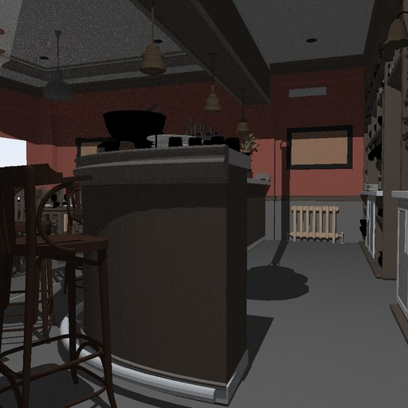

# Komorebi

[](https://kohakublueleaf.github.io/Komorebi/tutorial/)
[](https://kohakublueleaf.github.io/Komorebi/)
[](LICENSE)

**Move the data, move the thread, or move the code.**

A programming model for a network of independently programmable processors, in which a
thread reads what it needs or goes to where it is. It comes from the Tensix
architecture of Tenstorrent's Wormhole and Blackhole chips: a grid of cores, each with
its own memory and processors, on a network where any core reaches any other. Today it
runs on Blackhole, on its Tensix grid and its X280 cores. On `main` it runs on Wormhole
too: one chip, and the chips of a Galaxy as islands
([what Wormhole supports](docs/reference/wormhole.md)).

<picture>
  <source media="(prefers-color-scheme: dark)" srcset="docs/images/teaser-dark.svg">
  
</picture>

Runs on Tenstorrent Blackhole P150A cards: one, or two joined by their Ethernet links.
0.5.0 is on PyPI (as `komorebi-tt`), with a handler that is a hand-written kernel
(`km.kernel`), the chips of a Wormhole Galaxy as islands, and collectives that refuse
after a give-up until the host clears them ([release notes](docs/releases/0.5.0.md)).

| Program | On the card | Beside it, on the same card |
|---|---|---|
| LLM decode, Qwen3-1.7B in bfloat16, whole tokens | **105.5 tokens a second** | the official stack in bfloat16: 88.3 |
| The same with bfp8 and bfp4 weights, as the official stack's fastest setting | **163.4 tokens a second** | the official stack: 103.0 |
| Matrix product, 1024 cubed | 43.2 µs | TT-NN: 92.4 µs |
| Matrix product, 8192 cubed | 4.48 ms | TT-NN: 7.77 ms |
| SwiGLU, 256 x 256 x 512 | 32.2 µs | TT-NN: 39.4 µs |
| Attention, 2 x 8 x 1024 x 128 | 147.6 µs | TT-NN: 429.2 µs |
| Linear layer, 32 x 5120 x 17408, two cards | 223.1 µs | one card: 409.4 µs |
| Rasterizer, 10^6 triangles, 1024 x 1024 | 6.20 ms a frame | CUDA on a V100: 4.42 ms |
| Ray tracer, Sponza, 1024 x 1024 | 297.8 ms a frame | CUDA on a V100: 102.0 ms |

The decode rows are whole tokens: the embedding, the 28 layers, the head and the choice
of the token all run on the card, in a loop on one of its X280 cores. The official
stack is tt-metal's `tt_transformers` demo, and the kernel rows are 32 calls beside
TT-NN, each side at its fastest setting that passes the same check. The first token of
an 88-token prompt comes after 69 ms, against the official stack's 27 ms.

More under [Results](#results).

## Install

Linux x86-64, Python 3.13, a Blackhole P150A.

```
pip install "komorebi-tt[runtime]"   # the framework and the pinned tt-metal build
kmr setup                            # prepares the card, once
kmr doctor
```

The package is imported as `komorebi`; the command is `kmr`. No tt-metal tree, `ttnn`
or `torch` is needed ([the two wheels](docs/install.md#from-010-the-two-wheels)).

From a clone, for what is on `main` after 0.5.0 and for Wormhole (it needs a tt-metal source tree at
the version in [packaging/tt-metal.pin](packaging/tt-metal.pin), built with its X280
runtime, and `TT_METAL_HOME` naming it; [install](docs/install.md)):

```
git clone <this repository> komorebi && cd komorebi
uv venv -p 3.13 && source .venv/bin/activate && uv pip install -e ".[dev]"
kmr doctor
```

## Quick start

A program's kernels are loaded once and stay on the cores. After that a kernel is a
call: the host submits commands and the card runs them. Three handlers of one class
(`scale`, `add`, `sum`; this block is
[quick.py](examples/29_chain/as_class/quick.py) of [29_chain](examples/29_chain/README.md)):

```python
import numpy as np
import komorebi as km
from steps_class import Steps  # examples/29_chain/as_class: the kernels

with km.Session() as session:
    x = session.tensor(np.ones((16, 1024), np.float32), "float32")  # 16 tiles in DRAM
    y, z, s = (
        session.tensor(np.zeros((16, 1024), np.float32), "float32") for _ in "yzs"
    )
    t = session.tensor(np.zeros((1, 1024), np.float32), "float32")
    run = session.load(Steps(a=x, b=x, out=y, s=s, t=t))  # compiled and loaded once
    cores = (0, 8)  # a command goes to a core group; each core takes its share

    def scale(a, out, factor):  # a kernel call, as a function
        return run.submit(Steps.scale, cores, args=(a, out, factor, 2), exclusive=True)

    # Commands queue on the card: submit as many as you like, wait once.
    run.wait([scale(x, y, 2.0), scale(y, z, 3.0), scale(z, s, 0.5)])

    # A fixed sequence as ONE command: every core goes from each kernel to the next by
    # itself, with no host between them. Stated once, submitted as often as needed.
    layer = run.chain(
        [
            Steps.scale(x, y, 2.0, 2),
            Steps.scale(y, z, 3.0, 2),
            Steps.add(z, km.past(y), s, 2),
            Steps.sum(s, t, 16),
        ],
        cores=cores,
    )
    for _ in range(100):
        run.wait(run.submit(layer))
    run.stop()  # a tensor is read back once the run is stopped
    print(t.read()[0, :4])  # [128. 128. 128. 128.]
```

The card can also decide what runs next by itself: a C thread on an X280 cluster
submits the same commands ([below](#an-x280-thread)), and the dispatcher runs streams
and graphs of them ([streams](docs/streams.md), [graphs](docs/graphs.md)).

Every example runs on its own, checks its output against numpy and prints one JSON
line with `ok` ([examples](examples/README.md)); each program's page lists its
commands ([projects](projects/README.md)):

```
cd examples/02_merge_tree
python merge.py --jobs 20 --count 8 --form both
cd ../..
python -m projects.raytrace.frame --scene tiny --reps 16
```

## Writing a kernel

A kernel is loaded once on its core and stays there; every command the core receives
runs one of its handlers. A command goes to a core group, and each core takes its
share of the work.

### As a Python class

In 0.3.0, experimental. A method marked as a handler is compiled, when
the class is made, into the C++ kernels of the next section: its streams become the
data-movement code and the buffers, its parameters the command's words. The
arithmetic is tile functions, which the tile compiler turns into the matrix and vector
units' instructions.

A SwiGLU layer, `y = (silu(x W1) * (x W3)) W2`: two handlers and the chain that runs
them as one command. The class is [31_swiglu](examples/31_swiglu/README.md)'s, which
runs it on a card against float64.

```python
import komorebi as km


@km.tile_function
def gate(h, g):  # the vector unit
    return km.silu(h) * g


class SwiGLU(km.Program):
    """x is [32, D], W1 and W3 are [D, H], W2 is [H, D]; every size in tiles of 32."""

    D = km.constant(32)  # x's and y's width: 1,024
    H = km.constant(96)  # the hidden width: 3,072
    WIDTH = km.constant(8)  # the columns one core makes
    CHUNK = km.constant(2)  # K tiles a block
    W_BLOCK = CHUNK * WIDTH

    h: km.L1[km.fp32, 1, WIDTH, 32, 32]  # x W1, this core's columns: a field in L1
    g: km.L1[km.fp32, 1, WIDTH, 32, 32]  # x W3
    out: km.L1[km.fp32, 1, WIDTH, 32, 32]  # hidden W2

    @km.tile_function(fidelity="HiFi2")
    def project(x, w):  # the matrix unit
        return x @ w

    @km.handler
    def up(self, x: km.Tensor, w1: km.Tensor, w3: km.Tensor, hidden: km.Tensor):
        first = self.rank * self.WIDTH  # this core's columns of the hidden
        for xb, w1b, w3b in zip(
            km.Stream(x.tiles[0:1, 0 : self.D], block=self.CHUNK),
            km.Stream(
                w1.tiles[0 : self.D, first : first + self.WIDTH], block=self.W_BLOCK
            ),
            km.Stream(
                w3.tiles[0 : self.D, first : first + self.WIDTH], block=self.W_BLOCK
            ),
        ):
            self.h += self.project(xb, w1b)
            self.g += self.project(xb, w3b)
        hidden.tiles[0:1, first : first + self.WIDTH].write(gate(self.h, self.g))

    @km.handler
    def down(self, hidden: km.Tensor, w2: km.Tensor, y: km.Tensor):
        first = self.rank * self.WIDTH  # this core's columns of y
        for hb, wb in zip(
            km.Stream(hidden.tiles[0:1, 0 : self.H], block=self.CHUNK),
            km.Stream(
                w2.tiles[0 : self.H, first : first + self.WIDTH], block=self.W_BLOCK
            ),
        ):
            self.out += self.project(hb, wb)
        y.tiles[0:1, first : first + self.WIDTH].write(self.out)

    @km.chain
    def forward(self, x, w1, w3, w2, hidden, y):
        self.up(x, w1, w3, hidden, cores=(0, 12))  # 96 columns of the hidden, 8 a core
        self.down(hidden, w2, y, cores=(0, 4))  # 32 columns of y


program = SwiGLU(x=x, w1=w1, w3=w3, w2=w2, hidden=hidden, y=y)  # compiled here
run = session.load(program)
layer = run.chain(program.forward(x, w1, w3, w2, hidden, y))  # stated once
run.wait(run.submit(layer))  # the whole layer is one command
```

What a handler's lines may be is in [classes](docs/reference/classes.md), what a tile
function may contain in [tile functions](docs/reference/tile.md), a chain in
[the chain](docs/reference/chain.md). More classes: a group of cores each taking a
part of K and adding up a tree ([dense_class](experiments/language/dense_class/README.md)),
attention with a broadcast of K and V down a column and inline C++ for the arithmetic
([attention_class](experiments/language/attention_class/README.md)), the same class on
two cards ([01_mapcollect](examples/01_mapcollect/as_class/README.md)). Nine of the
examples have a class beside the hand program (`as_class/` in each).

### As C++ kernels

A program by hand is a data-movement kernel and a compute kernel. This one is the gate
of a SwiGLU layer, `out = silu(a) * b`, over two tensors in DRAM. The core's two
data-movement CPUs, the movers, bring its share of `a` and `b` from DRAM into L1 and
take `out` back, sharing every stream by a pattern (`AAAB`: mover A three of every
four blocks, mover B the fourth). The compute kernel does the math in the vector unit,
a block of tiles at a time. Reduced from [22_gate](examples/22_gate/README.md):

```cpp
// ---- kernels/movement.cpp: one file, built for both data-movement CPUs of a core ----
void kernel_main() {
    constexpr auto tensors = TensorAccessorArgs<0>();  // a, b and out share one layout
    km::Movement movement;  // stays loaded; runs once per command
    movement.run([&](const km_command_t& command) {
        const uint32_t tiles = command.a3;  // tiles a core
        const uint32_t first = (movement.me() - km::first(command)) * tiles;
        const km::Pattern pattern = km::Pattern::of(command.a4);
        const auto stream = [&](uint32_t direction, uint32_t address, km::BufferPair pair) {
            const TensorAccessor tensor(tensors, address);
            return km::Stream(direction, tensor, first, tiles, kBlock, 1, pair, pattern);
        };
        return movement.move(
            stream(km::kMoveRead, command.a0, kA),
            stream(km::kMoveRead, command.a1, kB),
            stream(km::kMoveWrite, command.a2, kOut)
        );
    });
}

// ---- kernels/compute.cpp: out = silu(a) * b in the vector unit, a block at a time ----
void kernel_main() {
    km::Compute compute;
    compute_kernel_hw_startup(kAMoverA, kOutMoverA);
    compute.run([&](const km_command_t& command) {
        const km::Pattern pattern = km::Pattern::of(command.a4);
        for (uint32_t block = 0; block < command.a3 / kBlock; block++) {
            // each block from the half of the buffer pair its mover filled
            const uint32_t a = km::block_half(kA, pattern, block);
            const uint32_t b = km::block_half(kB, pattern, block);
            const uint32_t out = km::block_half(kOut, pattern, block);
            compute.wait_front(a, kBlock);
            compute.wait_front(b, kBlock);
            tile_regs_acquire();
            copy_init(a);
            for (uint32_t tile = 0; tile < kBlock; tile++) copy_tile(a, tile, tile);
            silu_tile_init();
            for (uint32_t tile = 0; tile < kBlock; tile++) silu_tile(tile);
            mul_reuse_dest_init<kDestToSourceA>(b);
            for (uint32_t tile = 0; tile < kBlock; tile++) {
                mul_reuse_dest_tiles<kDestToSourceA>(b, tile, tile);
            }
            tile_regs_commit();
            tile_regs_wait();
            compute.reserve_back(out, kBlock);
            for (uint32_t tile = 0; tile < kBlock; tile++) pack_tile(tile, out);
            tile_regs_release();
            cb_push_back(out, kBlock);
            cb_pop_front(a, kBlock);
            cb_pop_front(b, kBlock);
        }
    });
}
```

The host declares the program, loads it and submits the command to a core group:

```python
program = km.Program(
    "gate",
    kernels="kernels/",  # movement.cpp for both movers, compute.cpp
    buffers=[
        km.BufferPair(0, 1, "bfloat16", 2048, pages=32),  # a: mover A's, mover B's
        km.BufferPair(2, 3, "bfloat16", 2048, pages=32),  # b
        km.BufferPair(16, 17, "bfloat16", 2048, pages=32),  # out
    ],
    compile_args={"movement": a.accessor_args()},  # how the kernel finds a, b and out
    handlers="kernels/gate.h",  # kHandlerGate = 1
)
run = session.load(program)
pattern = km.Pattern("AAAB")
words = [a.address, b.address, out.address, tiles, pattern.word]
run.wait(run.submit("gate", (0, 120), words))
```

### An X280 thread

The part of a program that decides is C on an X280 work cluster. A thread that splits
the grid between two programs every round, after one command from the host (reduced
from [19_thread_programs](examples/19_thread_programs/thread/rounds.c)):

```c
const uint32_t spin_cores = split(cores, spin_units, spin_rate, tiles, scale_rate);
km_command_t spin, scale;
kmx_command(&spin, kProgramSpin, kProgramSpinHandlerSpin, 0, spin_cores);
kmx_command(&scale, kProgramScale, kProgramScaleHandlerScale, spin_cores, cores - spin_cores);
kmx_submit(&spin, &spin_handle);
kmx_submit(&scale, &scale_handle);
kmx_wait(spin_handle, deadline, &spin_event);
kmx_wait(scale_handle, deadline, &scale_event);
```

Code that is not in the kernels is an [overlay](docs/reference/overlays.md), loaded
into a slot of a core's L1 while the run lives. Every example is a page under
[examples](examples/README.md), with what it measured.

## The programming model

Komorebi explores how to program a network of independently programmable processors,
where computation, communication, code placement and execution control are all the
program's own concern. It sees a program as threads, and a thread meets its data in one
of two ways:

- **The data comes to the thread.** A processor reads what it needs from shared memory,
  or receives it from other processors.
- **The thread goes to the data.** A message carries a thread's state to the processor
  that holds what it needs next, and that processor is chosen while the program runs,
  from the data.

A thread needs its code where it arrives: placed there in advance, or loaded when it is
needed.

This model was not brought to the card from somewhere else. It is the Tensix
architecture read as a programming model: a Tensix core has its own memory and its own
RISC-V processors, and the NoC lets any core reach any other core's memory. Wormhole and
Blackhole are both built this way, so the model belongs to both, and to other grids of
this kind and to several cards joined together. Two Blackhole cards joined together run
today.

Komorebi is written for Blackhole first, to use the whole card: its four X280 clusters
as well as its Tensix grid. The dispatcher, which takes the host's commands and hands
them to the cores, runs on an X280 cluster because Blackhole has one to give it; it is
work a Tensix core can do. Wormhole has no X280, so there the dispatcher is a kernel on
one Tensix core. On `main` that kernel is a first part: it hands the host's commands to
the cores and returns their events, and it does not yet decide anything by itself, as
the X280 dispatcher does. A first part of the framework runs on a Wormhole chip with it
([the two dispatchers, and Wormhole](#the-two-dispatchers-and-wormhole)).

### The card as Komorebi runs it

<picture>
  <source media="(prefers-color-scheme: dark)" srcset="docs/images/card-dark.svg">
  
</picture>

The grid is the card's real one in NoC0 coordinates; the numbers in the Tensix cores
are Komorebi's core index. A **command** is one 64-byte line: the handler, the group
(a contiguous range of cores, whose first core is its **leader**) and ten 32-bit
argument words. Every core sees every command and skips those whose group does not hold
it; cores report to the leader, which acknowledges to the dispatcher, with a
result word when the command asks for one.

Commands are one way cores talk. The figure draws each of the others once, in its own
colour; the next two figures take them one at a time, with the code that does each.

### A thread has a program counter and a place

<picture>
  <source media="(prefers-color-scheme: dark)" srcset="docs/images/breakpoints-dark.svg">
  
</picture>

Each panel is one way cores talk, on the piece of the grid it uses, with lines of the
example that does it (the example's name is in the panel's corner). A **breakpoint** is
a point where a thread must deal with another core; between two breakpoints it runs on
its core. A program is written as the handler bodies of its kernels, or as a class's
handlers.

### Code goes where the work is

<picture>
  <source media="(prefers-color-scheme: dark)" srcset="docs/images/placement-dark.svg">
  
</picture>

An **overlay** is kernel code that is not in the kernels when the run starts: the host
builds it, and a core **loads** it into a **slot** of its L1 and **calls** it; a held
overlay is called again without a load ([overlays](docs/reference/overlays.md),
[12_overlays](examples/12_overlays/)). The code can be decided where the work is: a
message names its handler and the core it reaches loads that handler's part if it does
not hold it ([20_message_overlays](examples/20_message_overlays/)), or another party
decides, a leader casting the overlay's number
([17_leader_overlay](examples/17_leader_overlay/)), an X280 core's answer to a pull
naming it ([18_thread_split](examples/18_thread_split/)), `run.load` making a group hold
another program ([16_two_programs](examples/16_two_programs/)). The cycles in the figure
are those of [the overlay costs](docs/reference/overlays.md#costs) and of
[a group switching program](docs/reference/overlays.md#a-group-switches-program); the
numbers measured on one card are in
[Measured](docs/measured.md#code-placement).

### Groups and commands in time

<picture>
  <source media="(prefers-color-scheme: dark)" srcset="docs/images/groups-dark.svg">
  
</picture>

Up to 64 commands are in flight at once; a run's window is 4 unless it asks for more. A
command that must run after an earlier one on overlapping cores is submitted with
`run.submit(..., exclusive=True)`.

A command need not come from the host, and the code it runs need not be fixed when the
run starts. In the second panel the host sends one command and an X280 thread splits
the grid between two programs every round
([19_thread_programs](examples/19_thread_programs/)); in the third a group's leader
casts which overlay every core runs next
([17_leader_overlay](examples/17_leader_overlay/)).

### A core goes on to the next kernel by itself

<picture>
  <source media="(prefers-color-scheme: dark)" srcset="docs/images/chain-dark.svg">
  
</picture>

A command is one kernel's work, and between two commands somebody decides the next:
the host, the dispatcher, a thread. When the next step is already known, that way back
is only cost. In the [decode project](projects/decode/README.md) a token's 28 layers
are 140 kernels in a fixed order, five a layer, with the final norm and the head after
them, so the program keeps a **record** for each in DRAM: the
command's words, its cores, and the next record's address. One command starts the
token. A core that finishes its part goes on to the next record by itself, and starts
on it once the cores that write its input have **marked** it written. While it waits
it already reads the next kernel's weights, so DRAM keeps reading through every
boundary.

With a command a step a layer takes 410 µs at 4,096 cached tokens; as one chain it
takes 315 µs, of which 245 is the hardware's own (the weights and the cache at the DRAM
ceiling, attention's products). Whole tokens, 200 generated from an 88-token prompt: 80.3
tokens a second with a command for each kernel, 105.5 with one chain a token.

The chain is a call of the framework ([the chain](docs/reference/chain.md)). A program
states its calls on the host; `run.chain` proves that every call's input is written
before it is read, and writes the records once; each submit after that is one command.
An X280 thread writes the same records with `kmx_chain_record`.

```python
chain = run.chain(steps, mode)  # steps: the calls; proven, then written once
run.wait(run.submit(chain, factor=5))  # one command for all of them
```

In [29_chain](examples/29_chain/), four calls of three handlers on 8 cores take 267 µs
a run from the host as one chain against 704 µs as four commands waited for one by
one; the cores' work is the same either way (126 against 131 µs on the card), and what
goes is three round trips to the host. A record names its handler, or leaves it to the
chain's command, as the decode's records do. A class states the same chain as a list of
its handlers' calls or an `@km.chain` method ([classes](docs/reference/classes.md#chains)).

### Kernels in: the host appends, the card runs

<picture>
  <source media="(prefers-color-scheme: dark)" srcset="docs/images/kernelin-dark.svg">
  
</picture>

A chain fixes its calls ahead. When the next call is only known as the program runs,
as with a framework's eager calls, the host can still stay off the path between two
kernels: it appends kernel calls to a list in DRAM and never waits for one, and a
thread on an X280 cluster walks the list and submits each. A call whose kernel is not
built yet is compiled and added to the live run. Getting a result out is one more
kernel, which pushes its pages to the host's memory.

In the [nn project](projects/nn/README.md) a call takes 140.9 µs with the host
submitting and waiting, 23.0 µs with the host appending to an open list, and 4.4 µs
replaying a written list. The list and its thread are that project's. Adding a kernel
to a live run is the framework's: `run.addon(program)` makes another class one more
program of the run, compiled against the loaded kernels, and a group then loads and
runs it ([another class added to a live run](docs/reference/classes.md#another-class-added-to-a-live-run),
[30_add_overlay](examples/30_add_overlay/)). On the card a class added this way gave
exact results at the time of the same class loaded at the start (9.4 µs a command),
beside a loaded program that ran as before. An X280 thread loads and calls it too:
from one thread command, the added class was loaded on a group in 10.5 µs and called
at 10.4 to 11.3 µs a call, where the host's submit and wait took 232 to 319 µs for the
same call ([threads](docs/reference/threads.md)). The nn project's list calling an
added class has not run yet.

### One program on the grid

<picture>
  <source media="(prefers-color-scheme: dark)" srcset="docs/images/mapcollect-dark.svg">
  
</picture>

The first panel is the simplest program, one command to a core group
([01_mapcollect](examples/01_mapcollect/)). The others are one program that uses most
of the model ([18_thread_split](examples/18_thread_split/)): every core pulls ranges
of work from its X280 core, the answer names the overlay for that range, and the core
loads it when it does not hold it and calls it. Choosing the code where the work is
takes 3,158 µs where the best single overlay takes 4,222 µs.

### A thread reaches any DRAM

<picture>
  <source media="(prefers-color-scheme: dark)" srcset="docs/images/reach-dark.svg">
  
</picture>

An X280 cluster's cache reaches one DRAM bank, the one beside it, and its own loads
through a NoC window move 0.024 GB/s. So a thread does not load far data: it calls
`kmx_fetch`, and Tensix cores copy the range, from any bank or from a tensor's pages,
into the thread's region at the bank's rate; `kmx_store` is the same the other way.
The call names the tensor and the range, never where they are: for a tensor another
island holds, the same call goes straight between the two cards' DRAMs
([threads](docs/reference/threads.md), [bank_fetch](experiments/x280/bank_fetch/)).

### More than one card

<picture>
  <source media="(prefers-color-scheme: dark)" srcset="docs/images/islands-dark.svg">
  
</picture>

An **island** is a set of cores that reach the others only through links: one card's
chip, or a part of one card when a card is split to develop with. Ranks stay flat and
contiguous across islands, so a command names a group as on one card and a kernel finds
its place in it the same way; a core holds a table with one entry for each island, not
one for each rank. The islands are a graph of any shape: a rank may be any number of
links away, and a link core sends on what is not for its island.

The link cores serve four operations, each named by a flat rank or a tensor's page: a
write into a rank's L1 (`km::write_l1`), an add to a word of a rank (`km::add_word`), a
write of pages and a read of pages. A call is the same on one island and on many, and
what a program uses is built from them: a command's part from the host, a thread or an
engine; a port's send; the collectives over a tree of the islands' leaders
(`km::all_gather`, `km::all_reduce`, `km::reduce_to`, `km::broadcast_from`, and
`km.all_reduce` in a class). The host places a tensor by a hint in the kernel's own
words, and a kernel reads and writes it with the page calls, which ask the island that
holds a page: the kernels of a program written for one card run on two unchanged.
Crossing a link is slower than the NoC, and the run counts what crossed
(`run.crossings()`), so a program can be placed to cross less
([islands](docs/concepts/islands.md), [reference](docs/reference/islands.md),
[link_ops](experiments/islands/link_ops/)).

## Results

On one P150A unless said. Every table, with its conditions, the card's power and where
the time goes: [Measured](docs/measured.md).

   

*Read back from the card, 512 x 512 downscales of 1024 x 1024 frames. The first two
are rasterized, both bit-exact against numpy: Sponza overview (3.71 ms a frame) and
Bistro interior overview (6.34 ms). The last two are ray traced: Sponza close (297.8
ms a frame) and Bistro interior close (470.1 ms). Crytek Sponza, (c) 2010 Frank Meinl,
Crytek, CC BY 3.0; Amazon Lumberyard Bistro, (c) 2017 Amazon Lumberyard, CC BY 4.0
(Open Research Content Archive); both from the McGuire Computer Graphics Archive.*

Beside the official software on the same card, 2026-11-18, the card's clock at 1,350 MHz
at every read ([conditions](docs/measured.md#beside-tt-nn-and-the-official-stack)).

Qwen3-1.7B, whole tokens, tokens a second
([decode](projects/decode/README.md#what-runs-whole-tokens)). The official stack is
tt-metal's `tt_transformers` text demo (v0.81.1):

| | 88-token prompt, 200 generated | 256 cached | 1,024 cached | 4,096 cached |
|---|---:|---:|---:|---:|
| Komorebi, bfloat16 everywhere | 105.5 | 104.9 | 98.8 | 91.2 |
| Official stack, bfloat16 everywhere | 88.3 | 87.8 | 84.1 | 77.7 |
| Komorebi, the official stack's weight formats | 163.4 | 161.7 | 150.5 | 129.4 |
| Official stack, its `performance` setting | 103.0 | 104.3 | 99.7 | 93.2 |

- The official stack's formats: gate and up in bfp4, the other layer weights and the
  head in bfp8, the embedding a bfloat16 copy. Its KV cache is bfp8; ours is bfloat16
  in every row.
- The first token of the 88-token prompt, by the host's clock: 69.0 ms in bfloat16
  against the official stack's 27.4 ms, and 29.5 ms with the official formats against
  22.9 ms. Our prompt runs as three commands of up to 32 tokens each.
- Greedy tokens against torch on the same weights: ours are equal for the first 18 of
  200 in bfloat16 and the first 38 of 200 with the official formats; the official
  stack's settings were checked on their first 16.
- The cached columns: ours generates 64 tokens from that position on an empty cache;
  the official stack's prompt is 48 tokens shorter than the column and it generates 96.
- Our builds with a cache of 1,024 rows or fewer (the first two columns) run attention
  in groups of 8 cores a head; the 1,024 and 4,096 cached columns keep their figures
  from the earlier head, whose code they run unchanged.

Kernels beside TT-NN (tt-metal v0.81.1), µs a call: 32 calls, the wall time of all of
them over 32, each side at its fastest setting that passes the same check against
float64. Our weights are read from DRAM in every call:

| Kernel | Komorebi | Its 32 calls run as | TT-NN |
|---|---:|---|---:|
| Matrix product, 128 x 896 x 128 | 14.9 | one chain command | 27.7 |
| Matrix product, 1024 cubed | 43.2 | one after another, submitted on the card | 92.4 |
| Matrix product, 8192 cubed | 4,482.3 | one after another, queued by the host | 7,769.7 |
| SwiGLU, 256 x 256 x 512 | 32.2 | one chain command | 39.4 |
| Attention, 2 x 8 x 1024 x 128 | 147.6 | 32 passes in one command | 429.2 |
| Attention, 1 x 8 x 1024 x 64, causal | 62.0 | 32 passes in one command | 175.7 |

The same work as one chain and as commands one after another
([the chain](#a-core-goes-on-to-the-next-kernel-by-itself)):

| Program | One after another | As one chain |
|---|---:|---:|
| Qwen3-1.7B decode in bfloat16, whole tokens | 80.3 tokens a second | 105.5 tokens a second |
| SwiGLU, 256 x 256 x 512, weights read every call | 43.1 µs | 32.2 µs |
| SwiGLU, weights kept in the cores' L1 | 29.9 µs | 18.2 µs |
| Matrix product, 128 x 896 x 128, weights read every call | 21.0 µs | 14.9 µs |
| Matrix product, 128 x 896 x 128, weights kept in the cores' L1 | 14.8 µs | 8.7 µs |
| Matrix product, 1024 cubed, written as a class ([dense](projects/dense/README.md)) | 55.8 µs | 46.1 µs |
| Ray tracer, Sponza close, a frame | 359.9 ms | 323.5 ms |
| Ray tracer, Bistro interior close, a frame | 597.0 ms | 516.8 ms |

The kernel rows are 32 calls: one after another each call starts when the one before is
done; in one chain command the 32 calls overlap on the card, each with its own output,
all 32 checked. The ray tracer's frame is 24 commands or one chain; with its tiles
dealt to the cores by the frame before's cost the chain takes 297.8 and 470.1 ms.

Against Kohaku-TT and a V100, over every shape measured:

| Program | Reference | Our speed over the reference's |
|---|---|---|
| Matrix product, seven shapes ([dense](projects/dense/README.md#results)) | Kohaku-TT, same card | 0.86 to 4.75 |
| SwiGLU, four shapes ([SwiGLU](projects/dense/SWIGLU.md#results)) | Kohaku-TT, same card | 2.49 to 4.26 |
| Attention, five shapes ([attention](projects/attention/README.md#time-and-power)) | Kohaku-TT, same card | 0.92 to 1.75 |
| Rasterizer, whole frames, bit-exact against numpy ([raster](projects/raster/README.md)) | CUDA on a V100 | 0.26 to 0.95 |
| Ray tracer, whole frames ([raytrace](projects/raytrace/README.md)) | CUDA on a V100 | 0.06 to 0.45 |

Two cards ([dense](projects/dense/README.md#a-linear-layer-on-one-card-and-two),
[islands](docs/reference/islands.md)):

| What | Two cards |
|---|---|
| Linear layer, the weight sharded along the output dimension | 0.54 to 0.59 of one card's time |
| Matrix product, 8192 and 16,384 cubed | 1.90 and 1.95 times one card's speed |
| Pages put across the links by kernels | 72.5 GB/s each way |
| A message across a link | 4.7 µs |
| A write of 16 bytes into a rank's L1 across a link, with an add | 11.8 µs |
| An add to a word of a rank across a link, not waited for | 2.16 µs |
| All-gather and all-reduce of 256 pages | 21.3 µs and 180.0 µs |

Five weight products at a large layer's shapes, written as Python classes, against the
memory the card can read
([bounds](experiments/language/bounds/README.md#the-five-products-in-one-job)). This is a
benchmark of reading weights, not a language model: the shapes are chosen (hidden 5,376,
MLP 21,504), the weights are synthetic, and no attention step, norm or token is computed.
One job on 2026-11-18:

| Cards | Weights | The five products | Weights read | The card's ceiling |
|---|---|---:|---:|---:|
| One | bfp8_b | 1,054.3 µs | 416.1 GB/s | 495.6 GB/s |
| One | bfp4_b | 626.5 µs | 370.7 GB/s | 495.6 GB/s |
| Two, the products as one chain | bfp8_b | 670.9 µs | 653.8 GB/s | 991.2 GB/s |
| Two, the products as one chain | bfp4_b | 471.1 µs | 493.0 GB/s | 991.2 GB/s |

The same products with many rows at once, bfloat16 rows against the same weights, each
product on the faster of two plans
([table](experiments/language/bounds/README.md#owned-with-w-in-dram-pages-of-k-tiles)):

| Cards | Weights | 256 rows | 1,024 rows | 4,096 rows |
|---|---|---:|---:|---:|
| One | bfp8_b | 144 TFLOPS | 184 TFLOPS | 213 TFLOPS |
| One | bfp4_b | 189 TFLOPS | 201 TFLOPS | 213 TFLOPS |
| Two | bfp8_b | 159 TFLOPS | 223 TFLOPS | 369 TFLOPS |
| Two | bfp4_b | 164 TFLOPS | 230 TFLOPS | 372 TFLOPS |

A class beside the C++ kernels written by hand, the time of a command:

| Program | As a class | By hand |
|---|---|---|
| The gate, 12 cores, 64 tiles a core ([22_gate](examples/22_gate/as_class/README.md)) | 83.7 µs | 76.2 µs |
| Linear layer, 32 x 4096 x 4096, the handler above ([dense_class](experiments/language/dense_class/README.md)) | 94.2 µs | 92.4 µs |
| Linear layer, 1024 x 4096 x 4096, casts along rows and down columns | 358.6 µs | 382.4 µs |
| The ray tracer's trace pass ([raytrace_class](experiments/language/raytrace_class/README.md)) | 3,294.9 µs | 3,259.9 µs |
| The rasterizer's fill pass, a small scene ([raster_class](experiments/language/raster_class/README.md)) | 88.3 µs | 118.9 µs |

Code placement ([overlays](docs/reference/overlays.md#costs)):

| What | Time |
|---|---|
| A core loads an overlay part; finds a held one | 0.88 µs; 0.07 µs |
| A group changes program, on the cores | 2.3 to 2.6 µs |
| The call for it from an X280 thread; from the host | 6.2 µs; 134.9 µs |

## Features

| Part | On main | Page | Example |
|---|---|---|---|
| Persistent kernel: commands, 64 mailbox slots per core, the reader, compute and writer loops, every wait with a timeout, the trace | implemented | [Tensix runtime](docs/reference/runtime.md) | [01_mapcollect](examples/01_mapcollect/) |
| Groups per command, several in flight, completion per group, a result word per command | implemented | [Tensix runtime](docs/concepts/runtime.md) | [01_mapcollect](examples/01_mapcollect/) |
| Channels: `emit`, `arrive`, `take`, groups, reduce by owner and by tree | implemented | [ports](docs/reference/ports.md) | [02_merge_tree](examples/02_merge_tree/) |
| Channels: broadcast along a row or a column, two broadcasts at once | implemented | [broadcasts](docs/reference/broadcast.md) | [03_broadcast](examples/03_broadcast/) |
| Routed messages: messages through per-core queues in DRAM, a send quota, the quiet end found by the dispatcher; a body of up to 4 KiB beside a message; a handler as an overlay; X280 cores as ranks | implemented; one dynamic run at a time | [dynamic handlers](docs/reference/dynamic.md) | [05_forward](examples/05_forward/), [23_message_body](examples/23_message_body/), [24_thread_rank](examples/24_thread_rank/) |
| Movement: both data-movement CPUs of a core on one stream, the pattern chosen by the command; each mover's NoC a field of the program | implemented | [movement](docs/reference/movement.md) | [11_movement](examples/11_movement/) |
| X280 ports: a core tells, asks and pulls from its X280 core; a pull's answer carries a range and a word | implemented | [ports](docs/reference/ports.md) | [10_x280_ports](examples/10_x280_ports/), [18_thread_split](examples/18_thread_split/) |
| Code placement: overlays built on the host, loaded into slots of a core's L1 and called; named by a handler, a message, a leader's cast or a pull's answer; a group changes program inside a run by `run.load` or a thread's `kmx_load` | implemented; not: the dynamic handlers of two programs in one run | [overlays](docs/reference/overlays.md) | [12_overlays](examples/12_overlays/), [16_two_programs](examples/16_two_programs/), [17_leader_overlay](examples/17_leader_overlay/), [20_message_overlays](examples/20_message_overlays/), [21_thread_load](examples/21_thread_load/) |
| Page calls: `km::Tensor`, `km::read_pages`, `km::write_pages`, `km::put_bytes`, `km::read_bytes`, one call wherever the page is held | implemented | [islands](docs/reference/islands.md#a-kernels-page-reads-and-writes) | [06_graph](examples/06_graph/), [09_bucket_sort](examples/09_bucket_sort/) |
| The chain: calls written once as records in DRAM and run as one command, every core going on to its next record by itself, a record's input waiting for the marks of the cores that wrote it; from the host (`run.chain`) and from an X280 thread (`kmx_chain_record`) | implemented, on one island or over several, for the handlers of one program, those that cast to a row or a column among them; a chain's program runs untraced | [the chain](docs/reference/chain.md) | [29_chain](examples/29_chain/) |
| The dispatcher on X280 cluster 0: host ring, slots, deadlines, events | implemented | [dispatcher](src/komorebi_native/x280/kernel/README.md) | all |
| The dispatcher on one Tensix core (`km.Session(dispatcher="tensix")`): the host's commands handed to the cores, their events returned | implemented (0.4.0): the job queue, dynamic handlers, recovery, the trace, streams and graphs (host-fed, and the resident engines on its core's TRISC 0), islands and links, and on Blackhole X280 threads, X280 ports and X280 ranks; not shared regions; on Wormhole one thread, on its own core, and no X280 ports ([below](#the-two-dispatchers-and-wormhole)) | [host API](docs/reference/host.md) | [01_mapcollect](examples/01_mapcollect/) with `KMR_DISPATCHER=tensix` |
| Wormhole: a session on one chip, its facts read from the device; the chips of a Galaxy as islands, up to 31; kernels built for it with no chip (`kmr prebuild --arch wormhole_b0`) | a first part (0.4.0); islands over a Galaxy (0.5.0) ([below](#the-two-dispatchers-and-wormhole)) | [Wormhole](docs/reference/wormhole.md), [tile functions](docs/reference/tile.md#on-wormhole) | [tile_wormhole](experiments/language/tile_wormhole/), [28_islands_reduce](examples/28_islands_reduce/) |
| Micro-op streams and the job queue in the dispatcher | implemented; builder, check and simulator on the CPU | [streams](docs/streams.md) | [04_uop_stream](examples/04_uop_stream/) |
| Graphs in the dispatcher: command nodes, CPU-task nodes, joins, a kept graph run again | implemented; also host-fed | [graphs](docs/graphs.md) | [06_graph](examples/06_graph/) |
| X280 threads: `kmx_parallel`, `kmx_spawn` / `kmx_join`, regions, the command ring, a host fallback in Python; a thread on each of work clusters 1 to 3, regions shared on one bank; `kmx_parallel_all` over twelve cores and `kmx_push` across banks; `kmx_fetch` / `kmx_fetch_clean` / `kmx_store` of any bank through Tensix cores | implemented | [X280 threads](docs/threads.md) | [07_work_cluster](examples/07_work_cluster/), [08_parallel_thread](examples/08_parallel_thread/) |
| The host package: `Program`, `Session`, `Run`, uploads and engine events, reads by page range, errors that name the core | implemented | [host API](docs/reference/host.md) | all |
| Host transfers through the host channel: the cores move a tensor's pages between DRAM or L1 and the host's memory | implemented; a read under 80 KiB without a run still goes through the device API | [the host channel](docs/reference/host.md#the-host-channel) | all |
| Hardening: the kernel instruction check, an optimisation level per kernel, `Session(kernel_bytes=...)`, an exit with a timeout; the card's state checked before the open (`km.CardNotReady`), `kmr dram-check` | implemented | [host API](docs/reference/host.md#instructions-the-cores-lack) | |
| Recovery without a card reset: `run.inspect` of a running core, the give-up of one command at its deadline, the reset and reload of one core by the host and by the dispatcher (by itself at a give-up), the watch on the dispatcher's own loop; a `km::move` stream whose buffer index is 32 or above gives up by name (`move_buffer`) | implemented; the session hands the dispatcher the reset lists at load (`recover=True`) | [recovery](docs/guides/recovery.md) | [01_mapcollect](examples/01_mapcollect/) (`give_up.py`) |
| Islands: two cards as one session, each card's chip an island with its own grid and dispatcher; flat ranks across the islands, tensors placed by a hint; the islands a graph of any shape, a rank any number of links away; on the link cores: `km::write_l1`, `km::add_word`, page writes and reads; across the links: a command's part from the host, a thread, a stream or a graph, messages, a port's send, the parts of a reduce or a broadcast, the collectives over a tree of leaders, a thread's `kmx_fetch` / `kmx_store`; programs loaded by island, inspect, time-outs and recovery by island; one card split into two to four islands as a line, a ring or a 2 x 2 grid with wrap, to develop with one card | implemented over two P150A cards joined by four links and over one split card; not: more than two cards, X280 cores as ranks on a split card or more than one link away, a dynamic run that holds the links on part of the ranks | [islands](docs/concepts/islands.md), [reference](docs/reference/islands.md) | [01_mapcollect](examples/01_mapcollect/) (`islands.py`), [25_islands_threads](examples/25_islands_threads/), [26_islands_sum](examples/26_islands_sum/), [27_islands_gather](examples/27_islands_gather/), [28_islands_reduce](examples/28_islands_reduce/) |

## The two dispatchers, and Wormhole

New in 0.4.0. The chips of a Galaxy as islands are new in 0.5.0.

`km.Session(dispatcher="tensix")` puts the dispatcher on the grid's last Tensix core
and runs the program on the others: 119 cores on a P150A, 79 on a Wormhole chip. It is
the default where the build has no X280 runtime; `KMR_DISPATCHER` names it for a script.

**The dispatcher on a Tensix core serves what the X280 dispatcher serves but shared
regions.** It takes commands from the host's ring, from the command rings of X280
threads, from the stream and graph engines, which run on its own core's TRISC 0, and
from another island; it hands them to the cores and returns their events. What it does
not serve is refused by name (`km.NotServed`) at the load or the call. On Blackhole the
card list passes under it but for the two lines with shared regions: 92 lines on one
card and 22 on two.

| | X280 dispatcher | Dispatcher on a Tensix core |
|---|---|---|
| Plain commands, result words, exclusive commands, deadlines, tensor reads and writes under a run | yes | yes |
| A chain written by the host (`run.chain`) | yes | yes |
| Overlays and add-ons; several programs in one run | yes | yes |
| The job queue | yes | yes |
| Micro-op streams and graphs | yes | yes: host-fed (`run.run_hostfed`), and the resident engines (`run.upload`, `run.start`) on its core's TRISC 0, an upload region of 64 KiB ([04_uop_stream](examples/04_uop_stream/)) |
| Dynamic handlers (routed messages) | yes | yes, on one island and across islands; X280 ranks on Blackhole, refused by name on a chip with no X280 |
| X280 threads and X280 ports | yes | on Blackhole a thread on each of clusters 1 to 3 on the X280, all it does on its own cluster and its command ring (`kmx_submit`, `kmx_wait`, `kmx_poll`) to the dispatcher's core; on Wormhole one thread, on cluster 1, on the dispatcher's own core, its arguments, result and command ring; on both, commands to it (`kmx_program`) ([threads](docs/threads.md#on-the-tensix-dispatchers-core)); on Blackhole X280 ports ([10_x280_ports](examples/10_x280_ports/)); no shared regions yet |
| Islands and links | yes | yes: cards as islands and a card split into islands, one dispatcher an island ([under the Tensix dispatcher](docs/reference/islands.md#under-the-tensix-dispatcher)); X280 threads, X280 ports and X280 ranks on a split card are refused by name; on Wormhole a card split into islands is refused by name (its writer is over the 16 KiB) |
| A command given up at its deadline, the run going on; `run.inspect` | yes | yes |
| The reset and reload of one core (`run.reset_core`, a give-up's) | yes | yes |
| The watch on the dispatcher's loop (`run.stalls`) | yes | yes: it reports a stall; the X280's also sends its loop back in |
| The trace (`load(trace=...)`, `run.trace()`) | yes | yes (not the X280's slot trace of `KMD_TRACE` test builds) |

**What Wormhole supports**, with the dispatcher on a Tensix core: one chip as a session
of 79 cores, and the chips of a Galaxy Wormhole box as islands, up to 31 of its 32. A
row says supported only for what ran there (the one-chip census of 159 lines, the runs
over 2 to 31 chips, this tree's own check); the limits, the refusals' words and the
runs are in [the Wormhole reference](docs/reference/wormhole.md).

| Feature | On Wormhole |
|---|---|
| A session whose facts come from the device; kernels built with no chip (`kmr prebuild --arch wormhole_b0`) | supported |
| Plain commands, result words, the job queue; kernels in C++ and as Python classes; tensors through the host channel | supported |
| Channels, reduces by owner and by tree, broadcasts, movement on both movers | supported |
| Overlays, add-ons, several programs in one run, program switches | supported, limit: an overlay fetch hung in 4 of 725 runs, and one script left a chip's cores busy in 2 of 38 ([hazards](docs/reference/hazards.md#a-wormhole-chip-whose-cores-stay-busy-after-a-run-open)) |
| A writer over NCRISC's 16 KiB of code | supported, limit: built again at the lowest writer level that fits; over at level 4, refused by name |
| Routed messages, dynamic handlers, a handler as an overlay | supported |
| Micro-op streams and graphs, the trace | supported |
| The chain from the host, the chain step classes | supported, limit: a chain whose writer is over at level 4 is refused by name |
| A command given up at its deadline, `run.inspect`, a core's reset and reload | supported, limit: one stop's grid timeout in 42 runs of one tutorial |
| A thread's C on the dispatcher's own core (TRISC 1), commands to and from it | supported |
| X280 threads beyond that one, X280 ports, X280 ranks, shared regions, the X280 dispatcher | refused by name (no X280 on the chip) |
| Tile functions and tile products in Wormhole's own words; the reciprocal and its kin from Wormhole's estimate | supported, limit: within 1.2e-7 of float64 (tanh 3e-7) |
| A comparison with no free register, a template negating an operand another word reads, a Blackhole vector word in a hand-written kernel | refused by name |
| `km::dst` from a pack thread; a held field's release | supported |
| Dst through Blackhole's RISC-V window (`ckernel_dest.h`): the ray tracer, the raster stages | fails: the build stops (no such file); the raster's arithmetic handler is refused by name |
| The dense and attention projects; the raster project's fill | supported |
| Chips as islands: the machine's pairs, the one-dimensional fabric forms | supported, limit: up to 31 islands at one link a pair; two links ran in the link checks on four chips; a writer over its code with second links is refused by name |
| Commands across islands, a dynamic run's deliveries, the Tensix dispatcher's waves over more than 17 islands | supported |
| `km::write_l1`, `km::add_word`, pages and asks into another island's L1 | supported |
| Puts and pages into another island's DRAM (`put_bytes` batches, `send_pages` into a tensor, `cross()`) | refused by name ([hazards](docs/reference/hazards.md#a-link-packet-for-a-far-wormhole-chips-dram)) |
| The collectives over islands, from a kernel and from the host | supported, limit: through the far leader's L1, about 0.4 GB/s; all-gather and all-reduce ran on 2 and 31 islands, broadcast and reduce-to alone did not |
| A collective given up, then `run.clear_collectives()` | supported, limit: exact on 2 islands; not run on 31 since the meetings became markers |
| `km.all_gather` in a chain, example 29's chain over islands | refused by name |
| The near build: an island program over the 16 KiB that never needs the far paths | supported (2 and 31 islands, bit-identical to one card) |
| A card split into islands | refused by name (its writer is over the 16 KiB) |

`kmr prebuild --arch wormhole_b0 <script>` builds a script's kernels for Wormhole on a
machine with no Wormhole chip.

## Komorebi IR

`src/komorebi-ir/` is a Rust crate: a language for Komorebi programs (`.kom` files), its
checker, a byte code (`.komc`) and a reference interpreter, with the command `komo`
(`komo check`, `komo fmt`, `komo compile`, `komo run`). The language states what a program
means and what the hardware must be able to do to run it, and never which hardware. It is
frozen at byte code version 6 and not released, and nothing in the `komorebi-tt` package depends on it: a Python class is
compiled as before. No backend and no frontend is part of the build yet; the ones written
before the language was finished are kept as reference material under
`experiments/ir/reference/`. The pages under [docs/ir](docs/ir/operations.md) describe the
language, and `examples/ir/` holds its lessons and four applications, each run on the
interpreter by a test.

## Limits

Fixed sizes of the runtime and limits of the card; a program is written to fit them.

- **A command is one 64-byte line**: ten 32-bit argument words; larger data travels by
  reference.
- **64 commands in flight at most**; the default window is 4.
- **Handlers 1 to 239 per program.** More code is another program or an overlay.
- **A core's L1** holds its kernels, its buffers and its overlay slots; a program that
  does not fit is refused at load with the budget table.
- **A link is slower than the NoC**, so a program over islands is placed to cross
  little.
- **A message is one 64-byte line**, with a body of at most one 4 KiB page. Messages
  have no order between them.
- **Dynamic handlers**: one dynamic run at a time, and not the dynamic handlers of two
  programs in one run.
- **What costs a card reset**: a core stuck inside a compute unit, a dispatcher whose
  first core stopped, an X280 thread that never returns and polls nothing, a process
  killed with SIGKILL ([recovery](docs/guides/recovery.md)).
- **One clock for the four X280 clusters**: 1,350 MHz by default; 1,000, 1,250, 1,350
  or 1,500 by `pll_mhz`.
- **One card's grid**: up to 128 cores in at most two multicast panels; two cards run
  as 236 ranks. With the dispatcher on a Tensix core the program has one core fewer
  (119 on a P150A).

- **A Wormhole core's writer holds 16 KiB of code** (NCRISC runs it from its own
  memory): a writer over it is built again with more of its paths after a command's
  work in L1, at the lowest writer level that fits; a load states the margin and
  level, and warns under 1 KiB at the highest
  ([hazards](docs/reference/hazards.md#a-writer-near-the-16-kib-of-code-a-wormhole-cores-ncrisc-holds)).

## TODO

- More than two cards
- Tensors named by a bank address, across islands
- Messages over every link
- A link core reset by its dispatcher
- Debugging on the card: registers, buffers, a program's variables
- Loading TT-NN's kernels
- Starting without tt-metal's launch
- The dispatcher on a Tensix core: shared regions; X280 threads, ports and ranks on a
  split card
- Wormhole: a thread's `kmx_load`, regions, ports and many-core calls; a card split
  into islands and the other writers whose resident code is over the second
  data-movement CPU's 16 KiB; pages into another island's DRAM but the collectives';
  the raster stages and the ray tracer
- The Komorebi IR: finishing the language and its interpreter; then a frontend and
  backends on it

## Repository map

```text
src/komorebi/                  the Python package: Program, Session, Run, layout, power, kmr
  engines/                     micro-op streams and graphs: builders, encodings, checks,
                               simulators; the host-fed executor
  program/thread.py            X280 threads: declaration, regions, results, host fallback
  manifest/                    reserved: a program's commands and handlers declared
src/komorebi-ir/               the Komorebi IR (Rust), frozen at byte code 6: text, checker, byte
                               code, interpreter, `komo`
src/komorebi_native/
  include/komorebi/abi/        the command, the event and the stream format, shared by all
  include/komorebi/device/     the persistent kernel, groups, ports, groups, broadcasts, dynamic
                               handlers, the trace
  kernels/                     the generic reader and writer of dynamic handlers; the
                               dispatcher for one Tensix core
  x280/kernel/                 the dispatcher for X280 cluster 0
  x280/engines/  x280/kmx/     the plain-C graph engine; the X280 thread library
  csrc/host/                   the native module: X280 runtime, commands, events
examples/                      01_mapcollect to 32_islands_l1
projects/                      raster, raytrace, dense (with SwiGLU), attention, decode, nn
experiments/                   hardware and design probes (see its README)
reference/                     CPU, C++ and CUDA references the programs are checked against
tests/core/  tests/projects/   tests with no card: the framework; the programs
tests/hardware/                card tests (KMR_CARD=1)
docs/                          concepts, references, measured, install, development
```

## Documentation

| Page | Read it for |
|---|---|
| [docs index](docs/README.md) | every concept and reference page |
| [Tensix runtime](docs/reference/runtime.md) | the device headers, the command, timed waits, the control block |
| [ports](docs/reference/ports.md), [broadcasts](docs/reference/broadcast.md), [dynamic handlers](docs/reference/dynamic.md) | messages between cores |
| [streams](docs/streams.md), [graphs](docs/graphs.md) | deciding on the card in the dispatcher |
| [islands](docs/concepts/islands.md), [recovery](docs/guides/recovery.md) | two cards as one session; a command that does not return |
| [X280 threads](docs/threads.md) | C on a work cluster with kmx |
| [host API](docs/reference/host.md) | `Program`, `Session`, `Run`, errors, builds |
| [classes](docs/reference/classes.md), [tile functions](docs/reference/tile.md), [tile formats](docs/reference/formats.md) | kernels written as Python classes; arithmetic compiled for the vector and matrix units; the card's formats and a product's placement |
| [the chain](docs/reference/chain.md) | calls written once as records and run as one command, each input waiting for marks, not for the host |
| [measured](docs/measured.md) | every program's tables, with conditions and where the time goes |
| [examples](examples/README.md), [projects](projects/README.md) | runnable examples; the five programs and their results |
| [the IR's operations](docs/ir/operations.md), [checks](docs/ir/checks.md), [run scripts](docs/ir/run-scripts.md) | the Komorebi IR and `komo`, frozen at byte code version 6 |
| [install](docs/install.md), [development](docs/development.md) | building from a clone; layout, checks, conventions |

## Contributing

Open an issue first for a feature. Before a pull request, from the repository in the
environment of [install](docs/install.md):

```
python -m pytest tests/core
python -m pytest tests/projects
python -m komorebi.tools.cxx_format --check
python -m komorebi.tools.comment_lint --check src tests examples experiments packaging tutorial projects
ruff check . && black --check . && blacken-docs -t py313 -l 88 $(git ls-files '*.md')
```

Conventions: [development](docs/development.md).

## Licence

Apache-2.0; see [LICENSE](LICENSE).
