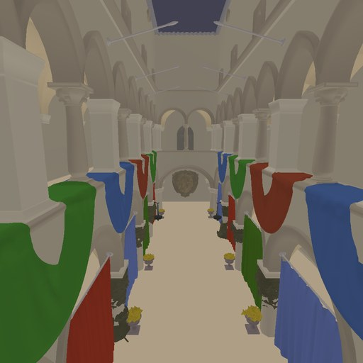

# Komorebi

[](https://kohakublueleaf.github.io/Komorebi/tutorial/)
[](https://kohakublueleaf.github.io/Komorebi/)
[](LICENSE)

**Move the data, move the thread, or move the code.**

A programming model for a network of independently programmable processors, in which a
thread reads what it needs or goes to where it is. Today it runs on the Tensix grid and
the X280 cores of a Tenstorrent Blackhole card.

<picture>
  <source media="(prefers-color-scheme: dark)" srcset="docs/images/teaser-dark.svg">
  
</picture>

Komorebi explores how to program a network of independently programmable processors,
where computation, communication, code placement and execution control are all the
program's own concern. It sees a program as threads, and a thread meets its data in one
of two ways:

- **The data comes to the thread.** A processor reads what it needs from shared memory,
  or receives it from other processors.
- **The thread goes to the data.** A message carries a thread's state to the processor
  that holds what it needs next, and that processor is chosen while the program runs,
  from the data.

A thread needs its code where it arrives: placed there in advance, or loaded when it is
needed. Nothing in this asks for one particular chip. It asks for processors with their
own memory and a network on which any of them can reach any other, so other grids of
this kind, and several cards joined together, fit the same description. None of those
has been tried.

## On a Blackhole card, today

This repository is the model built for one machine, a Tenstorrent Blackhole card
(developed on a P150A): 120 Tensix cores in a grid, 16 X280 cores in four clusters, and
the card's network between them.

| Concern | On the card |
|---|---|
| Computation | A program is a set of persistent kernels on every Tensix core. Each command they receive names a handler of code and a core group, and every core of the group works on its partition. |
| Communication | Cores read and write DRAM, and send each other data through ports, reduces and broadcasts. A routed message goes to a core chosen at run time. Both data-movement CPUs of a core can carry one stream ([Movement](docs/reference/movement.md)). |
| Code placement | A program's kernels are loaded on every core when the run starts. Code that is not in them, an **overlay**, is built on the host and kept in DRAM; a core **loads** it into a **slot** of its own L1 when it is first needed, and **calls** it. A handler can name it, a message (its handler is loaded where the message arrives), a leader's cast, or the word of a pull's answer from an X280 core. A program can itself be an overlay under kernels the runtime owns: several programs share one run, each on its own group of cores or all on every core, and `run.load` (or an X280 thread's `kmx_load`) gives a group another program while the run is live ([overlays](docs/reference/overlays.md)). |
| Execution control | A dispatcher on one X280 cluster submits the commands and runs streams and graphs of them on the card. C threads on the other three X280 clusters run the irregular part of a program. |

What is not there in code placement: the dynamic handlers of two programs in one run; a
message that carries a body (a message names a handler, and the handler's code is loaded
where the message arrives); an X280 core as a rank of a run (an
[experiment](experiments/x280_rank/README.md)); a switch of program in a run where every
core holds every program; a load issued by a cast or a pull (the host issues
`run.load`, an X280 thread `kmx_load`); a switch of a dynamic program; and what the old
program kept in its buffers, which a switch loses.

**Status: early development; 0.1.0 is a first release, for one card model.** Everything
below runs on one P150A, from the two wheels on PyPI or from a clone against a tt-metal
source tree. It has run on no other hardware.

## At a glance

One P150A, 2026-11-13 and 2026-11-14; every number is a row of [Measured](#measured), from the
program's page and its committed results.

| Program | Shape | Komorebi | Reference | Reference / Komorebi |
|---|---|---|---|---|
| Matrix product | 128 x 896 x 128 | 6.0 µs | Kohaku-TT, same card: 28.7 µs | 4.75 |
| Matrix product | 8192 cubed | 8608.3 µs | Kohaku-TT, same card: 11797.6 µs | 1.37 |
| Matrix product | 16,384 cubed | 87944.5 µs | Kohaku-TT, same card: 75522.5 µs | 0.86 |
| SwiGLU | 256 x 256 x 512 | 42.6 µs | Kohaku-TT, same card: 181.6 µs | 4.26 |
| SwiGLU | 16,384 x 384 x 384 | 161.7 µs | Kohaku-TT, same card: 458.1 µs | 2.83 |
| Attention | 2 x 8 x 1024 x 128, 2 K / V heads | 149.9 µs | Kohaku-TT, same card: 261.8 µs | 1.75 |
| Attention | 1 x 8 x 1024 x 64, causal | 58.1 µs | Kohaku-TT, same card: 53.7 µs | 0.92 |
| Rasterizer, whole frame | 10^6 triangles, 1024 x 1024 | 6.34 ms | CUDA on a V100: 4.42 ms | 0.70 |
| Ray tracer, whole frame | Sponza close, 1024 x 1024 | 359.86 ms | CUDA on a V100: 102.00 ms | 0.28 |

Above 1, Komorebi takes less time. The neural workloads are on parallel with or ahead of
Kohaku-TT on most shapes; the rasterizer and the ray tracer run whole frames on the
card, bit-exact against numpy, today at 0.4 to 0.9 of the V100's speed from 10^5
triangles up (the rasterizer) and a third or less (the ray tracer).

## A kernel

A kernel is loaded once on its core and stays there: `run` calls the function below for
every command the core receives. A program is a data-movement kernel and a compute
kernel.

The example computes the gate of a SwiGLU layer, `out = silu(a) * b`, over two tensors
in DRAM. A command goes to a core group; each core takes its share of the tiles. Its
two data-movement CPUs, the movers, bring that share of `a` and `b` from DRAM into L1
and take `out` back, sharing every stream by a pattern (`AAAB`: mover A three of every
four blocks, mover B the fourth). Its compute kernel does the math in the vector unit,
a block of tiles at a time (`kBlock`, 8: the tiles its registers hold). Both files take
the three buffer pairs and `kBlock` from a header that the host reads too. The two
kernels below are reduced from [22_gate](examples/22_gate/README.md), which also checks
every wait and is run against numpy:

```cpp
// ---- kernels/movement.cpp: one file, built for both data-movement CPUs of a core ----
void kernel_main() {
    constexpr auto tensors = TensorAccessorArgs<0>();  // a, b and out share one layout
    km::Movement movement;  // stays loaded; runs once per command
    movement.run([&](const km_command_t& command) {
        const uint32_t tiles = command.a3;  // tiles a core
        const uint32_t first = (movement.me() - km::first(command)) * tiles;
        const km::Pattern pattern = km::Pattern::of(command.a4);
        const auto stream = [&](uint32_t direction, uint32_t address, km::BufferPair pair) {
            const TensorAccessor tensor(tensors, address);
            return km::Stream(direction, tensor, first, tiles, kBlock, 1, pair, pattern);
        };
        return movement.move(
            stream(km::kMoveRead, command.a0, kA),
            stream(km::kMoveRead, command.a1, kB),
            stream(km::kMoveWrite, command.a2, kOut)
        );
    });
}

// ---- kernels/compute.cpp: out = silu(a) * b in the vector unit, a block at a time ----
void kernel_main() {
    km::Compute compute;
    compute_kernel_hw_startup(kAMoverA, kOutMoverA);
    compute.run([&](const km_command_t& command) {
        const km::Pattern pattern = km::Pattern::of(command.a4);
        for (uint32_t block = 0; block < command.a3 / kBlock; block++) {
            // each block from the half of the buffer pair its mover filled
            const uint32_t a = km::block_half(kA, pattern, block);
            const uint32_t b = km::block_half(kB, pattern, block);
            const uint32_t out = km::block_half(kOut, pattern, block);
            compute.wait_front(a, kBlock);
            compute.wait_front(b, kBlock);
            tile_regs_acquire();
            copy_init(a);
            for (uint32_t tile = 0; tile < kBlock; tile++) copy_tile(a, tile, tile);
            silu_tile_init();
            for (uint32_t tile = 0; tile < kBlock; tile++) silu_tile(tile);
            mul_reuse_dest_init<kDestToSourceA>(b);
            for (uint32_t tile = 0; tile < kBlock; tile++) {
                mul_reuse_dest_tiles<kDestToSourceA>(b, tile, tile);
            }
            tile_regs_commit();
            tile_regs_wait();
            compute.reserve_back(out, kBlock);
            for (uint32_t tile = 0; tile < kBlock; tile++) pack_tile(tile, out);
            tile_regs_release();
            cb_push_back(out, kBlock);
            cb_pop_front(a, kBlock);
            cb_pop_front(b, kBlock);
        }
    });
}
```

The host declares the program, loads it and submits the command to a core group:

```python
program = km.Program(
    "gate",
    kernels="kernels/",  # movement.cpp for both movers, compute.cpp
    buffers=[
        km.BufferPair(0, 1, "bfloat16", 2048, pages=32),  # a: mover A's, mover B's
        km.BufferPair(2, 3, "bfloat16", 2048, pages=32),  # b
        km.BufferPair(16, 17, "bfloat16", 2048, pages=32),  # out
    ],
    compile_args={"movement": a.accessor_args()},  # how the kernel finds a, b and out
    handlers="kernels/gate.h",  # kHandlerGate = 1
)
run = session.load(program)
pattern = km.Pattern("AAAB")
words = [a.address, b.address, out.address, tiles, pattern.word]
run.wait(run.submit("gate", (0, 120), words))
```

The part of a program that decides is C on an X280 work cluster. A thread that splits
the grid between two programs every round, after one command from the host (reduced
from [19_thread_programs](examples/19_thread_programs/thread/rounds.c)):

```c
const uint32_t spin_cores = split(cores, spin_units, spin_rate, tiles, scale_rate);
km_command_t spin, scale;
kmx_command(&spin, kProgramSpin, kProgramSpinHandlerSpin, 0, spin_cores);
kmx_command(&scale, kProgramScale, kProgramScaleHandlerScale, spin_cores, cores - spin_cores);
kmx_submit(&spin, &spin_handle);
kmx_submit(&scale, &scale_handle);
kmx_wait(spin_handle, deadline, &spin_event);
kmx_wait(scale_handle, deadline, &scale_event);
```

Code that is not in the kernels is an [overlay](docs/reference/overlays.md), loaded
into a slot of a core's L1 while the run lives. Every example is a page under
[examples](examples/README.md), with what it measured.

## The programming model

### The card as Komorebi runs it

<picture>
  <source media="(prefers-color-scheme: dark)" srcset="docs/images/card-dark.svg">
  
</picture>

The grid is the card's real one in NoC0 coordinates; the numbers in the Tensix cores
are Komorebi's core index. A **command** is one 64-byte line: the handler, the group
(a contiguous range of cores, whose first core is its **leader**) and ten 32-bit
argument words. Every core sees every command and skips those whose group does not hold
it; cores report to the leader, which acknowledges to the dispatcher, with a
result word when the command asks for one.

Commands are one way cores talk. The figure draws each of the others once, in its own
colour; the next two figures take them one at a time, with the code that does each.

### A thread has a program counter and a place

<picture>
  <source media="(prefers-color-scheme: dark)" srcset="docs/images/breakpoints-dark.svg">
  
</picture>

Each panel is one way cores talk, on the piece of the grid it uses, with lines of the
example that does it (the example's name is in the panel's corner). A **breakpoint** is
a point where a thread must deal with another core; between two breakpoints it runs on
its core. Today a program is written as the handler bodies of its kernels, as above.

### Code goes where the work is

<picture>
  <source media="(prefers-color-scheme: dark)" srcset="docs/images/placement-dark.svg">
  
</picture>

An **overlay** is kernel code that is not in the kernels when the run starts: the host
builds it, and a core **loads** it into a **slot** of its L1 and **calls** it; a held
overlay is called again without a load ([overlays](docs/reference/overlays.md),
[12_overlays](examples/12_overlays/)). The code can be decided where the work is: a
message names its handler and the core it reaches loads that handler's part if it does
not hold it ([20_message_overlays](examples/20_message_overlays/)), or another party
decides, a leader casting the overlay's number
([17_leader_overlay](examples/17_leader_overlay/)), an X280 core's answer to a pull
naming it ([18_thread_split](examples/18_thread_split/)), `run.load` making a group hold
another program ([16_two_programs](examples/16_two_programs/)). The cycles in the figure
are those of [the overlay costs](docs/reference/overlays.md#costs) and of
[a group switching program](docs/reference/overlays.md#a-group-switches-program); the
numbers measured on one card are [below](#code-placement).

### Groups and commands in time

<picture>
  <source media="(prefers-color-scheme: dark)" srcset="docs/images/groups-dark.svg">
  
</picture>

Up to 16 commands are in flight at once. A command that must run after an earlier one
on overlapping cores is submitted with `run.submit(..., exclusive=True)`.

A command need not come from the host, and the code it runs need not be fixed when the
run starts. In the second panel the host sends one command and an X280 thread splits
the grid between two programs every round
([19_thread_programs](examples/19_thread_programs/)); in the third a group's leader
casts which overlay every core runs next
([17_leader_overlay](examples/17_leader_overlay/)).

### One program on the grid

<picture>
  <source media="(prefers-color-scheme: dark)" srcset="docs/images/mapcollect-dark.svg">
  
</picture>

The first panel is the simplest program, one command to a core group
([01_mapcollect](examples/01_mapcollect/)). The others are one program that uses most
of the model ([18_thread_split](examples/18_thread_split/)): every core pulls ranges
of work from its X280 core, the answer names the overlay for that range, and the core
loads it when it does not hold it and calls it. Choosing the code where the work is
takes 3,158 µs where the best single overlay takes 4,222 µs.

## What exists

| Part | On main | Page | Example |
|---|---|---|---|
| Persistent kernel: commands, 16 mailbox slots per core, the reader, compute and writer loops, every wait with a timeout, the trace | implemented | [Tensix runtime](docs/reference/runtime.md) | [01_mapcollect](examples/01_mapcollect/) |
| Groups per command, several in flight, completion per group, a result word per command | implemented | [Tensix runtime](docs/concepts/runtime.md) | [01_mapcollect](examples/01_mapcollect/) |
| Channels: `emit`, `arrive`, `take`, groups, reduce by owner and by tree | implemented | [ports](docs/reference/ports.md) | [02_merge_tree](examples/02_merge_tree/) |
| Channels: broadcast along a row or a column, two broadcasts at once | implemented | [broadcasts](docs/reference/broadcast.md) | [03_broadcast](examples/03_broadcast/) |
| Routed messages: messages through per-core queues in DRAM, a send quota, the quiet end found by the dispatcher; a body of up to 4 KiB beside a message; a handler as an overlay; X280 cores as ranks | implemented; one dynamic run at a time | [dynamic handlers](docs/reference/dynamic.md) | [05_forward](examples/05_forward/), [23_message_body](examples/23_message_body/), [24_thread_rank](examples/24_thread_rank/) |
| The dispatcher on X280 cluster 0: host ring, slots, deadlines, events | implemented | [dispatcher](src/komorebi_native/x280/kernel/README.md) | all |
| Micro-op streams and the job queue in the dispatcher | implemented; builder, check and simulator on the CPU | [streams](docs/streams.md) | [04_uop_stream](examples/04_uop_stream/) |
| Graphs in the dispatcher: command nodes, CPU-task nodes, joins, a kept graph run again | implemented; also host-fed | [graphs](docs/graphs.md) | [06_graph](examples/06_graph/) |
| X280 threads: `kmx_parallel`, `kmx_spawn` / `kmx_join`, regions, the command ring, a host fallback in Python; a thread on each of work clusters 1 to 3, regions shared on one bank; `kmx_parallel_all` over twelve cores and `kmx_push` across banks; `kmx_fetch` / `kmx_fetch_clean` / `kmx_store` of any bank through Tensix cores | implemented | [X280 threads](docs/threads.md) | [07_work_cluster](examples/07_work_cluster/), [08_parallel_thread](examples/08_parallel_thread/) |
| The host package: `Program`, `Session`, `Run`, uploads and engine events, reads by page range, errors that name the core | implemented | [host API](docs/reference/host.md) | all |
| Hardening: the kernel instruction check, an optimisation level per kernel, `Session(kernel_bytes=...)`, an exit with a timeout | implemented | [host API](docs/reference/host.md#instructions-the-cores-lack) | |
| Recovery without a card reset: `run.inspect` of a running core, the give-up of one command at its deadline, the reset and reload of one core by the host and by the dispatcher (by itself at a give-up), the watch on the dispatcher's own loop | implemented; the session does not yet hand the dispatcher the reset lists by itself | [recovery](docs/guides/recovery.md) | [01_mapcollect](examples/01_mapcollect/) (`give_up.py`) |
| Islands: two cards as one session, each card's chip an island with its own grid and dispatcher; one flat group of 240 cores from the host, a tensor split over the islands, inspect and time-outs by island | implemented over two P150A cards; nothing crosses between the cards inside a run | [islands](docs/concepts/islands.md) | [01_mapcollect](examples/01_mapcollect/) (`islands.py`) |

## Measured

Whole programs on one P150A, every row from the program's page and its committed
results, all dated 2026-11-13: AICLK 1,350 MHz nominal (the card lowers it under its
power limit in the long matrix loops; each page gives the clock it sampled) and the
X280 at the session's 1,000 MHz. Power is the whole card's mean over the loop.

### Rasterizer and ray tracer: whole frames

Both programs run the whole frame on the card, 1024 x 1024, and both are far below
half of a V100's speed today. The V100 and C++ columns are the reference's whole
frame (the same algorithm in CUDA on one idle Tesla V100 32 GB, and in C++ on a shared
96-thread AMD EPYC 7K62); none of the three counts the scene's upload or the image's
read-back.

The **rasterizer**: the passes and the counting run on the 120 cores, the serial rest of
the middle pass between them on a thread on the X280 work cluster; the image is bit-exact
against numpy. Median of 5 loads, each about 1 s of frames; card 1
([raster](projects/raster/README.md#the-frame-on-the-work-clusters-thread), results in
`projects/raster/results/`,
[reference](projects/raster/reference/README.md#timings-and-power)):

| Scene | Triangles | Frame | Card frame, ms | of which the X280 step | Card W | C++ 96 threads, ms | V100, ms | V100 / card |
|---|---|---|---|---|---|---|---|---|
| tiny | 398 | first | 0.987 | 0.436 | 61.9 | 2.66 | 0.29 | 0.29 |
| tiny | 398 | settled | 0.987 | 0.436 | 63.4 | 2.66 | 0.29 | 0.29 |
| 10^4 | 11,994 | first | 0.982 | 0.440 | 67.0 | 3.32 | 0.25 | 0.25 |
| 10^4 | 11,994 | settled | 0.952 | 0.453 | 65.8 | 3.32 | 0.25 | 0.26 |
| 10^5 | 102,308 | first | 2.050 | 0.753 | 68.0 | 4.08 | 0.79 | 0.39 |
| 10^5 | 102,308 | settled | 1.967 | 0.772 | 68.2 | 4.08 | 0.79 | 0.40 |
| 10^6 | 997,806 | first | 6.894 | 0.807 | 68.9 | 17.87 | 4.42 | 0.64 |
| 10^6 | 997,806 | settled | 6.339 | 0.823 | 70.2 | 17.87 | 4.42 | 0.70 |
| Sponza, overview | 262,266 | first | 5.770 | 0.457 | 68.8 | 7.88 | 2.31 | 0.40 |
| Sponza, overview | 262,266 | settled | 3.795 | 0.466 | 71.6 | 7.88 | 2.31 | 0.61 |
| Bistro interior, overview | 1,020,903 | first | 8.762 | 0.736 | 66.9 | 14.10 | 5.99 | 0.68 |
| Bistro interior, overview | 1,020,903 | settled | 6.503 | 0.753 | 69.4 | 14.10 | 5.99 | 0.92 |

"First" is a scene's first frame, with COUNT's and SETUP's ranges cut into equal
parts: what a single image costs. "Settled" is a later frame of the same camera, whose
ranges are cut by the frame before's predicted costs. Where the time goes (settled
frame): at 10^6 FILL 2.1 ms, SETUP 1.9 ms, COUNT 1.1 ms and the X280 step 0.8 ms; on
Bistro SETUP and FILL 2.1 ms each and COUNT 1.3 ms. The fill alone is ahead of the
V100's fill stage (10^6: 2.1 against 3.3 ms; Bistro: 2.1 against 5.6 ms).

The **ray tracer**: ray generation, four traces and shading are eight commands on the
120 cores; trees larger than L1 are read from DRAM as treelets. Card 1. A cold frame
has no history and is submitted by the host. A warm frame is the second or third of the
same camera, submitted by a thread on the X280. Before each trace the thread cuts the
rays into the cores' ranges by the frame before's costs; its plan time counts in the frame
([raytrace](projects/raytrace/README.md#the-frame-planned-on-the-x280)):

| Scene | Frame | Card frame, ms | of which the X280 plan | Card W | C++ all threads, ms | V100, ms | V100 / card | Pixels differing from numpy |
|---|---|---|---|---|---|---|---|---|
| tiny (tree in L1) | cold and warm | 22.24 | - | 68.0 | 20.59 | 2.59 | 0.12 | 0 |
| 10^4 | cold | 57.91 | - | 63.0 | 26.44 | 4.16 | 0.07 | 0 |
| 10^4 | warm | 70.63 | 5.27 | 61.0 | 26.44 | 4.16 | 0.06 | 0 |
| 10^5 | cold | 81.51 | - | 63.0 | 35.47 | 6.57 | 0.08 | 0 |
| 10^5 | warm | 93.01 | 5.34 | 66.9 | 35.47 | 6.57 | 0.07 | 0 |
| 10^6 | cold | 154.21 | - | 63.0 | 53.66 | 11.61 | 0.08 | 1 |
| 10^6 | warm | 192.50 | 5.32 | 70.4 | 53.66 | 11.61 | 0.06 | 1 |
| Sponza, close | cold | 359.86 | - | 63.0 | 264.78 | 102.00 | 0.28 | 244 |
| Sponza, close | warm | 323.38 | 3.64 | 71.0 | 264.78 | 102.00 | 0.32 | 244 |
| Sponza, overview | cold | 348.53 | - | 69.2 | 230.36 | 95.52 | 0.27 | 234 |
| Sponza, overview | warm | 313.63 | 4.14 | 68.2 | 230.36 | 95.52 | 0.30 | 234 |
| Bistro interior, close | cold | 596.97 | - | 61.0 | 401.87 | 211.42 | 0.35 | 2 |
| Bistro interior, close | warm | 596.86 | 4.35 | 70.0 | 401.87 | 211.42 | 0.35 | 3 |
| Bistro interior, overview | cold | 523.72 | - | 73.1 | 336.80 | 153.94 | 0.29 | 2 |
| Bistro interior, overview | warm | 477.48 | 4.57 | 70.5 | 336.80 | 153.94 | 0.32 | 2 |

Where the time goes: the four traces take 67 % (10^4) to 97 % (Bistro) of the frame,
the bounce trace alone 36 to 59 %; each core sorts its bounce and second-shadow rays
(about 15 ms a frame) and reads the treelets its rays need from DRAM. In the traces,
box tests on packets with few live broadcasts come first (61 % on Sponza's overview), then
the wait for each command's slowest core. The differing pixels are ties between two
triangles at the same float32 distance, but for one or two on each Bistro view. The
plan by the frame before takes 35 to 46 ms off Sponza and Bistro's overview, nothing off
Bistro's close view, and costs 12 to 38 ms on 10^4 to 10^6: it cuts the traces into up
to 8 commands, and the cores read more treelets.

   

*Read back from the card, 512 x 512 downscales of 1024 x 1024 frames. The first two
are rasterized, both bit-exact against numpy: Sponza overview (3.80 ms a settled frame
above) and Bistro interior overview (6.50 ms). The last two are ray traced: Sponza close
(359.86 ms a frame above) and Bistro interior close (596.97 ms). Crytek Sponza, (c) 2010 Frank Meinl,
Crytek, CC BY 3.0; Amazon Lumberyard Bistro, (c) 2017 Amazon Lumberyard, CC BY 4.0
(Open Research Content Archive); both from the McGuire Computer Graphics Archive.*

### Matrix product, attention and SwiGLU against Kohaku-TT

The same card, ours and Kohaku-TT (at ac81ff2) one after the other in one session;
bf16 operands, fp32 accumulation; time per call in a loop of calls, uploads and
read-back outside it. "Kohaku-TT / ours" above 1 means ours is faster.
Ours was measured again on 2026-11-14 with the programs' own bench scripts (best of three
runs); a row that moved by less than 3 % keeps its value of 2026-11-13, and Kohaku-TT's
columns were not run again. Replaced: four matrix product rows, three attention rows
and the one SwiGLU cell in [its page](projects/dense/SWIGLU.md#results) that moved.

[Matrix product](projects/dense/README.md#results), HiFi2, Kohaku-TT's fastest of its
three routes (`results/<preset>-ours.json`, `-ktt-<route>.json`):

| M x K x N | Ours, µs | W | Kohaku-TT, µs | W | Kohaku-TT / ours |
|---|---|---|---|---|---|
| 128 x 896 x 128 | 6.0 | 71 | 28.7 | 63 | 4.75 |
| 16,384 x 384 x 384 | 61.2 | 130 | 94.1 | 116 | 1.54 |
| 16,384 x 1024 x 1024 | 393.5 | 128 | 389.9 | 136 | 0.99 |
| 4096 cubed | 958.3 | 138 | 957.0 | 151 | 1.00 |
| 8192 cubed | 8608.3 | 141 | 11797.6 | 139 | 1.37 |
| 16,384 cubed | 87944.5 | 137 | 75522.5 | 142 | 0.86 |
| 32 x 4096 x 4096, K split | 92.4 | 83 | 81.0 | 91 | 0.88 |

From 4096 cubed up both sides are bound by the card's power limit in a loop (ours ran
in a slower mode in most loops of 4096 and 8192 cubed on 2026-11-14, see the
[page](projects/dense/README.md#results); the table shows the fastest run); the last row
is the K split of the [page](projects/dense/README.md#the-k-split) (14,1,16,5 tree, groups
of 16 cores to an output block), bound by reading W from DRAM: 363 GB/s in the call
against Kohaku-TT's 414.

[Attention](projects/attention/README.md#time-and-power), K and V multicast down broadcasts of
cores, the same compute body as Kohaku-TT's flash kernel
(`results/ours-<preset>.json`, `ktt-<preset>.json`):

| B x H x S x D | Ours, µs | W | Kohaku-TT, µs | W | Kohaku-TT / ours |
|---|---|---|---|---|---|
| 1 x 32 x 4096 x 64 | 2675.3 | 138 | 2918.5 | 135 | 1.09 |
| 1 x 24 x 4096 x 128 | 2328.3 | 144 | 3001.8 | 132 | 1.29 |
| 8 x 16 x 256 x 64 | 76.7 | 123 | 80.7 | 110 | 1.05 |
| 1 x 8 x 1024 x 64, causal | 58.1 | 103 | 53.7 | 99 | 0.92 |
| 2 x 8 x 1024 x 128, 2 K / V heads | 149.9 | 136 | 261.8 | 105 | 1.75 |

The causal row is behind per call (58.1 against 53.7) and ahead per pass (48.3): the cost of a command.

[SwiGLU](projects/dense/SWIGLU.md#results), `silu(x W1) * (x W3)` then `W2`, HiFi2,
ours in its faster form (`results/swiglu-<preset>-<form>-hifi2.json`, `-ktt-<route>.json`):

| M x D x H | Ours, µs | W | Kohaku-TT, µs | W | Kohaku-TT / ours |
|---|---|---|---|---|---|
| 256 x 256 x 512 | 42.6 | 76 | 181.6 | 73 | 4.26 |
| 4096 x 256 x 512 | 73.7 | 114 | 183.5 | 95 | 2.49 |
| 16,384 x 256 x 512 | 180.2 | 137 | 542.1 | 109 | 3.01 |
| 16,384 x 384 x 384 | 161.7 | 142 | 458.1 | 108 | 2.83 |

### Code placement

Overlays, programs in one run and handlers loaded where they are needed, each number
from the page it links (the runs are on those pages; none was measured again for this
table). One P150A, AICLK 1,350 MHz.

| What | Number | Page |
|---|---|---|
| A held overlay called, against the same code compiled in | from a leader's cast to the last call done, 1.19 to 1.31 µs held against 1.00 to 1.13 µs compiled in, on a row, a column and the grid | [17_leader_overlay](examples/17_leader_overlay/README.md#measured) |
| A load | `load()` of a reader part 0.88 µs; of a reader and compute parts, meeting, 1.82 to 1.88 µs; held, 0.07 µs | [17_leader_overlay](examples/17_leader_overlay/README.md#measured) |
| A group changes program (`run.load`) | 2.3 to 2.6 µs (3,124 to 3,360 cycles), on 1 core and on 120 | [16_two_programs](examples/16_two_programs/README.md#numbers) |
| A group changes program from an X280 thread (`kmx_load`) | 6.2 µs from issue to done in the thread, against 134.9 µs for `run.load` and its wait from the host; 40 rounds of a load and two commands on 120 cores in 1,825 µs against 16,950 µs host-fed | [21_thread_load](examples/21_thread_load/README.md#numbers) |
| A command to an X280 thread | 133.0 µs from the host one at a time against 132.6 µs for a grid command; in a graph on the X280, a round with the thread's command 19.3 µs against 11.2 µs with a second grid command | [13_thread_commands](examples/13_thread_commands/README.md#numbers) |
| A message through handlers as parts | 10^6 messages on 120 cores in 10.76 ms with a slot for each handler against 10.83 ms with the handlers compiled in (94.2 and 93.6 million messages a second); 11.40 ms with one slot | [20_message_overlays](examples/20_message_overlays/README.md#measured) |
| A thread splits the grid between two programs | 24 rounds in 974 µs on 12 cores and 1,023 µs on 120, against 1,001 and 1,070 µs for the best fixed split and 7,378 and 7,521 µs with the host feeding it | [19_thread_programs](examples/19_thread_programs/README.md#numbers) |

The examples' own timings (commands per microsecond, broadcasts, forwards, streams, graphs and
threads) are in each [example's README](examples/README.md).

## Install

Komorebi 0.1.0 is on PyPI as two distributions, `komorebi-tt` (the framework) and
`komorebi-runtime` (the pinned tt-metal build), with the GitHub release `v0.1.0`. It is a
first release, for one card model, the Blackhole P150A. Komorebi is used from those
wheels ([the two wheels](docs/install.md#from-010-the-two-wheels)) or from a clone
([packaging](packaging/README.md), [from a wheel](docs/install.md#from-a-wheel)), on
Linux x86-64 with Python 3.13:

```
git clone <this repository> komorebi && cd komorebi
uv venv -p 3.13 && source .venv/bin/activate && uv pip install -e ".[dev]"
kmr doctor                      # the Python, the tt-metal tree and its X280 runtime
```

The CPU tests and the stream and graph tools need nothing else. To run on a card: a
Blackhole P150A whose X280 memory is prepared for the X280 runtime, a tt-metal source
tree at the version in [packaging/tt-metal.pin](packaging/tt-metal.pin) (v0.81.1) built
with its X280 runtime, and `TT_METAL_HOME` naming that tree (neither `ttnn` nor
`torch` is needed). The dispatcher image and the native module are
built from the tree on first use (`python -m komorebi.native` builds them ahead).
Details: [install](docs/install.md).

The distribution is named `komorebi-tt`; the package is imported as `komorebi` and the
command is `kmr`. `pip install "komorebi-tt[runtime]"` installs it with
`komorebi-runtime`, the pinned tt-metal build, and a program runs on a card with no
tt-metal tree ([the two wheels](docs/install.md#from-010-the-two-wheels)); `kmr setup`
prepares the card once.

## Usage

Every example runs on its own, checks its output against numpy and prints one JSON
line with `ok` ([examples](examples/README.md)); each program's page lists its
commands ([projects](projects/README.md)):

```
cd examples/02_merge_tree
python merge.py --jobs 20 --count 8 --form both
python merge.py --group-list 0:8,0:119 --form both --stall-rank 3
cd ../..
python -m projects.raytrace.frame --scene tiny --reps 16
```

The second command adds a load in which rank 3 of job 1 never sends: the host raises
`km.CommandTimeout` naming the handle and the cores that did not report, and the next
load in the same session runs exact.

## Repository map

```text
src/komorebi/                  the Python package: Program, Session, Run, layout, power, kmr
  engines/                     micro-op streams and graphs: builders, encodings, checks,
                               simulators; the host-fed executor
  thread.py                    X280 threads: declaration, regions, results, host fallback
  manifest/                    reserved: a program's commands and handlers declared
src/komorebi_native/
  include/komorebi/abi/        the command, the event and the stream format, shared by all
  include/komorebi/device/     the persistent kernel, groups, ports, groups, broadcasts, dynamic
                               handlers, the trace
  kernels/                     the generic reader and writer of dynamic handlers
  x280/kernel/                 the dispatcher for X280 cluster 0
  x280/engines/  x280/kmx/     the plain-C graph engine; the X280 thread library
  csrc/host/                   the native module: X280 runtime, commands, events
examples/                      01_mapcollect to 08_parallel_thread
projects/                      raster, raytrace, dense (with SwiGLU), attention
experiments/                   hardware and design probes (see its README)
reference/                     CPU, C++ and CUDA references the programs are checked against
tests/core/  tests/projects/   tests with no card: the framework; the programs
tests/hardware/                card tests (KMR_CARD=1)
docs/                          concepts, references, install, development
```

## Sizes a program works within

These are fixed sizes of the runtime. They are not on the TODO list: a program is
written to fit them, and what has been built so far (matrix product, attention, a
rasterizer, a ray tracer) fits.

- **A command is one 64-byte line.** It carries ten 32-bit argument words. Anything
  larger travels by reference: two of the words can name a block of up to 1,024 bytes,
  and tensors are named by their address.
- **64 commands in flight at most.** A command costs more the more are in flight (about
  7 % at 16, 21 % at 48), so a program keeps a small window; the default is 4.
- **Handlers 1 to 239 per program.** More code is another program, or an overlay a core
  loads when it is first needed.
- **A core's L1 holds its kernels, its buffers and its overlay slots.** A program that
  does not fit is refused at load with the budget table; the answer is smaller buffers,
  or code moved into overlays.
- **One card's grid.** Up to 128 cores in at most two multicast panels; one harvesting
  pattern has been run. Two cards run as two such grids (240 ranks on the two P150A).

## TODO

What Komorebi does not do yet. Each item says what holds today; none of them is a
property of the model.

1. **More than one card.** Today a session drives two Blackhole P150A cards joined by
   four Ethernet links, each card's chip an island: one flat group of 240 cores from the
   host, a tensor split over the islands, inspect and time-outs by island
   ([islands](docs/concepts/islands.md)). Not yet: messages and pages between islands
   from kernels, commands across from a thread, a card split into islands; more than
   two cards have not been tried.
2. **Wormhole.** Today only Blackhole. A Wormhole card has the Tensix grid and no X280
   cores, so the dispatcher and the threads need another home there.
3. **Loading TT-NN's kernels.** A TT-NN operation is a tt-metal program (kernels,
   buffers, arguments), which is what a program loaded as overlays is. Today a program
   is written for Komorebi; nothing loads an operation's kernels as they are.
4. **Host transfers at the link's speed, everywhere.** Today reads and writes go
   through the host channel (a 20 MiB frame read in 30 ms without a run, 7 ms inside
   one) for interleaved DRAM tensors, on each card. Tensors in L1, reads under 80 KiB
   without a run, pages the L1 or the channel cannot hold and a session without the
   channel still go through the device API at about 2 MB per second
   ([host](docs/reference/host.md#the-host-channel)).
5. **Starting without tt-metal's launch.** Today the session opens the card in slow
   dispatch and tt-metal launches the kernels once, core by core. Everything after that
   (commands, programs, overlays) is Komorebi's own and runs from the card.
6. **Dynamic handlers.** Today one dynamic run at a time; a message can carry a body of
   up to 4 KiB, a handler can be an overlay, and X280 cores of one work cluster can be
   ranks (on one island, sending only to core ranks, not in a program with bodies).
   Messages travel through queues in DRAM, also to a core's own queue; a message cannot
   ask for a DRAM fetch; there is no order between messages
   ([dynamic handlers](docs/reference/dynamic.md#not-in-this-version)).
7. **A work cluster reading every DRAM bank at the cores' rate.** Today a thread reads
   or writes any bank or tensor with `kmx_fetch` and `kmx_store`: four Tensix cores of
   the loaded run copy 64 MiB in 1.06 ms, and the blocking `kmx_fetch` takes 11.9 ms, one
   sweep of the region's cache lines before the copy; `kmx_fetch_clean`, for a range the
   cache holds no line of, takes 1.07 ms
   ([bank_fetch](experiments/bank_fetch/README.md)). The X280's own reads of another
   bank stay at 0.024 GB/s, and the cores that copy run no other command meanwhile.
8. **The X280's clock.** Today 1,350 MHz by default; a runtime whose table lacks that
   row answers "no PLL solution", and the session opens at 1,000 MHz and logs it once.
   At the 1,750 MHz opt-in the dispatcher trapped in 9 of 18 runs under full matrix
   load (the card lowers its core voltage), and in 0 of 23 at 1,000 MHz. One PLL clocks
   all four clusters ([host](docs/reference/host.md#session)).
9. **Recovery without a reset.** Today a command that misses its deadline in one of the
   runtime's waits is given up and the run goes on
   ([giving up one command](docs/reference/runtime.md#giving-up-one-command)), and one
   core of a run can be reset and loaded with its kernels again, by the host or by the
   dispatcher, which does it by itself for the cores that do not leave a given-up
   command once it holds the write lists. The session does not hand it the lists yet
   (the [experiment](experiments/core_reset/ladder.py) does). A dynamic run's waits and
   a thread's own command are not given up. A dispatcher whose loop stops making passes
   is brought back after 100 ms by another X280 core. A dispatcher that stopped
   executing, an X280 thread that never returns and polls nothing, and a packer that
   writes past its buffer still cost a card reset ([recovery](docs/guides/recovery.md)).
10. **Debugging on the card.** Today tt-metal's watcher cannot run while the X280
    runtime is open. `run.inspect` reads each core's state words, the wait each kernel
    is in and its latest trace entries while the run goes on
    ([inspecting a run](docs/reference/host.md#inspecting-a-run)). Nothing reads a
    core's registers, its buffers' contents or a program's own variables.
11. **The build.** Today `kmr build host` and `kmr build pymodule` take their compile
    flags from two targets that the
    [tt-x280-dispatch](https://github.com/KohakuBlueleaf/tt-x280-dispatch) project adds
    to a tt-metal build ([development](docs/development.md#known-limitations)).

Komorebi has run on Blackhole P150A cards, one and two together, and on no other hardware.

## Documentation

| Page | Read it for |
|---|---|
| [docs index](docs/README.md) | every concept and reference page |
| [Tensix runtime](docs/reference/runtime.md) | the device headers, the command, timed waits, the control block |
| [ports](docs/reference/ports.md), [broadcasts](docs/reference/broadcast.md), [dynamic handlers](docs/reference/dynamic.md) | messages between cores |
| [streams](docs/streams.md), [graphs](docs/graphs.md) | deciding on the card in the dispatcher |
| [islands](docs/concepts/islands.md), [recovery](docs/guides/recovery.md) | two cards as one session; a command that does not return |
| [X280 threads](docs/threads.md) | C on a work cluster with kmx |
| [host API](docs/reference/host.md) | `Program`, `Session`, `Run`, errors, builds |
| [examples](examples/README.md), [projects](projects/README.md) | runnable examples; the five programs and their results |
| [install](docs/install.md), [development](docs/development.md) | building from a clone; layout, checks, conventions |

## Contributing

Open an issue first for a feature. Before a pull request, from the repository in the
environment of [install](docs/install.md):

```
python -m pytest tests/core
python -m pytest tests/projects
python -m komorebi.tools.cxx_format --check
python -m komorebi.tools.comment_lint --check src tests examples experiments packaging tutorial projects
ruff check . && black --check . && blacken-docs -t py313 -l 88 $(git ls-files '*.md')
```

Conventions: [development](docs/development.md).

## Licence

Apache-2.0; see [LICENSE](LICENSE).
