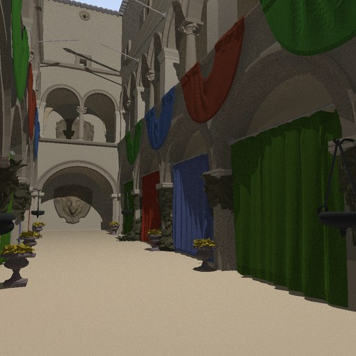

# Komorebi

A programming model and a framework for the Tensix grid and the X280 cores of a
Tenstorrent Blackhole card (developed on a P150A). A program is a set of **resident
kernels** that stay on every Tensix core and run **thread programs**: each record the
card receives names a segment of code and a **team** of cores, and every member works
on its share. Values and blocks cross between cores (**crossings**: a value to one
core, a block along a lane of cores, or items that move to the core that holds their
data), a **dispatch kernel** on one X280 cluster issues the records and runs streams and
graphs of them on the card, and a **user thread** on a second X280 cluster runs the
irregular part of a program in plain C. It is for kernel authors whose work does not
fit one fixed program per shape: rendering, and dense work split over changing teams.

**Status: early development; nothing is released.** Everything below runs on one
P150A, from a clone, against a tt-metal source tree.

A member's compute kernel in the merge-tree example: it adds its share of the input
tiles, then merges the parts of the other members, at one owner or along a tree. The
runtime owns the loop and calls the body once for each record whose team holds this
core
([02_merge_tree/kernels/compute.cpp](examples/02_merge_tree/kernels/compute.cpp),
lines 28 to 66; above them are the includes and the helper `add_page`, which copies
one tile into DST and adds it):

```cpp
void kernel_main() {
    km::Compute cp;
    compute_kernel_hw_startup(kCbIn, kCbOut);
    cp.run([&](const km_record_t& r) {
        if (km::seg(r) != kSegMerge) {
            return;
        }
        const km::Group g = km::team_group(r, cp.me());
        const km::Share s = km::share(r.a1, g.rank, g.size);
        const km::Arrival arrival = {kCbArrive, kArrivePages, r.a7};
        tile_regs_acquire();
        fill_tile_init();
        for (uint32_t d = 0; d < r.a7; d++) {
            fill_tile(d, 0.0f);
        }
        bool ok = true;  // the same on all three threads (wait_front tells them)
        for (uint32_t i = 0; ok && i < s.len; i++) {
            ok = cp.wait_front(kCbIn, 1);
            if (ok) {
                add_page(kCbIn, 0, (s.start + i) % r.a7);
                cb_pop_front(kCbIn, 1);
            }
        }
        ok = ok && km::reduce(cp, arrival, g, r.a4, [&](uint32_t k) {
                 for (uint32_t d = 0; d < r.a7; d++) {
                     add_page(kCbArrive, km::slot_page(arrival, k) + d, d);
                 }
             });
        tile_regs_commit();
        tile_regs_wait();
        if (ok && cp.reserve_back(kCbOut, r.a7)) {  // a give-up: no output tiles
            for (uint32_t d = 0; d < r.a7; d++) {
                pack_tile(d, kCbOut);
            }
            cb_push_back(kCbOut, r.a7);
        }
        tile_regs_release();
    });
}
```

The reader of the same program reads the member's share from DRAM and waits for the
parts it merges (`km::reduce_arrive`); the writer sends this member's part into its
receiver's slot (`km::reduce_emit`), or, on member 0, writes the total. On the host,
`program()` in [merge.py](examples/02_merge_tree/merge.py) declares the three kernels,
three circular buffers and the segment header, and one load issues a `MERGE` record
per job to its team, through the dispatch kernel (`launch()`, lines 103 to 107 and 123
to 127):

```python
run = session.load(
    program(args, inputs[0], out),
    deadline=args.deadline if stall < 0 else 4 * args.wait,
    wait=args.wait,
)
# ... the record words of job j (lines 108 to 122)
team = (first, count)
tickets.append(run.issue("merge", team, words, exclusive=True, result=True))
log(f"{run.drain(timeout=30.0)} events")
host_s = time.perf_counter() - t0
run.stop()
```

The script checks every total against numpy and prints one JSON line with `ok`. On
1,000 jobs on random teams with random forms, 1,000 were checked and 0 were wrong; a
job of 64 tiles takes 36.7 µs on 8 cores and 51.8 µs on 119 through a session, each
record returning a checksum of the total as its result word
([02_merge_tree](examples/02_merge_tree/README.md)).

The irregular part of a program is C on an X280 work cluster: `kmx_par` runs a function
on the cluster's four cores. A two-pass prefix sum over chunks
([08_parallel_thread/thread/parallel.c](examples/08_parallel_thread/thread/parallel.c),
lines 148 to 197 without `nothing`, an empty function for timing `kmx_par`; the job
struct and the chunk helpers are above them in the file):

```c
/* (c) prefix, pass 1: each chunk's sum. */
static void chunk_sums(int hart, void* arg) {
    const job_t* j = (const job_t*)arg;
    for (uint64_t c = first(j, hart); c < chunks(j); c += j->parts) {
        uint32_t s = 0;
        for (uint64_t i = c * CHUNK; i < end(j, c); i++) {
            s += j->in[i];
        }
        g_chunk[c] = s;
    }
}

/* Pass 2: out[i] = the chunk's base + the chunk's words before i. */
static void chunk_prefix(int hart, void* arg) {
    const job_t* j = (const job_t*)arg;
    for (uint64_t c = first(j, hart); c < chunks(j); c += j->parts) {
        uint32_t run = g_chunk[c];
        for (uint64_t i = c * CHUNK; i < end(j, c); i++) {
            j->out[i] = run;
            run += j->in[i];
        }
    }
}

/* Runs fn on hart 0 alone or on all four; KMX_OK, or kmx_par's error. */
static int on(void (*fn)(int, void*), job_t* j) {
    if (j->parts == 1) {
        fn(0, j);
        return KMX_OK;
    }
    return kmx_par(fn, j);
}

/* The two-pass exclusive prefix sum (mod 2^32); between the passes hart 0 turns the
 * chunk sums into bases. */
static int prefix(job_t* j) {
    const int e = on(chunk_sums, j);
    uint32_t base = 0;
    for (uint64_t c = 0; c < chunks(j); c++) {
        const uint32_t s = g_chunk[c];
        g_chunk[c] = base;
        base += s;
    }
    return e != KMX_OK ? e : on(chunk_prefix, j);
}
```

Over 262,144 words it takes 2.48 ms on four cores, exact against numpy
([08_parallel_thread](examples/08_parallel_thread/README.md)). A thread also issues
records to the grid through its own ring and decides from their result words
([07_work_cluster](examples/07_work_cluster/)).

## Highlights

- **Resident workers**: `km::Reader`, `km::Compute` and `km::Writer` own each kernel's
  loop; a program supplies the bodies, a switch on the segment. Every wait of the
  runtime is bounded and watches a stop word
  ([runtime](docs/reference/runtime.md)).
- **Teams per record**: a record names a contiguous range of cores; several teams run
  at once and a team's size is free from record to record.
- **Crossings between cores**: a value to one core (`emit`, `arrive`, reduce by owner
  and by tree), a block along a lane of a row or a column, and items that hop from core
  to core as their data decides, with a run that ends by itself
  ([ports](docs/reference/ports.md), [lanes](docs/reference/lanes.md),
  [dynamic segments](docs/reference/dynamic.md)).
- **Deciding on the card**: the dispatch kernel runs micro-op streams, a job queue and
  graphs with record and CPU-task nodes, so a loop that ends on a value computed on
  the card needs no host step ([streams](docs/streams.md), [graphs](docs/graphs.md)).
- **X280 threads**: a C program on a work cluster with `kmx_par`, regions shared with
  the grid through DRAM, and a host fallback in Python that runs the same program
  ([X280 threads](docs/threads.md)).
- **Failures that say where**: a missed deadline raises `km.RecordTimeout` naming each
  member that did not report and where its kernels gave up; a kernel holding an
  instruction its core lacks, or too large for its buffer, is refused before anything
  is loaded ([host API](docs/reference/host.md#errors)).
- **Whole programs on it**: a rasterizer and a ray tracer whose images are bit-exact
  against numpy, and a matrix product, attention and SwiGLU checked against float64
  ([projects](projects/README.md)).

## The programming model

### The card as Komorebi runs it

<picture>
  <source media="(prefers-color-scheme: dark)" srcset="docs/images/card-dark.svg">
  
</picture>

The figure is the card's real tile grid in NoC0 coordinates; the numbers in the Tensix
cores are Komorebi's core index, row by row over the 12 x 10 grid of usable cores, so
index and position differ where the grid skips the fused-off, X280 and DRAM columns.
The session finds the two multicast panels from the card at start-up.

A **record** is one 64-byte line: a sequence number, the segment, the team and ten
32-bit argument words; the sequence number is repeated in each of the four 16-byte
chunks, so a core accepts the line only when all of it has landed. A **team** is a
contiguous range of cores `[first, first + count)` in core order, named in the record;
its first member is the team's **leader**. Every core sees every record and skips
those whose team does not hold it. Members report to the leader, and the leader writes
one word to the dispatch kernel, with a 32-bit result word when the record asks for
one.

### A thread has a program counter and a place

<picture>
  <source media="(prefers-color-scheme: dark)" srcset="docs/images/breakpoints-dark.svg">
  
</picture>

A **breakpoint** is a point where a thread must deal with another core; between two
breakpoints it runs on its core without interruption. The code between two breakpoints
is a **segment**; on the card it is one case of the switch a record selects. State has
a **home**, the core that holds it, such as a film tile or a treelet of a box tree.

| The author writes | What crosses the network | On the card today |
|---|---|---|
| `at X[i]: block` | the thread's live state | a dynamic segment: the state as a 64-byte item, `hop` to a member of the team, per-core queues in DRAM ([dynamic segments](docs/reference/dynamic.md), [05_hop](examples/05_hop/)) |
| `emit X[i] += v`, `emit v -> thread(j)` | the value | `km::emit` into a fixed slot of the receiver, `km::reduce` by owner or by tree ([ports](docs/reference/ports.md), [02_merge_tree](examples/02_merge_tree/)) |
| `v = wait(n)` | nothing | `km::arrive`: a bounded wait until `n` values have landed |
| a block to a row or a column of threads | the block, once per lane | lane broadcast ([lanes](docs/reference/lanes.md), [03_broadcast](examples/03_broadcast/)) |

The thread language itself, in which `at`, `emit` and `wait` are written as above and
compiled into segments, is planned; today a program is written as the segment bodies
of its kernels. The [model](docs/concepts/model.md) works through ray tracing,
attention and the matrix product in this form.

### Teams and records in time

<picture>
  <source media="(prefers-color-scheme: dark)" srcset="docs/images/teams-dark.svg">
  
</picture>

A record is in flight from the moment the dispatch kernel stores it until its leader's
acknowledgement arrives; it holds one of up to 16 completion slots. Two records in
flight on overlapping teams may be run by a shared core in either order. A record that
must run after an earlier one is issued with `run.issue(..., exclusive=True)`, which
the dispatch kernel holds until no team in flight overlaps it.

### One program on the grid

<picture>
  <source media="(prefers-color-scheme: dark)" srcset="docs/images/mapcollect-dark.svg">
  
</picture>

In [01_mapcollect](examples/01_mapcollect/) nothing but the record and the completion
travels between cores: each member reads its own share of the input from DRAM, works
in its own L1 and vector unit, and writes its own output tile. The merge tree above
adds one crossing to it.

## What exists

| Part | On main | Page | Example |
|---|---|---|---|
| Resident worker: records, 16 mailbox slots per core, the reader, compute and writer loops, bounded waits, the trace | implemented | [Tensix runtime](docs/reference/runtime.md) | [01_mapcollect](examples/01_mapcollect/) |
| Teams per record, completion per team, a result word per record | implemented | [Tensix runtime](docs/concepts/runtime.md) | [01_mapcollect](examples/01_mapcollect/) |
| Static crossings: `emit`, `arrive`, `take`, groups, reduce by owner and by tree | implemented | [ports](docs/reference/ports.md) | [02_merge_tree](examples/02_merge_tree/) |
| Static crossings: lane broadcast along a row or a column, two lanes at once | implemented | [lanes](docs/reference/lanes.md) | [03_broadcast](examples/03_broadcast/) |
| Dynamic crossings: items through per-core queues in DRAM, a spawn quota, the quiet end found by the dispatch kernel | implemented; one dynamic run at a time, the team's last cores hold the queue tails, no direct L1-to-L1 path | [dynamic segments](docs/reference/dynamic.md) | [05_hop](examples/05_hop/) |
| The dispatch kernel on X280 cluster 0: host ring, slots, deadlines, events | implemented | [dispatch kernel](src/komorebi_native/x280/kernel/README.md) | all |
| Micro-op streams and the job queue in the dispatch kernel | implemented; builder, check and simulator on the CPU | [streams](docs/streams.md) | [04_uop_stream](examples/04_uop_stream/) |
| Graphs in the dispatch kernel: record nodes, CPU-task nodes, joins, a kept graph run again | implemented; also run host-fed | [graphs](docs/graphs.md) | [06_graph](examples/06_graph/) |
| X280 threads: `kmx_par`, regions, the command ring, a host fallback | implemented on one work cluster per program (cluster 1) | [X280 threads](docs/threads.md), [reference](docs/reference/threads.md) | [07_work_cluster](examples/07_work_cluster/), [08_parallel_thread](examples/08_parallel_thread/) |
| The host package: `Program`, `Session`, `Run`, uploads and engine events, reads by page range, errors | implemented | [host API](docs/reference/host.md) | all |
| Hardening: the kernel instruction check, an optimisation level per kernel, `Session(kernel_bytes=...)`, a bounded exit | implemented | [host API](docs/reference/host.md#instructions-the-cores-lack) | |
| X280 threads on clusters 2 and 3; the thread language compiled into segments; homes declared | planned | [manifest](src/komorebi/manifest/README.md), [lang](src/komorebi/lang/README.md) | |

Hardening in a few words: `Session.load` disassembles every kernel and refuses one that
holds an instruction its core lacks (`km.KernelInstructionError`: a float divide or
square root on the compute threads would stop the core without a report); `Program(...,
opt={"reader": "Os"})` sets an optimisation level per kernel; a program that does not
fit the kernel buffer (70,656 bytes unless `Session(kernel_bytes=...)` gives more)
raises `km.KernelSizeError` before anything is loaded; and a session that opens the
card bounds the runtime's wait for the cores at its exit (30 s) unless the environment
sets a bound. A stuck RISC thread is recovered by the next device open; a kernel that
leaves a compute unit running is recovered only by a card reset.

## Measured

Whole programs on one P150A, every row from the program's page and its committed
results, all dated 2026-11-13: AICLK 1,350 MHz nominal (the card lowers it under its
power limit in the long matrix loops; each page gives the clock it sampled) and the
X280 at the session's 1,000 MHz. Power is the whole card's mean over the loop.

### Rasterizer and ray tracer: whole frames

Both programs run the whole frame on the card, 1024 x 1024, and both are far below
half of a V100's speed today. The V100 and C++ columns are the reference's whole
frame (the same algorithm in CUDA on one idle Tesla V100 32 GB, and in C++ on a shared
96-thread AMD EPYC 7K62); none of the three counts the scene's upload or the image's
read-back.

The **rasterizer**: a thread on the X280 work cluster conducts the frame: COUNT, HIST,
PLACE, SETUP and FILL run on the 120 cores, the step between the passes (tile costs,
bands, the lists' layout) on the thread; the image is bit-exact against numpy. Median of 5 loads, each about 1
s of frames; card 1, host load 5 to 9
([raster](projects/raster/README.md#the-frame-on-the-work-clusters-thread),
[reference](projects/raster/reference/README.md#timings-and-power)):

| Scene | Triangles | Card frame, ms | of which the X280 step | Card W | C++ 96 threads, ms | V100, ms | V100 / card |
|---|---|---|---|---|---|---|---|
| tiny | 398 | 5.131 | 4.477 | 62.9 | 2.66 | 0.29 | 0.06 |
| 10^4 | 11,994 | 5.086 | 4.462 | 62.9 | 3.32 | 0.25 | 0.05 |
| 10^5 | 102,308 | 12.223 | 9.897 | 62.7 | 4.08 | 0.79 | 0.06 |
| 10^6 | 997,806 | 26.033 | 11.577 | 64.1 | 17.87 | 4.42 | 0.17 |

Where the time goes: the step on the X280 thread (tile costs, bands, the layout of the
lists and every record's slot) is the largest part of every frame but 10^6's, where
SETUP takes 8.0 ms. The card draws 62.7 to 64.1 W through these frames, against 61.7 to
63.0 W with the program resident and idle.

The **ray tracer**: ray generation, the four traces (primary, shadow, bounce, shadow
at the bounce hit) and shading are eight records on the 120 cores; trees larger than
L1 are cut into treelets read from DRAM as rays need them. One frame each, card 1
([raytrace](projects/raytrace/README.md#the-whole-frame-on-larger-scenes)):

| Scene | Card frame, ms | Card W | C++ all threads, ms | V100, ms | V100 / card | Pixels differing from numpy |
|---|---|---|---|---|---|---|
| tiny (tree in L1) | 23.21 | 61.0 | 36.52 | 2.59 | 0.11 | 0 |
| 10^4 | 66.95 | 61.0 | 36.92 | 4.19 | 0.06 | 0 |
| 10^5 | 116.96 | 60.0 | 39.91 | 6.59 | 0.06 | 0 |
| 10^6 | 256.32 | 61.0 | 48.04 | 11.57 | 0.05 | 1 |
| Sponza, close | 681.40 | 70.7 | 262.31 | 101.34 | 0.15 | 192 |
| Sponza, overview | 678.53 | 61.0 | 252.45 | 94.91 | 0.14 | 221 |
| Bistro interior, close | 1266.72 | 73.6 | 395.61 | 211.44 | 0.17 | 2 |
| Bistro interior, overview | 1110.77 | 70.9 | 344.46 | 154.04 | 0.14 | 3 |

Where the time goes: the four traces take 93 % (10^4) to over 99 % (Sponza, Bistro) of
the frame and the bounce trace alone half or more; rays stay on their core and every
core reads the treelets its rays need from DRAM. The differing pixels are ties: two
triangles at the same distance in float32, which the treelet order breaks the other
way. On the tiny scene the stage records spend 47 to 69 % of their time moving pages
word by word between L1 and the vector unit.

 
 

*Read back from the card, 512 x 512 downscales of 1024 x 1024 frames. Top: rasterized,
both bit-exact against numpy. Bottom: ray traced, Sponza close (681.40 ms a frame
above) and Bistro interior close (1266.72 ms). Crytek Sponza, (c) 2010 Frank Meinl,
Crytek, CC BY 3.0; Amazon Lumberyard Bistro, (c) 2017 Amazon Lumberyard, CC BY 4.0
(Open Research Content Archive); both from the McGuire Computer Graphics Archive.*

### Matrix product, attention and SwiGLU against Kohaku-TT

The same card, ours and Kohaku-TT (at ac81ff2) one after the other in one session;
bf16 operands, fp32 accumulation; time per call in a loop of calls, uploads and
read-back outside it. "Kohaku-TT / ours" above 1 means ours is faster.

[Matrix product](projects/dense/README.md#results), HiFi2, Kohaku-TT's fastest of its
three routes (`results/<preset>-ours.json`, `-ktt-<route>.json`):

| M x K x N | Ours, µs | W | Kohaku-TT, µs | W | Kohaku-TT / ours |
|---|---|---|---|---|---|
| 128 x 896 x 128 | 6.3 | 67 | 28.7 | 63 | 4.58 |
| 16,384 x 384 x 384 | 61.2 | 130 | 94.1 | 116 | 1.54 |
| 16,384 x 1024 x 1024 | 393.5 | 128 | 389.9 | 136 | 0.99 |
| 4096 cubed | 958.3 | 138 | 957.0 | 151 | 1.00 |
| 8192 cubed | 7985.9 | 147 | 11797.6 | 139 | 1.48 |
| 16,384 cubed | 84018.0 | 133 | 75522.5 | 142 | 0.90 |
| 32 x 4096 x 4096 | 197.8 | 75 | 81.0 | 91 | 0.41 |

From 4096 cubed up both sides are bound by the card's power limit in a loop; the last
row is bound by reading W from DRAM on 72 cores.

[Attention](projects/attention/README.md#time-and-power), K and V cast down lanes of
cores, the same compute body as Kohaku-TT's flash kernel
(`results/ours-<preset>.json`, `ktt-<preset>.json`):

| B x H x S x D | Ours, µs | W | Kohaku-TT, µs | W | Kohaku-TT / ours |
|---|---|---|---|---|---|
| 1 x 32 x 4096 x 64 | 2675.3 | 138 | 2918.5 | 135 | 1.09 |
| 1 x 24 x 4096 x 128 | 2328.3 | 144 | 3001.8 | 132 | 1.29 |
| 8 x 16 x 256 x 64 | 91.7 | 122 | 80.7 | 110 | 0.88 |
| 1 x 8 x 1024 x 64, causal | 73.6 | 102 | 53.7 | 99 | 0.73 |
| 2 x 8 x 1024 x 128, 2 K / V heads | 163.3 | 143 | 261.8 | 105 | 1.60 |

The short rows are behind per call and ahead per pass: what is behind is the cost of a
record, not the kernel.

[SwiGLU](projects/dense/SWIGLU.md#results), `silu(x W1) * (x W3)` then `W2`, HiFi2,
ours in its faster form (`results/swiglu-<preset>-<form>-hifi2.json`, `-ktt-<route>.json`):

| M x D x H | Ours, µs | W | Kohaku-TT, µs | W | Kohaku-TT / ours |
|---|---|---|---|---|---|
| 256 x 256 x 512 | 42.6 | 76 | 181.6 | 73 | 4.26 |
| 4096 x 256 x 512 | 73.7 | 114 | 183.5 | 95 | 2.49 |
| 16,384 x 256 x 512 | 180.2 | 137 | 542.1 | 109 | 3.01 |
| 16,384 x 384 x 384 | 161.7 | 142 | 458.1 | 108 | 2.83 |

The examples' own timings (records per microsecond, lanes, hops, streams, graphs and
threads) are in each [example's README](examples/README.md).

## Install

Nothing is released: no package on PyPI and no GitHub release. Komorebi is used from a
clone, or from a wheel built from one with its dispatch image prebuilt
([packaging](packaging/README.md), [from a wheel](docs/install.md#from-a-wheel)), on
Linux x86-64 with Python 3.13:

```
git clone <this repository> komorebi && cd komorebi
uv venv -p 3.13 && source .venv/bin/activate && uv pip install -e ".[dev]"
kmr doctor                      # the Python, the tt-metal tree and its X280 runtime
```

The CPU tests and the stream and graph tools need nothing else. To run on a card: a
Blackhole P150A whose X280 memory is prepared for the X280 runtime, a tt-metal source
tree at the version in [packaging/tt-metal.pin](packaging/tt-metal.pin) (v0.81.1) built
with its X280 runtime, `ttnn` and `torch` from it in the same environment, and
`TT_METAL_HOME` naming that tree. The dispatch kernel image and the native module are
built from the tree on first use (`python -m komorebi.native` builds them ahead).
Details: [install](docs/install.md).

## Usage

Every example runs on its own, checks its output against numpy and prints one JSON
line with `ok` ([examples](examples/README.md)):

```
cd examples/02_merge_tree
python merge.py --jobs 20 --count 8 --form both
python merge.py --team-list 0:8,0:119 --form both --stall-member 3
cd ../08_parallel_thread
python parallel_thread.py
```

The second command adds a load in which member 3 of job 1 never sends: the host raises
`km.RecordTimeout` naming the ticket and the members that did not report, the driver
reads the port still waiting, and the next load in the same session runs the same jobs
exact. The programs run from the repository
root, for example `python -m projects.raytrace.frame --scene tiny --reps 16` or
`python -m projects.raster.bench_thread --scene s10k --runs 5 --frames 0 --host`; each page
under [projects](projects/README.md) lists its commands.

## Repository map

```text
src/komorebi/                  the Python package: Program, Session, Run, layout, power, kmr
  engines/                     micro-op streams and graphs: builders, encodings, checks,
                               simulators; the host-fed executor
  thread.py                    X280 threads: declaration, regions, results, host fallback
  manifest/  lang/             reserved: homes and segments declared; the thread language
src/komorebi_native/
  include/komorebi/abi/        the record, the event and the stream format, shared by all
  include/komorebi/device/     the resident worker, teams, ports, groups, lanes, dynamic
                               segments, the trace
  kernels/                     the generic reader and writer of dynamic segments
  x280/kernel/                 the dispatch kernel for X280 cluster 0
  x280/engines/  x280/kmx/     the plain-C graph engine; the X280 thread library
  csrc/host/                   the native module: X280 runtime, commands, events
examples/                      01_mapcollect to 08_parallel_thread
projects/                      raster, raytrace, dense (with SwiGLU), attention
experiments/                   hardware and design probes (see its README)
ref/                           CPU references in numpy
tests/core/  tests/projects/   tests with no card: the framework; the programs
tests/hardware/                card tests (KMR_CARD=1)
docs/                          concepts, references, install, development
```

## Limitations

- One Blackhole P150A, in slow dispatch. Grids of up to 128 cores in at most two
  multicast panels; one harvesting pattern has been run.
- One X280 work cluster per program (cluster 1); clusters 2 and 3 are not used yet.
- Dynamic segments: one dynamic run at a time; items travel through queues in DRAM,
  also to a core's own queue; an item cannot ask for a DRAM fetch; no order between
  items ([dynamic segments](docs/reference/dynamic.md#not-in-this-version)).
- At most 16 records in flight, ten 32-bit argument words per record, segments 1 to
  239.
- Reading back from the card runs at about 1 to 2 MB per second
  (`Session.read_chunks` reads in 2 MB chunks with a line per chunk); a rendered frame
  of 20 MB takes 10 to 18 s to read back.
- The X280 runs at 1,000 MHz by default: at the 1,750 MHz opt-in the dispatch kernel
  trapped in 9 of 18 runs under full matrix load (the card lowers its core voltage),
  and in 0 of 23 at 1,000 MHz. One PLL clocks all four clusters.
- A stuck RISC thread is recovered by the next device open. A kernel that leaves a
  compute unit running, a packer that writes past its buffer, an X280 thread that never
  returns and polls nothing, or a dispatch kernel whose loop has stopped costs a card
  reset. The compute kernel's waits between its own three threads and the NoC barriers
  are not bounded.
- tt-metal's watcher cannot run while the X280 runtime is open; debugging is by the
  cores' state words, "where" codes and the per-core trace, read after the stop.
- `kmr build host` and `kmr build pymodule` take their compile flags from two targets
  that the [tt-x280-dispatch](https://github.com/KohakuBlueleaf/tt-x280-dispatch)
  project adds to a tt-metal build
  ([development](docs/development.md#known-limitations)).

## Roadmap

Planned, in order:

1. The rasterizer and the ray tracer faster on the card, where their pages say the
   time goes.
2. X280 threads on all three work clusters.
3. A first release: the wheel published, with its prebuilt dispatch image.
4. The manifest and the thread language.

## Documentation

| Page | Read it for |
|---|---|
| [docs index](docs/README.md) | every concept and reference page |
| [programming model](docs/concepts/model.md) | threads, breakpoints, homes, space and time |
| [Tensix runtime](docs/reference/runtime.md) | the device headers, the record, bounded waits, the control block |
| [ports](docs/reference/ports.md), [lanes](docs/reference/lanes.md), [dynamic segments](docs/reference/dynamic.md) | crossings between cores |
| [streams](docs/streams.md), [graphs](docs/graphs.md) | deciding on the card in the dispatch kernel |
| [X280 threads](docs/threads.md) | C on a work cluster with kmx |
| [host API](docs/reference/host.md) | `Program`, `Session`, `Run`, errors, builds |
| [examples](examples/README.md), [projects](projects/README.md) | runnable examples; the five programs and their results |
| [install](docs/install.md), [development](docs/development.md) | building from a clone; layout, checks, conventions |

## Contributing

Open an issue first for a feature. Before a pull request, from the repository in the
environment of [install](docs/install.md):

```
python -m pytest tests/core
python -m pytest tests/projects
python -m komorebi.tools.cxx_format --check
python -m komorebi.tools.comment_lint --check src tests examples experiments packaging
ruff check . && black --check . && blacken-docs -t py313 -l 88 $(git ls-files '*.md')
```

Conventions: [development](docs/development.md).

## Licence

Apache-2.0; see [LICENSE](LICENSE).
