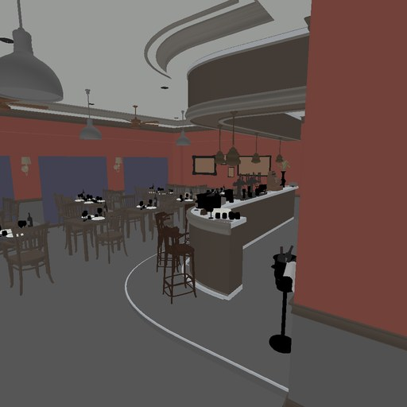

# Komorebi

[](https://kohakublueleaf.github.io/Komorebi/tutorial/)
[](https://kohakublueleaf.github.io/Komorebi/)
[](LICENSE)

**Move the data, move the thread, or move the code.**

A programming model for a network of independently programmable processors, in which a
thread reads what it needs or goes to where it is. Today it runs on the Tensix grid and
the X280 cores of a Tenstorrent Blackhole card.

<picture>
  <source media="(prefers-color-scheme: dark)" srcset="docs/images/teaser-dark.svg">
  
</picture>

Komorebi explores how to program a network of independently programmable processors,
where computation, communication, code placement and execution control are all the
program's own concern. It sees a program as threads, and a thread meets its data in one
of two ways:

- **The data comes to the thread.** A processor reads what it needs from shared memory,
  or receives it from other processors.
- **The thread goes to the data.** A message carries a thread's state to the processor
  that holds what it needs next, and that processor is chosen while the program runs,
  from the data.

A thread needs its code where it arrives: placed there in advance, or loaded when it is
needed. Nothing in this asks for one particular chip. It asks for processors with their
own memory and a network on which any of them can reach any other, so other grids of
this kind, and several cards joined together, fit the same description. Two cards
joined together run today; no other grid has been tried.

## On a Blackhole card, today

This repository is the model built for one machine, a Tenstorrent Blackhole card
(developed on a P150A): 120 Tensix cores in a grid, 16 X280 cores in four clusters, and
the card's network between them. Two such cards joined by their Ethernet links run as
one program.

| Concern | On the card |
|---|---|
| Computation | A program is a set of persistent kernels on every Tensix core. Each command they receive names a handler of code and a core group, and every core of the group works on its partition. |
| Communication | Cores read and write DRAM, and send each other data through ports, reduces and broadcasts. A routed message goes to a core chosen at run time. Both data-movement CPUs of a core can carry one stream ([Movement](docs/reference/movement.md)). |
| Code placement | A program's kernels are loaded on every core when the run starts. Code that is not in them, an **overlay**, is built on the host and kept in DRAM; a core **loads** it into a **slot** of its own L1 when it is first needed, and **calls** it. A handler can name it, a message (its handler is loaded where the message arrives), a leader's cast, or the word of a pull's answer from an X280 core. A program can itself be an overlay under kernels the runtime owns: several programs share one run, each on its own group of cores or all on every core, and `run.load` (or an X280 thread's `kmx_load`) gives a group another program while the run is live ([overlays](docs/reference/overlays.md)). |
| Execution control | A dispatcher on one X280 cluster submits the commands and runs streams and graphs of them on the card. C threads on the other three X280 clusters run the irregular part of a program. |
| More than one card | Each card is an **island** with its own grid and dispatcher. Ranks stay flat across islands, the host places each tensor by a hint, and commands, pages, parts of a page, messages and the parts of a reduce or a broadcast cross the links between the cards. The kernels of a program written for one card run on two unchanged ([islands](docs/concepts/islands.md)). |

**Status: early development; 0.2.0 is the second release, for one card model.** Everything
below runs on one P150A, from the two wheels on PyPI or from a clone against a tt-metal
source tree; two P150As as two islands run from a clone. It has run on no other hardware.

New in 0.2.0:

- **Code goes where the work is.** Overlays loaded into slots of a core's L1 and called;
  a handler, a message, a leader's cast or an X280 core's answer names the code; a group
  changes program inside a run, from the host (`run.load`) or from an X280 thread
  (`kmx_load`).
- **Two cards as one program.** Islands with flat ranks, tensors placed by a hint, and
  commands, pages, parts of a page, messages, reduces and broadcasts across the links.
  One page call reads or writes a tensor wherever its pages are.
- **Messages carry more.** A body of up to 4 KiB beside a message; X280 cores as ranks
  of a dynamic run.
- **A thread reaches any DRAM.** `kmx_fetch` and `kmx_store` of any bank, or of a tensor
  another card holds, at the cores' rate.
- **The host at the link's speed.** Tensor reads and writes go through the host channel:
  a 20 MiB frame read in 7 ms inside a run, where the device API took 10 s.
- **A run survives a stuck core.** `run.inspect` of a running core; a command given up
  at its deadline; one core reset and loaded again by the dispatcher, by itself.
- **The X280 clusters at 1,350 MHz** by default (1,000 before), and a mover's NoC as a
  field of the program.

On `main`, after 0.2.0:

- **Kernels as Python classes.** A class's handlers are compiled into the kernels, and
  its tile functions into the vector and matrix units' instructions
  ([below](#a-kernel-as-a-python-class)); experimental.
- **All-gather and all-reduce across islands**, as calls from a kernel and from the
  host ([27_islands_gather](examples/27_islands_gather/),
  [28_islands_reduce](examples/28_islands_reduce/)).
- **A whole LLM decode as one program**: Qwen3-1.7B at 128 tokens a second on one card
  ([decode](projects/decode/README.md)).

## At a glance

Whole programs on the card, each checked against a reference. These are a few rows of
[Measured](docs/measured.md), which has every table, its conditions and where the time
goes.

| Program | What ran | On the card | Beside it |
|---|---|---|---|
| LLM decode: Qwen3-1.7B in bfloat16, its own weights | a token through all 28 layers, one card | **128 tokens a second** at 256 cached tokens, 113 at 4,096 | the weights are read at 73 % of the card's DRAM ceiling; 16 of 16 greedy tokens are torch's |
| Linear layer at a decode step | 32 x 5120 x 17408, two cards | 223.1 µs | one card: 409.4 µs; the weight is read at 799 GB/s over the two cards |
| Matrix product | 8192 cubed | 8.61 ms | Kohaku-TT, same card: 11.80 ms |
| SwiGLU | 256 x 256 x 512 | 42.6 µs | Kohaku-TT, same card: 181.6 µs |
| Attention | 2 x 8 x 1024 x 128, 2 K / V heads | 149.9 µs | Kohaku-TT, same card: 261.8 µs |
| Rasterizer, whole frame | 10^6 triangles, 1024 x 1024 | 6.34 ms | CUDA on a V100: 4.42 ms |
| Ray tracer, whole frame | Sponza close, 1024 x 1024 | 359.9 ms | CUDA on a V100: 102.0 ms |

Against Kohaku-TT on the same card the neural programs are level or ahead on most
shapes and behind on a few (16,384 cubed at 0.86 of its speed, causal attention at
0.92). The rasterizer and the ray tracer run whole frames on the card: the rasterizer
bit-exact against numpy at 0.4 to 0.9 of a V100's speed from 10^5 triangles up, the
ray tracer at 0.35 of it or less.

   

*Read back from the card, 512 x 512 downscales of 1024 x 1024 frames. The first two
are rasterized, both bit-exact against numpy: Sponza overview (3.80 ms a frame) and
Bistro interior overview (6.50 ms). The last two are ray traced: Sponza close (359.86
ms a frame) and Bistro interior close (596.97 ms). Crytek Sponza, (c) 2010 Frank Meinl,
Crytek, CC BY 3.0; Amazon Lumberyard Bistro, (c) 2017 Amazon Lumberyard, CC BY 4.0
(Open Research Content Archive); both from the McGuire Computer Graphics Archive.*

## A kernel

A kernel is loaded once on its core and stays there: `run` calls the function below for
every command the core receives. A program is a data-movement kernel and a compute
kernel.

The example computes the gate of a SwiGLU layer, `out = silu(a) * b`, over two tensors
in DRAM. A command goes to a core group; each core takes its share of the tiles. Its
two data-movement CPUs, the movers, bring that share of `a` and `b` from DRAM into L1
and take `out` back, sharing every stream by a pattern (`AAAB`: mover A three of every
four blocks, mover B the fourth). Its compute kernel does the math in the vector unit,
a block of tiles at a time (`kBlock`, 8: the tiles its registers hold). Both files take
the three buffer pairs and `kBlock` from a header that the host reads too. The two
kernels below are reduced from [22_gate](examples/22_gate/README.md), which also checks
every wait and is run against numpy:

```cpp
// ---- kernels/movement.cpp: one file, built for both data-movement CPUs of a core ----
void kernel_main() {
    constexpr auto tensors = TensorAccessorArgs<0>();  // a, b and out share one layout
    km::Movement movement;  // stays loaded; runs once per command
    movement.run([&](const km_command_t& command) {
        const uint32_t tiles = command.a3;  // tiles a core
        const uint32_t first = (movement.me() - km::first(command)) * tiles;
        const km::Pattern pattern = km::Pattern::of(command.a4);
        const auto stream = [&](uint32_t direction, uint32_t address, km::BufferPair pair) {
            const TensorAccessor tensor(tensors, address);
            return km::Stream(direction, tensor, first, tiles, kBlock, 1, pair, pattern);
        };
        return movement.move(
            stream(km::kMoveRead, command.a0, kA),
            stream(km::kMoveRead, command.a1, kB),
            stream(km::kMoveWrite, command.a2, kOut)
        );
    });
}

// ---- kernels/compute.cpp: out = silu(a) * b in the vector unit, a block at a time ----
void kernel_main() {
    km::Compute compute;
    compute_kernel_hw_startup(kAMoverA, kOutMoverA);
    compute.run([&](const km_command_t& command) {
        const km::Pattern pattern = km::Pattern::of(command.a4);
        for (uint32_t block = 0; block < command.a3 / kBlock; block++) {
            // each block from the half of the buffer pair its mover filled
            const uint32_t a = km::block_half(kA, pattern, block);
            const uint32_t b = km::block_half(kB, pattern, block);
            const uint32_t out = km::block_half(kOut, pattern, block);
            compute.wait_front(a, kBlock);
            compute.wait_front(b, kBlock);
            tile_regs_acquire();
            copy_init(a);
            for (uint32_t tile = 0; tile < kBlock; tile++) copy_tile(a, tile, tile);
            silu_tile_init();
            for (uint32_t tile = 0; tile < kBlock; tile++) silu_tile(tile);
            mul_reuse_dest_init<kDestToSourceA>(b);
            for (uint32_t tile = 0; tile < kBlock; tile++) {
                mul_reuse_dest_tiles<kDestToSourceA>(b, tile, tile);
            }
            tile_regs_commit();
            tile_regs_wait();
            compute.reserve_back(out, kBlock);
            for (uint32_t tile = 0; tile < kBlock; tile++) pack_tile(tile, out);
            tile_regs_release();
            cb_push_back(out, kBlock);
            cb_pop_front(a, kBlock);
            cb_pop_front(b, kBlock);
        }
    });
}
```

The host declares the program, loads it and submits the command to a core group:

```python
program = km.Program(
    "gate",
    kernels="kernels/",  # movement.cpp for both movers, compute.cpp
    buffers=[
        km.BufferPair(0, 1, "bfloat16", 2048, pages=32),  # a: mover A's, mover B's
        km.BufferPair(2, 3, "bfloat16", 2048, pages=32),  # b
        km.BufferPair(16, 17, "bfloat16", 2048, pages=32),  # out
    ],
    compile_args={"movement": a.accessor_args()},  # how the kernel finds a, b and out
    handlers="kernels/gate.h",  # kHandlerGate = 1
)
run = session.load(program)
pattern = km.Pattern("AAAB")
words = [a.address, b.address, out.address, tiles, pattern.word]
run.wait(run.submit("gate", (0, 120), words))
```

The part of a program that decides is C on an X280 work cluster. A thread that splits
the grid between two programs every round, after one command from the host (reduced
from [19_thread_programs](examples/19_thread_programs/thread/rounds.c)):

```c
const uint32_t spin_cores = split(cores, spin_units, spin_rate, tiles, scale_rate);
km_command_t spin, scale;
kmx_command(&spin, kProgramSpin, kProgramSpinHandlerSpin, 0, spin_cores);
kmx_command(&scale, kProgramScale, kProgramScaleHandlerScale, spin_cores, cores - spin_cores);
kmx_submit(&spin, &spin_handle);
kmx_submit(&scale, &scale_handle);
kmx_wait(spin_handle, deadline, &spin_event);
kmx_wait(scale_handle, deadline, &scale_event);
```

Code that is not in the kernels is an [overlay](docs/reference/overlays.md), loaded
into a slot of a core's L1 while the run lives. Every example is a page under
[examples](examples/README.md), with what it measured.

## A kernel as a Python class

The gate above is two C++ kernels, a header, three buffer pairs and compile arguments.
The same program can be written as one Python class (experimental, on `main` after
0.2.0). A method marked as a handler is compiled, when the class is made, into those
files: its streams become the movers' code and the buffers, its parameters the
command's words. The arithmetic is a tile function, which the tile compiler turns into
the vector unit's instructions for the compute kernel. Reduced from
[22_gate/as_class](examples/22_gate/as_class/README.md):

```python
import komorebi as km

BLOCK = 8  # tiles a block


@km.tile_function(tolerance=1e-6)  # the largest relative error against float64
def silu_gate(a, b):
    return km.silu(a) * b


class Gate(km.Program):
    @km.handler
    def gate(
        self,
        a: km.Tensor,
        b: km.Tensor,
        out: km.Tensor,
        tiles: int,
        pattern: km.Pattern,
    ):
        first = self.rank * tiles  # this core's share
        results = km.Stream(
            out.pages(first, tiles), write=True, block=BLOCK, pattern=pattern
        )
        for x, g in zip(
            km.Stream(a.pages(first, tiles), block=BLOCK, pattern=pattern),
            km.Stream(b.pages(first, tiles), block=BLOCK, pattern=pattern),
        ):
            results.push(silu_gate(x, g))


program = Gate(a=a, b=b, out=out)  # compiled here: the kernels and the header
run = session.load(program)
words = (a, b, out, tiles, km.Pattern("AAAB"))
run.wait(run.submit(Gate.gate, (0, 120), args=words))
```

A class can also keep a field in each core's L1, multiply in the matrix unit, and add
up what a group of cores made. This handler is a linear layer at a decode step, `Y = X
W` for one tile row of X: a group of 14 cores makes 16 columns of Y, each core from a
fourteenth of K, and the group's parts are added up a tree to its first core, which
writes them. Reduced from
[dense_class](experiments/language/dense_class/README.md):

```python
K_TILES = 128  # K = 4096
SPLIT = 14  # cores a group, each a fourteenth of K
WIDTH = 16  # a group's columns of Y, in tiles
CHUNK = 2  # K tiles a block


class Linear(km.Program):
    sums: km.L1[km.fp32, 1, WIDTH, 32, 32]  # a field in each core's L1

    @km.tile_function(fidelity="HiFi2")
    def project(x, w):
        return x @ w  # the matrix unit

    @km.handler
    def split(self, x: km.Tensor, w: km.Tensor, y: km.Tensor):
        share = self.rank % SPLIT  # this core's part of K
        first = self.rank // SPLIT * WIDTH  # its group's columns of Y
        k0 = share * K_TILES // SPLIT
        k1 = (share + 1) * K_TILES // SPLIT
        for xb, wb in zip(
            km.Stream(x.tiles[0:1, k0:k1], block=CHUNK),
            km.Stream(w.tiles[k0:k1, first : first + WIDTH], block=CHUNK * WIDTH),
        ):
            self.sums += self.project(xb, wb)
        whole = km.reduce(self.sums, form="tree", group=SPLIT)
        if self.rank == self.leader:  # the group's first core
            y.tiles[0:1, first : first + WIDTH].write(whole)
```

On the card each class gives the hand program's result. The time of a command, the
class beside the C++ kernels written by hand:

| Program | As a class | By hand |
|---|---|---|
| The gate, 12 cores, 64 tiles a core ([22_gate](examples/22_gate/as_class/README.md)) | 83.7 µs | 76.2 µs |
| Linear layer, 32 x 4096 x 4096, the handler above ([dense_class](experiments/language/dense_class/README.md)) | 94.2 µs | 92.4 µs |
| Linear layer, 1024 x 4096 x 4096, casts along rows and down columns | 358.6 µs | 382.4 µs |
| The ray tracer's trace pass ([raytrace_class](experiments/language/raytrace_class/README.md)) | 3,294.9 µs | 3,259.9 µs |
| The rasterizer's fill pass, a small scene ([raster_class](experiments/language/raster_class/README.md)) | 88.3 µs | 118.9 µs |

The gate's emitted arithmetic takes 1,597 cycles a tile against 1,901.5 for the
hand-written body, in 37,632 B of kernel text against 38,640. Nine of the examples have
a class beside the hand program (`as_class/` in each); each README gives the class's
result, time and kernel text beside the hand's. What a handler's lines may be is in
[classes](docs/reference/classes.md), what a tile function may contain in
[tile functions](docs/reference/tile.md).

In work: the lines for a program whose movers walk a table of jobs (attention is not
a class yet; the rasterizer's passes are, with some of their moves still inline C++
bodies), and a chain of kernels (the decode,
[below](#a-core-goes-on-to-the-next-kernel-by-itself)).

## The programming model

### The card as Komorebi runs it

<picture>
  <source media="(prefers-color-scheme: dark)" srcset="docs/images/card-dark.svg">
  
</picture>

The grid is the card's real one in NoC0 coordinates; the numbers in the Tensix cores
are Komorebi's core index. A **command** is one 64-byte line: the handler, the group
(a contiguous range of cores, whose first core is its **leader**) and ten 32-bit
argument words. Every core sees every command and skips those whose group does not hold
it; cores report to the leader, which acknowledges to the dispatcher, with a
result word when the command asks for one.

Commands are one way cores talk. The figure draws each of the others once, in its own
colour; the next two figures take them one at a time, with the code that does each.

### A thread has a program counter and a place

<picture>
  <source media="(prefers-color-scheme: dark)" srcset="docs/images/breakpoints-dark.svg">
  
</picture>

Each panel is one way cores talk, on the piece of the grid it uses, with lines of the
example that does it (the example's name is in the panel's corner). A **breakpoint** is
a point where a thread must deal with another core; between two breakpoints it runs on
its core. Today a program is written as the handler bodies of its kernels, as above.

### Code goes where the work is

<picture>
  <source media="(prefers-color-scheme: dark)" srcset="docs/images/placement-dark.svg">
  
</picture>

An **overlay** is kernel code that is not in the kernels when the run starts: the host
builds it, and a core **loads** it into a **slot** of its L1 and **calls** it; a held
overlay is called again without a load ([overlays](docs/reference/overlays.md),
[12_overlays](examples/12_overlays/)). The code can be decided where the work is: a
message names its handler and the core it reaches loads that handler's part if it does
not hold it ([20_message_overlays](examples/20_message_overlays/)), or another party
decides, a leader casting the overlay's number
([17_leader_overlay](examples/17_leader_overlay/)), an X280 core's answer to a pull
naming it ([18_thread_split](examples/18_thread_split/)), `run.load` making a group hold
another program ([16_two_programs](examples/16_two_programs/)). The cycles in the figure
are those of [the overlay costs](docs/reference/overlays.md#costs) and of
[a group switching program](docs/reference/overlays.md#a-group-switches-program); the
numbers measured on one card are in
[Measured](docs/measured.md#code-placement).

### Groups and commands in time

<picture>
  <source media="(prefers-color-scheme: dark)" srcset="docs/images/groups-dark.svg">
  
</picture>

Up to 64 commands are in flight at once; a run's window is 4 unless it asks for more. A
command that must run after an earlier one on overlapping cores is submitted with
`run.submit(..., exclusive=True)`.

A command need not come from the host, and the code it runs need not be fixed when the
run starts. In the second panel the host sends one command and an X280 thread splits
the grid between two programs every round
([19_thread_programs](examples/19_thread_programs/)); in the third a group's leader
casts which overlay every core runs next
([17_leader_overlay](examples/17_leader_overlay/)).

### A core goes on to the next kernel by itself

<picture>
  <source media="(prefers-color-scheme: dark)" srcset="docs/images/chain-dark.svg">
  
</picture>

A command is one kernel's work, and between two commands somebody decides the next:
the host, the dispatcher, a thread. When the next step is already known, that way back
is only cost. In the [decode project](projects/decode/README.md) a token is 140 kernels
in a fixed order, five a layer, so the program keeps a **record** for each in DRAM: the
command's words, its cores, and the next record's address. One command starts the
token. A core that finishes its part goes on to the next record by itself, and starts
on it once the cores that write its input have **marked** it written. While it waits
it already reads the next kernel's weights, so DRAM keeps reading through every
boundary.

With a command a step a layer takes 410 µs at 4,096 cached tokens; as one chain it
takes 315 µs, of which 245 is the hardware's own (the weights and the cache at the DRAM
ceiling, attention's products): 87 and 113 tokens a second. Today the chain is the
decode project's own kernels. A framework call that gives any program the same chain,
and the class lines that state one, are in work.

### One program on the grid

<picture>
  <source media="(prefers-color-scheme: dark)" srcset="docs/images/mapcollect-dark.svg">
  
</picture>

The first panel is the simplest program, one command to a core group
([01_mapcollect](examples/01_mapcollect/)). The others are one program that uses most
of the model ([18_thread_split](examples/18_thread_split/)): every core pulls ranges
of work from its X280 core, the answer names the overlay for that range, and the core
loads it when it does not hold it and calls it. Choosing the code where the work is
takes 3,158 µs where the best single overlay takes 4,222 µs.

### A thread reaches any DRAM

<picture>
  <source media="(prefers-color-scheme: dark)" srcset="docs/images/reach-dark.svg">
  
</picture>

An X280 cluster's cache reaches one DRAM bank, the one beside it, and its own loads
through a NoC window move 0.024 GB/s. So a thread does not load far data: it calls
`kmx_fetch`, and Tensix cores copy the range, from any bank or from a tensor's pages,
into the thread's region at the bank's rate; `kmx_store` is the same the other way.
The call names the tensor and the range, never where they are: for a tensor another
island holds, the same call goes straight between the two cards' DRAMs
([threads](docs/reference/threads.md), [bank_fetch](experiments/x280/bank_fetch/)).

### More than one card

<picture>
  <source media="(prefers-color-scheme: dark)" srcset="docs/images/islands-dark.svg">
  
</picture>

An **island** is a set of cores that reach the others only through links: one card's
chip. Ranks stay flat and contiguous across islands, so a command names a group as
on one card and a kernel finds its place in it the same way; a core holds a table
with one entry for each island, not one for each rank. The host places a tensor by a
hint in the kernel's own words, and a kernel reads and writes it with the page calls,
which ask the other island for what it holds: the kernels of a program written for
one card run on two unchanged. Crossing a link is slower than the NoC, and the run
counts what crossed (`run.crossings()`), so a program can be placed to cross less
([islands](docs/concepts/islands.md), [reference](docs/reference/islands.md)).

## What exists

| Part | On main | Page | Example |
|---|---|---|---|
| Persistent kernel: commands, 64 mailbox slots per core, the reader, compute and writer loops, every wait with a timeout, the trace | implemented | [Tensix runtime](docs/reference/runtime.md) | [01_mapcollect](examples/01_mapcollect/) |
| Groups per command, several in flight, completion per group, a result word per command | implemented | [Tensix runtime](docs/concepts/runtime.md) | [01_mapcollect](examples/01_mapcollect/) |
| Channels: `emit`, `arrive`, `take`, groups, reduce by owner and by tree | implemented | [ports](docs/reference/ports.md) | [02_merge_tree](examples/02_merge_tree/) |
| Channels: broadcast along a row or a column, two broadcasts at once | implemented | [broadcasts](docs/reference/broadcast.md) | [03_broadcast](examples/03_broadcast/) |
| Routed messages: messages through per-core queues in DRAM, a send quota, the quiet end found by the dispatcher; a body of up to 4 KiB beside a message; a handler as an overlay; X280 cores as ranks | implemented; one dynamic run at a time | [dynamic handlers](docs/reference/dynamic.md) | [05_forward](examples/05_forward/), [23_message_body](examples/23_message_body/), [24_thread_rank](examples/24_thread_rank/) |
| Movement: both data-movement CPUs of a core on one stream, the pattern chosen by the command; each mover's NoC a field of the program | implemented | [movement](docs/reference/movement.md) | [11_movement](examples/11_movement/) |
| X280 ports: a core tells, asks and pulls from its X280 core; a pull's answer carries a range and a word | implemented | [ports](docs/reference/ports.md) | [10_x280_ports](examples/10_x280_ports/), [18_thread_split](examples/18_thread_split/) |
| Code placement: overlays built on the host, loaded into slots of a core's L1 and called; named by a handler, a message, a leader's cast or a pull's answer; a group changes program inside a run by `run.load` or a thread's `kmx_load` | implemented; not: the dynamic handlers of two programs in one run | [overlays](docs/reference/overlays.md) | [12_overlays](examples/12_overlays/), [16_two_programs](examples/16_two_programs/), [17_leader_overlay](examples/17_leader_overlay/), [20_message_overlays](examples/20_message_overlays/), [21_thread_load](examples/21_thread_load/) |
| Page calls: `km::Tensor`, `km::read_pages`, `km::write_pages`, `km::put_bytes`, `km::read_bytes`, one call wherever the page is held | implemented | [islands](docs/reference/islands.md#a-kernels-page-reads-and-writes) | [06_graph](examples/06_graph/), [09_bucket_sort](examples/09_bucket_sort/) |
| The dispatcher on X280 cluster 0: host ring, slots, deadlines, events | implemented | [dispatcher](src/komorebi_native/x280/kernel/README.md) | all |
| Micro-op streams and the job queue in the dispatcher | implemented; builder, check and simulator on the CPU | [streams](docs/streams.md) | [04_uop_stream](examples/04_uop_stream/) |
| Graphs in the dispatcher: command nodes, CPU-task nodes, joins, a kept graph run again | implemented; also host-fed | [graphs](docs/graphs.md) | [06_graph](examples/06_graph/) |
| X280 threads: `kmx_parallel`, `kmx_spawn` / `kmx_join`, regions, the command ring, a host fallback in Python; a thread on each of work clusters 1 to 3, regions shared on one bank; `kmx_parallel_all` over twelve cores and `kmx_push` across banks; `kmx_fetch` / `kmx_fetch_clean` / `kmx_store` of any bank through Tensix cores | implemented | [X280 threads](docs/threads.md) | [07_work_cluster](examples/07_work_cluster/), [08_parallel_thread](examples/08_parallel_thread/) |
| The host package: `Program`, `Session`, `Run`, uploads and engine events, reads by page range, errors that name the core | implemented | [host API](docs/reference/host.md) | all |
| Host transfers through the host channel: the cores move a tensor's pages between DRAM or L1 and the host's memory | implemented; a read under 80 KiB without a run still goes through the device API | [the host channel](docs/reference/host.md#the-host-channel) | all |
| Hardening: the kernel instruction check, an optimisation level per kernel, `Session(kernel_bytes=...)`, an exit with a timeout | implemented | [host API](docs/reference/host.md#instructions-the-cores-lack) | |
| Recovery without a card reset: `run.inspect` of a running core, the give-up of one command at its deadline, the reset and reload of one core by the host and by the dispatcher (by itself at a give-up), the watch on the dispatcher's own loop | implemented; the session hands the dispatcher the reset lists at load (`recover=True`) | [recovery](docs/guides/recovery.md) | [01_mapcollect](examples/01_mapcollect/) (`give_up.py`) |
| Islands: two cards as one session, each card's chip an island with its own grid and dispatcher; flat ranks across the cards, tensors placed by a hint; across the links: a command's part from the host and from a thread, pages and parts of a page from a kernel's calls, messages, the parts of a reduce or a broadcast, a thread's `kmx_fetch` / `kmx_store`; programs loaded by island, inspect, time-outs and recovery by island; one card split into two to four islands, to develop with one card | implemented over two P150A cards joined by four links; not: more than two cards, X280 cores as ranks over a link, a dynamic run on part of the ranks | [islands](docs/concepts/islands.md), [reference](docs/reference/islands.md) | [01_mapcollect](examples/01_mapcollect/) (`islands.py`), [25_islands_threads](examples/25_islands_threads/), [26_islands_sum](examples/26_islands_sum/) |

## Measured

Every table, with its conditions, the card's power and where the time goes, is on one
page: [Measured](docs/measured.md). In short, on one P150A unless said:

- **LLM decode** ([decode](projects/decode/README.md)). Qwen3-1.7B in bfloat16, a token
  through 28 layers as one command: 315.2, 287.1 and 278.6 µs a layer at 4,096, 1,024
  and 256 cached tokens, 113.3 to 128.2 tokens a second. At 4,096, 244.6 µs of a layer
  is the hardware's floor (the weights and the cache read at the DRAM ceiling of 495.6
  GB/s, attention's products); the page accounts for the other 70.6 term by term.
- **Matrix product, SwiGLU and attention**, against Kohaku-TT on the same card
  ([dense](projects/dense/README.md#results), [SwiGLU](projects/dense/SWIGLU.md#results),
  [attention](projects/attention/README.md#time-and-power)). Kohaku-TT's time over
  ours: matrix product 0.86 to 4.75 over seven shapes, SwiGLU 2.49 to 4.26 over four,
  attention 0.92 to 1.75 over five. From 4096 cubed up both are bound by the card's
  power limit.
- **Two cards**
  ([dense](projects/dense/README.md#a-linear-layer-on-one-card-and-two),
  [islands](docs/reference/islands.md)). A linear layer with the weight sharded along
  the output dimension takes 0.54 to 0.59 of one card's time, at a decode step and at
  prefill; with the weight gathered on both cards, 8192 and 16,384 cubed take half of
  one card's time (1.90 and 1.95 times faster). Beside Kohaku-TT in the same form on
  the same two cards, ours takes 1.03 to 1.31 of its time at a decode step. Kernels
  put pages across the links at 72.5 GB/s each way; a message crosses in 4.7 µs.
- **Rasterizer** ([raster](projects/raster/README.md)). Whole frames of 1024 x 1024,
  bit-exact against numpy: a settled frame takes 0.95 to 6.5 ms from 398 to 10^6
  triangles, 0.26 to 0.92 of a V100's speed. Its fill pass alone is ahead of the
  V100's fill stage (10^6 triangles: 2.1 against 3.3 ms).
- **Ray tracer** ([raytrace](projects/raytrace/README.md)). Whole frames of 1024 x
  1024, ray generation, four traces and shading as eight commands: 22 to 597 ms, 0.06
  to 0.35 of a V100's speed. The traces are 67 to 97 % of the frame.
- **Code placement** ([overlays](docs/reference/overlays.md#costs)). A core loads a
  reader part in 0.88 µs and finds a held one in 0.07 µs. A group changes program in
  2.3 to 2.6 µs on the cores; the call takes 6.2 µs from an X280 thread (`kmx_load`)
  against 134.9 µs from the host (`run.load` and its wait).

The examples' own timings (commands per microsecond, broadcasts, forwards, streams,
graphs and threads) are in each [example's README](examples/README.md).

## Install

Komorebi 0.2.0 is on PyPI as two distributions, `komorebi-tt` (the framework) and
`komorebi-runtime` (the pinned tt-metal build), with the GitHub release `v0.2.0`. It is
for one card model, the Blackhole P150A. Komorebi is used from those
wheels ([the two wheels](docs/install.md#from-010-the-two-wheels)) or from a clone
([packaging](packaging/README.md), [from a wheel](docs/install.md#from-a-wheel)), on
Linux x86-64 with Python 3.13:

```
git clone <this repository> komorebi && cd komorebi
uv venv -p 3.13 && source .venv/bin/activate && uv pip install -e ".[dev]"
kmr doctor                      # the Python, the tt-metal tree and its X280 runtime
```

The CPU tests and the stream and graph tools need nothing else. To run on a card: a
Blackhole P150A whose X280 memory is prepared for the X280 runtime, a tt-metal source
tree at the version in [packaging/tt-metal.pin](packaging/tt-metal.pin) (v0.81.1) built
with its X280 runtime, and `TT_METAL_HOME` naming that tree (neither `ttnn` nor
`torch` is needed). The dispatcher image and the native module are
built from the tree on first use (`python -m komorebi.native` builds them ahead).
Details: [install](docs/install.md).

The distribution is named `komorebi-tt`; the package is imported as `komorebi` and the
command is `kmr`. `pip install "komorebi-tt[runtime]"` installs it with
`komorebi-runtime`, the pinned tt-metal build, and a program runs on a card with no
tt-metal tree ([the two wheels](docs/install.md#from-010-the-two-wheels)); `kmr setup`
prepares the card once.

## Usage

Every example runs on its own, checks its output against numpy and prints one JSON
line with `ok` ([examples](examples/README.md)); each program's page lists its
commands ([projects](projects/README.md)):

```
cd examples/02_merge_tree
python merge.py --jobs 20 --count 8 --form both
python merge.py --group-list 0:8,0:119 --form both --stall-rank 3
cd ../..
python -m projects.raytrace.frame --scene tiny --reps 16
```

The second command adds a load in which rank 3 of job 1 never sends: the host raises
`km.CommandTimeout` naming the handle and the cores that did not report, and the next
load in the same session runs exact.

## Repository map

```text
src/komorebi/                  the Python package: Program, Session, Run, layout, power, kmr
  engines/                     micro-op streams and graphs: builders, encodings, checks,
                               simulators; the host-fed executor
  thread.py                    X280 threads: declaration, regions, results, host fallback
  manifest/                    reserved: a program's commands and handlers declared
src/komorebi_native/
  include/komorebi/abi/        the command, the event and the stream format, shared by all
  include/komorebi/device/     the persistent kernel, groups, ports, groups, broadcasts, dynamic
                               handlers, the trace
  kernels/                     the generic reader and writer of dynamic handlers
  x280/kernel/                 the dispatcher for X280 cluster 0
  x280/engines/  x280/kmx/     the plain-C graph engine; the X280 thread library
  csrc/host/                   the native module: X280 runtime, commands, events
examples/                      01_mapcollect to 28_islands_reduce
projects/                      raster, raytrace, dense (with SwiGLU), attention, decode
experiments/                   hardware and design probes (see its README)
reference/                     CPU, C++ and CUDA references the programs are checked against
tests/core/  tests/projects/   tests with no card: the framework; the programs
tests/hardware/                card tests (KMR_CARD=1)
docs/                          concepts, references, measured, install, development
```

## Sizes a program works within

These are fixed sizes of the runtime and limits of the card. They are not on the TODO
list: a program is written to fit them, and what has been built so far (matrix product, attention, a
rasterizer, a ray tracer) fits.

- **A command is one 64-byte line.** It carries ten 32-bit argument words. Anything
  larger travels by reference: two of the words can name a block of up to 1,024 bytes,
  and tensors are named by their address.
- **64 commands in flight at most.** A command costs more the more are in flight (about
  7 % at 16, 21 % at 48), so a program keeps a small window; the default is 4.
- **Handlers 1 to 239 per program.** More code is another program, or an overlay a core
  loads when it is first needed.
- **A core's L1 holds its kernels, its buffers and its overlay slots.** A program that
  does not fit is refused at load with the budget table; the answer is smaller buffers,
  or code moved into overlays. Code runs from below 1 MB of L1 (a taken branch to code
  above it costs about 4 cycles more): the kernels and slots sit at the bottom, the
  buffers above them, and a load whose code would reach past 1 MB raises
  `SlowCodeError` unless the session allows it (`slow_code=True`).
- **A link is slower than the NoC.** What crosses between islands is bound by the
  links, so a program over islands is placed to cross little: a tensor split along the
  dimension its work is split along, or gathered where every island reads all of it,
  and what must cross sent as one gather or one reduce.
- **A message is one line.** 64 bytes, with a body of at most one 4 KiB page beside
  it. Messages have no order between them, and a message cannot ask for a DRAM fetch.
- **What costs a card reset.** A core stuck inside a compute unit, a dispatcher whose
  first core stopped executing, an X280 thread that never returns and polls nothing,
  and a process killed with SIGKILL ([recovery](docs/guides/recovery.md)).
- **One clock for the four X280 clusters.** 1,350 MHz by default; the session takes
  1,000, 1,250, 1,350 or 1,500 (`pll_mhz`). 1,750 MHz is an opt-in that is not stable
  under full matrix load: the card lowers its core voltage there, and the dispatcher
  trapped in 9 of 18 runs.
- **One card's grid.** Up to 128 cores in at most two multicast panels; one harvesting
  pattern has been run. Two cards run as two such grids: 236 ranks on two P150A joined
  by four links, since two cores of each card serve the links.

## TODO

What Komorebi does not do yet. None of these is a property of the model; what a
program has to be written around is under
[sizes](#sizes-a-program-works-within).

1. **More than two cards.** Two P150A run as two islands; three or four islands have
   run only as one card split into islands. Not yet over a link: X280 cores as ranks, a
   dynamic run on part of the ranks, a put to an island two links away.
2. **Collectives across islands at the links' rate.** An all-gather and an all-reduce
   are calls, from a kernel and from the host (on `main`, after 0.2.0). A gather of two
   pages takes 12.7 µs where a message crosses in 4.7 µs; a larger one moves 15 to 25
   GB/s each way where puts from every core on the same links reach 72.5 GB/s (one
   line from DRAM a share, bound by the reads a link core keeps in flight); and the
   reduce's addition is made by the movers in integer instructions, not by the compute
   units.
3. **Tensors an island cannot hold yet.** A tensor is placed by pages of one size set
   at build. A range of one DRAM bank (an X280 thread's region) and a stream whose page
   size is set by the command are named by bank address, so only their own island
   reads them.
4. **Messages over every link by default.** A message service on each of the four links
   carried a run's messages across in about a quarter of one link's time (80 ms against
   302 ms), but one run of three stalled; until that is explained one link carries the
   messages and the rest is an option.
5. **Dynamic handlers.** One dynamic run at a time, and not the dynamic handlers of two
   programs in one run ([dynamic handlers](docs/reference/dynamic.md#not-in-this-version)).
6. **A link core reset by its dispatcher.** A dispatcher resets and loads again the
   cores of its own island; a link core that hangs is named by it and reset by the
   host ([recovery](docs/guides/recovery.md)).
7. **Debugging on the card.** `run.inspect` shows each core's state, the wait it is in
   and its trace. Nothing reads a core's registers, its buffers' contents or a
   program's own variables, and tt-metal's watcher cannot run beside the X280 runtime.
8. **A language above the kernels.** A Python layer that writes the kernels from
   classes and compiles tile arithmetic is on `main`, after 0.2.0
   ([classes](docs/reference/classes.md), [tile functions](docs/reference/tile.md)).
   A program whose movers walk a table of jobs, or whose cores go from one kernel
   to the next by themselves, is still written as C++ kernels.
9. **Loading TT-NN's kernels.** A TT-NN operation is a tt-metal program, which is what
   a program loaded as overlays is; nothing loads an operation's kernels as they are.
10. **Starting without tt-metal's launch.** The session opens the card in slow dispatch
    and tt-metal launches the kernels once, core by core; everything after that is
    Komorebi's own.
11. **Wormhole.** Only Blackhole. A Wormhole card has the Tensix grid and no X280 cores,
    so the dispatcher and the threads need another home there.
12. **The build from a clone.** `kmr build host` and `kmr build pymodule` take their
    compile flags from two targets that the
    [tt-x280-dispatch](https://github.com/KohakuBlueleaf/tt-x280-dispatch) project adds
    to a tt-metal build ([development](docs/development.md#known-limitations)). The
    wheels need neither.

Komorebi has run on Blackhole P150A cards, one and two together, and on no other hardware.

## Documentation

| Page | Read it for |
|---|---|
| [docs index](docs/README.md) | every concept and reference page |
| [Tensix runtime](docs/reference/runtime.md) | the device headers, the command, timed waits, the control block |
| [ports](docs/reference/ports.md), [broadcasts](docs/reference/broadcast.md), [dynamic handlers](docs/reference/dynamic.md) | messages between cores |
| [streams](docs/streams.md), [graphs](docs/graphs.md) | deciding on the card in the dispatcher |
| [islands](docs/concepts/islands.md), [recovery](docs/guides/recovery.md) | two cards as one session; a command that does not return |
| [X280 threads](docs/threads.md) | C on a work cluster with kmx |
| [host API](docs/reference/host.md) | `Program`, `Session`, `Run`, errors, builds |
| [classes](docs/reference/classes.md), [tile functions](docs/reference/tile.md) | kernels written as Python classes; arithmetic compiled for the vector and matrix units |
| [the chain](docs/reference/chain.md) | calls written once as records and run as one command, each input waiting for marks, not for the host |
| [measured](docs/measured.md) | every program's tables, with conditions and where the time goes |
| [examples](examples/README.md), [projects](projects/README.md) | runnable examples; the five programs and their results |
| [install](docs/install.md), [development](docs/development.md) | building from a clone; layout, checks, conventions |

## Contributing

Open an issue first for a feature. Before a pull request, from the repository in the
environment of [install](docs/install.md):

```
python -m pytest tests/core
python -m pytest tests/projects
python -m komorebi.tools.cxx_format --check
python -m komorebi.tools.comment_lint --check src tests examples experiments packaging tutorial projects
ruff check . && black --check . && blacken-docs -t py313 -l 88 $(git ls-files '*.md')
```

Conventions: [development](docs/development.md).

## Licence

Apache-2.0; see [LICENSE](LICENSE).
