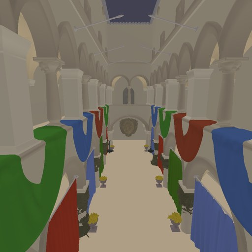
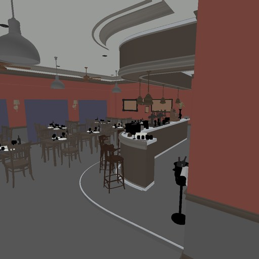
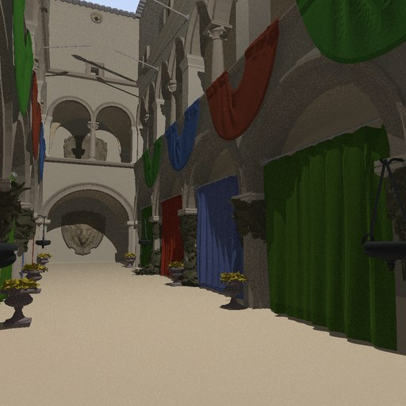
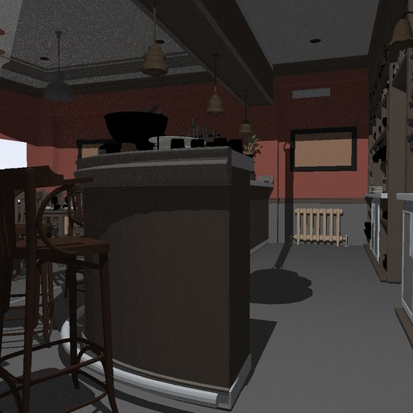

# Measured

Every whole program's table, each row from the program's own page and its committed
results. The [README](../README.md#results) keeps a few of these numbers; this page
keeps all of them.

Unless a section says otherwise: one P150A, 2026-11-13, AICLK 1,350 MHz nominal (the
card lowers it under its power limit in the long matrix loops; each page gives the
clock it sampled) and the X280 at the session's 1,000 MHz. Power is the whole card's
mean over the loop.

## LLM decode

One decode step of Qwen3-1.7B in bfloat16, with its own weights: 28 layers of five
kernels (qkv, attend, o, gate_up, down), a whole token as one command on all 120 cores
of one card, 2026-11-15 ([decode](../projects/decode/README.md)). T is the number of
cached tokens.

| | T 4096 | T 1024 | T 256 |
|---|---:|---:|---:|
| µs a layer | 315.2 | 287.1 | 278.6 |
| tokens a second | 113.3 | 124.4 | 128.2 |
| the weights' and the cache's read at the DRAM ceiling (495.6 GB/s), µs a layer | 236.9 | 211.5 | 205.2 |
| share of that ceiling | 75 % | 74 % | 74 % |

The weights are 100.7 MB a layer, read once a token: at 128.2 tokens a second that is
361 GB/s, 73 % of the DRAM ceiling (64 % at T 4096). Each tensor is within bfloat16's
error of a float64 reference, and with a real prompt 16 of 16 greedy tokens are
torch's, at 125.3 tokens a second. Of a layer's 315.2 µs at T 4096, 244.6 is the
hardware's floor (the weights and the cache at the DRAM ceiling, and attention's
products on its busiest core); the rest is the hand-over between kernels, term by term
in [the account of a layer](../projects/decode/README.md#the-account-of-a-layer-at-t-4096).

## Rasterizer and ray tracer: whole frames

Both programs run the whole frame on the card, 1024 x 1024, and both are far below
half of a V100's speed today. The V100 and C++ columns are the reference's whole
frame (the same algorithm in CUDA on one idle Tesla V100 32 GB, and in C++ on a shared
96-thread AMD EPYC 7K62); none of the three counts the scene's upload or the image's
read-back.

The **rasterizer**: the passes and the counting run on the 120 cores, the serial rest of
the middle pass between them on a thread on the X280 work cluster; the image is bit-exact
against numpy. Median of 5 loads, each about 1 s of frames; card 1
([raster](../projects/raster/README.md#the-frame-on-the-work-clusters-thread), results in
`projects/raster/results/`,
[reference](../projects/raster/reference/README.md#timings-and-power)):

| Scene | Triangles | Frame | Card frame, ms | of which the X280 step | Card W | C++ 96 threads, ms | V100, ms | V100 / card |
|---|---|---|---|---|---|---|---|---|
| tiny | 398 | first | 0.987 | 0.436 | 61.9 | 2.66 | 0.29 | 0.29 |
| tiny | 398 | settled | 0.987 | 0.436 | 63.4 | 2.66 | 0.29 | 0.29 |
| 10^4 | 11,994 | first | 0.982 | 0.440 | 67.0 | 3.32 | 0.25 | 0.25 |
| 10^4 | 11,994 | settled | 0.952 | 0.453 | 65.8 | 3.32 | 0.25 | 0.26 |
| 10^5 | 102,308 | first | 2.050 | 0.753 | 68.0 | 4.08 | 0.79 | 0.39 |
| 10^5 | 102,308 | settled | 1.967 | 0.772 | 68.2 | 4.08 | 0.79 | 0.40 |
| 10^6 | 997,806 | first | 6.894 | 0.807 | 68.9 | 17.87 | 4.42 | 0.64 |
| 10^6 | 997,806 | settled | 6.339 | 0.823 | 70.2 | 17.87 | 4.42 | 0.70 |
| Sponza, overview | 262,266 | first | 5.770 | 0.457 | 68.8 | 7.88 | 2.31 | 0.40 |
| Sponza, overview | 262,266 | settled | 3.795 | 0.466 | 71.6 | 7.88 | 2.31 | 0.61 |
| Bistro interior, overview | 1,020,903 | first | 8.762 | 0.736 | 66.9 | 14.10 | 5.99 | 0.68 |
| Bistro interior, overview | 1,020,903 | settled | 6.503 | 0.753 | 69.4 | 14.10 | 5.99 | 0.92 |

"First" is a scene's first frame, with COUNT's and SETUP's ranges cut into equal
parts: what a single image costs. "Settled" is a later frame of the same camera, whose
ranges are cut by the frame before's predicted costs. Where the time goes (settled
frame): at 10^6 FILL 2.1 ms, SETUP 1.9 ms, COUNT 1.1 ms and the X280 step 0.8 ms; on
Bistro SETUP and FILL 2.1 ms each and COUNT 1.3 ms. The fill alone is ahead of the
V100's fill stage (10^6: 2.1 against 3.3 ms; Bistro: 2.1 against 5.6 ms).

The **ray tracer**: ray generation, four traces and shading are eight commands on the
120 cores; trees larger than L1 are read from DRAM as treelets. Card 1. A cold frame
has no history and is submitted by the host. A warm frame is the second or third of the
same camera, submitted by a thread on the X280. Before each trace the thread cuts the
rays into the cores' ranges by the frame before's costs; its plan time counts in the frame
([raytrace](../projects/raytrace/README.md#the-frame-planned-on-the-x280)):

| Scene | Frame | Card frame, ms | of which the X280 plan | Card W | C++ all threads, ms | V100, ms | V100 / card | Pixels differing from numpy |
|---|---|---|---|---|---|---|---|---|
| tiny (tree in L1) | cold and warm | 22.24 | - | 68.0 | 20.59 | 2.59 | 0.12 | 0 |
| 10^4 | cold | 57.91 | - | 63.0 | 26.44 | 4.16 | 0.07 | 0 |
| 10^4 | warm | 70.63 | 5.27 | 61.0 | 26.44 | 4.16 | 0.06 | 0 |
| 10^5 | cold | 81.51 | - | 63.0 | 35.47 | 6.57 | 0.08 | 0 |
| 10^5 | warm | 93.01 | 5.34 | 66.9 | 35.47 | 6.57 | 0.07 | 0 |
| 10^6 | cold | 154.21 | - | 63.0 | 53.66 | 11.61 | 0.08 | 1 |
| 10^6 | warm | 192.50 | 5.32 | 70.4 | 53.66 | 11.61 | 0.06 | 1 |
| Sponza, close | cold | 359.86 | - | 63.0 | 264.78 | 102.00 | 0.28 | 244 |
| Sponza, close | warm | 323.38 | 3.64 | 71.0 | 264.78 | 102.00 | 0.32 | 244 |
| Sponza, overview | cold | 348.53 | - | 69.2 | 230.36 | 95.52 | 0.27 | 234 |
| Sponza, overview | warm | 313.63 | 4.14 | 68.2 | 230.36 | 95.52 | 0.30 | 234 |
| Bistro interior, close | cold | 596.97 | - | 61.0 | 401.87 | 211.42 | 0.35 | 2 |
| Bistro interior, close | warm | 596.86 | 4.35 | 70.0 | 401.87 | 211.42 | 0.35 | 3 |
| Bistro interior, overview | cold | 523.72 | - | 73.1 | 336.80 | 153.94 | 0.29 | 2 |
| Bistro interior, overview | warm | 477.48 | 4.57 | 70.5 | 336.80 | 153.94 | 0.32 | 2 |

Where the time goes: the four traces take 67 % (10^4) to 97 % (Bistro) of the frame,
the bounce trace alone 36 to 59 %; each core sorts its bounce and second-shadow rays
(about 15 ms a frame) and reads the treelets its rays need from DRAM. In the traces,
box tests on packets with few live broadcasts come first (61 % on Sponza's overview), then
the wait for each command's slowest core. The differing pixels are ties between two
triangles at the same float32 distance, but for one or two on each Bistro view. The
plan by the frame before takes 35 to 46 ms off Sponza and Bistro's overview, nothing off
Bistro's close view, and costs 12 to 38 ms on 10^4 to 10^6: it cuts the traces into up
to 8 commands, and the cores read more treelets.

   

*Read back from the card, 512 x 512 downscales of 1024 x 1024 frames. The first two
are rasterized, both bit-exact against numpy: Sponza overview (3.80 ms a settled frame
above) and Bistro interior overview (6.50 ms). The last two are ray traced: Sponza close
(359.86 ms a frame above) and Bistro interior close (596.97 ms). Crytek Sponza, (c) 2010 Frank Meinl,
Crytek, CC BY 3.0; Amazon Lumberyard Bistro, (c) 2017 Amazon Lumberyard, CC BY 4.0
(Open Research Content Archive); both from the McGuire Computer Graphics Archive.*

## Matrix product, attention and SwiGLU against Kohaku-TT

The same card, ours and Kohaku-TT (at ac81ff2) one after the other in one session;
bf16 operands, fp32 accumulation; time per call in a loop of calls, uploads and
read-back outside it. "Kohaku-TT / ours" above 1 means ours is faster.
Ours was measured again on 2026-11-14 with the programs' own bench scripts (best of three
runs); a row that moved by less than 3 % keeps its value of 2026-11-13, and Kohaku-TT's
columns were not run again. Replaced: four matrix product rows, three attention rows
and the one SwiGLU cell in [its page](../projects/dense/SWIGLU.md#results) that moved.

[Matrix product](../projects/dense/README.md#results), HiFi2, Kohaku-TT's fastest of its
three routes (`results/<preset>-ours.json`, `-ktt-<route>.json`):

| M x K x N | Ours, µs | W | Kohaku-TT, µs | W | Kohaku-TT / ours |
|---|---|---|---|---|---|
| 128 x 896 x 128 | 6.0 | 71 | 28.7 | 63 | 4.75 |
| 16,384 x 384 x 384 | 61.2 | 130 | 94.1 | 116 | 1.54 |
| 16,384 x 1024 x 1024 | 393.5 | 128 | 389.9 | 136 | 0.99 |
| 4096 cubed | 958.3 | 138 | 957.0 | 151 | 1.00 |
| 8192 cubed | 8608.3 | 141 | 11797.6 | 139 | 1.37 |
| 16,384 cubed | 87944.5 | 137 | 75522.5 | 142 | 0.86 |
| 32 x 4096 x 4096, K split | 92.4 | 83 | 81.0 | 91 | 0.88 |

From 4096 cubed up both sides are bound by the card's power limit in a loop (ours ran
in a slower mode in most loops of 4096 and 8192 cubed on 2026-11-14, see the
[page](../projects/dense/README.md#results); the table shows the fastest run); the last row
is the K split of the [page](../projects/dense/README.md#the-k-split) (14,1,16,5 tree, groups
of 16 cores to an output block), bound by reading W from DRAM: 363 GB/s in the call
against Kohaku-TT's 414.

[Attention](../projects/attention/README.md#time-and-power), K and V multicast down broadcasts of
cores, the same compute body as Kohaku-TT's flash kernel
(`results/ours-<preset>.json`, `ktt-<preset>.json`):

| B x H x S x D | Ours, µs | W | Kohaku-TT, µs | W | Kohaku-TT / ours |
|---|---|---|---|---|---|
| 1 x 32 x 4096 x 64 | 2675.3 | 138 | 2918.5 | 135 | 1.09 |
| 1 x 24 x 4096 x 128 | 2328.3 | 144 | 3001.8 | 132 | 1.29 |
| 8 x 16 x 256 x 64 | 76.7 | 123 | 80.7 | 110 | 1.05 |
| 1 x 8 x 1024 x 64, causal | 58.1 | 103 | 53.7 | 99 | 0.92 |
| 2 x 8 x 1024 x 128, 2 K / V heads | 149.9 | 136 | 261.8 | 105 | 1.75 |

The causal row is behind per call (58.1 against 53.7) and ahead per pass (48.3): the cost of a command.

[SwiGLU](../projects/dense/SWIGLU.md#results), `silu(x W1) * (x W3)` then `W2`, HiFi2,
ours in its faster form (`results/swiglu-<preset>-<form>-hifi2.json`, `-ktt-<route>.json`):

| M x D x H | Ours, µs | W | Kohaku-TT, µs | W | Kohaku-TT / ours |
|---|---|---|---|---|---|
| 256 x 256 x 512 | 42.6 | 76 | 181.6 | 73 | 4.26 |
| 4096 x 256 x 512 | 73.7 | 114 | 183.5 | 95 | 2.49 |
| 16,384 x 256 x 512 | 180.2 | 137 | 542.1 | 109 | 3.01 |
| 16,384 x 384 x 384 | 161.7 | 142 | 458.1 | 108 | 2.83 |

## Two cards as one program

Two P150A joined by four Ethernet links, one session, 2026-11-14 and 2026-11-15; each
number from the page it links.

A linear layer `Y = X W`, bfloat16 with fp32 accumulation, cubes from 128 to 16,384,
the same script and kernels on one card and on two
([dense](../projects/dense/README.md#one-card-and-two-128-to-16384-cubed)); median single
call in microseconds, "x" one card's time over two cards':

| Cube | One card | Two cards, W gathered | x | Kohaku-TT: one card / two cards (W gathered) |
|---|---|---|---|---|
| 128 | 7.2 | 7.6 | 0.95 |  |
| 256 | 11.6 | 10.0 | 1.16 |  |
| 512 | 15.9 | 19.8 | 0.80 |  |
| 1024 | 43.8 | 40.6 | 1.08 |  |
| 2048 | 167.1 | 125.4 | 1.33 |  |
| 4096 | 655.0 | 420.7 | 1.56 | 819.8 / 487.3 |
| 8192 | 4,488.1 | 2,357.6 | 1.90 | 4,549.5 / 2,482.8 |
| 16,384 | 34,544.8 | 17,731.5 | 1.95 | 32,489.3 / 17,067.8 |

With the weight gathered on both cards nothing crosses in a call, and two cards take
half of one card's time from 8192 up, as Kohaku-TT's default two-card form does.

With one copy of the weight, the form to use is the **output dimension sharded** one: W
and Y split along N, the activation on both cards. Each card runs the one-card kernel
on its half of N and nothing crosses in the call
([dense](../projects/dense/README.md#a-linear-layer-on-one-card-and-two)). Shapes of
models' layers, M = 32 a decode step and M = 1024 or 4096 prefill, microseconds a call.
"Hardware" is what one card needs for its half at its measured ceilings (DRAM read
495.6 GB/s, 4.70e9 tile products a second), whichever is longer:

| M x K x N | One card | Two cards | Of one card | Hardware, a card | Where the rest goes, on the slower card |
|---|---|---|---|---|---|
| 32 x 4096 x 4096 | 94.0 | 53.8 | 0.57 | 33.9 | W read under the ceiling 7.2, the sum inside a group 9.0, way in and out 2.4 |
| 32 x 8192 x 8192 | 312.3 | 172.8 | 0.55 | 135.4 | read 21.9, sum 12.0, way in and out 2.3 |
| 32 x 5120 x 17408 | 409.4 | 223.1 | 0.54 | 179.8 | read 25.8, sum 13.1, way in and out 2.4 |
| 32 x 17408 x 5120 | 422.4 | 227.4 | 0.54 | 179.8 | read 26.3, sum 18.3, way in and out 1.6 |
| 1024 x 8192 x 8192 | 698.8 | 380.6 | 0.54 | 223.1 | W crosses a column twice: read by the column's cores into its sender, then cast down the column |
| 1024 x 5120 x 17408 | 961.5 | 518.8 | 0.54 | 296.3 | the same: 247.8 into the sender, 173.2 the cast |
| 4096 x 5120 x 17408 | 2,960.2 | 1,739.8 | 0.59 | 1,185.2 | the matrix unit, 1,469.4 on the slowest core |

At a decode step the call is the weight's read: 32 x 5120 x 17408 in 223.1 µs is 799
GB/s over the two cards. At M = 1024 the weight's read is spread over each column's
cores (one row of cores read it before, at a quarter of the ceiling: 1,408.0 µs on one
card then, 698.8 now, calls back to back); what is left is the kernel's own, the weight
crossing a column twice. A chain of two such layers
(hidden to mlp to hidden) gathers the first layer's output to both cards with
`km::all_gather` inside its kernel, 20.6 to 34.5 µs a call and 5.9 to 14.0 % of the
chain. The all-gather and all-reduce calls are on `main`, after 0.2.0.

The **input dimension sharded** form (X and W split along K, each card a partial of the
whole output, one addition across the cards) is exact and recorded on the same page. It
has to move the whole output across a link and add it, 69 to 149 µs at a decode step,
so it is not the form to use on this hardware.

Beside Kohaku-TT in the same form on the same two cards, 24 shapes
([table](../projects/dense/README.md#the-terms-where-ours-was-slower-one-by-one)): at a
decode step ours takes 1.03 to 1.31 of its time on two cards and 0.94 to 1.12 on one.
Kohaku-TT's own form (every core all of K for its columns, no sum) is a second plan of
the same kernel, with the weight on both movers and the casts on its NoCs, and the
kernel takes it where it is faster: that brought one card level. On two cards what is
left is the tail after the products (the sum, the output, the islands' add: about
10 µs) and the weight's rate at the last core to finish; under the other plan it is the
sum inside a group and a second read of the activation. At prefill ours takes 0.61 to
0.99 of its time where a card's half of N is wide (4096 x 5120 x 17408: 1,637.3
against 2,665.6 µs) and 1.02 to 1.56 where it is narrow (4096 x 9216 x 2560: 681.5
against 436.8 µs): there the time is the step of a broadcast, a hand-over into the
sending core and then its cast. Each of these terms is the kernel's own, not the
links' or the model's.

What crosses a link, and what it costs ([islands](reference/islands.md)):

| What | Measured |
|---|---|
| A command to a group over both cards | 7.46 µs split by the host, 10.89 µs sent across by a thread's dispatcher |
| A message forwarded to a rank of the other card | 4.7 µs a crossing in a run of round trips |
| A reduce over both cards | a sum over 238 ranks in 172.6 µs against 162.8 µs on one card of 119 |
| Pages put by kernels, both cards at once | 512 MiB each way in 7.41 ms, 72.5 GB/s each way |
| Pages read by kernels | 512 MiB in 11.1 to 13.2 ms, 40.6 to 48.3 GB/s |
| Part of a page, written (`km::put_bytes`) | 65,536 keys placed in the other card's DRAM in 5.99 ms |
| Part of a page, read (`km::read_bytes`) | a range every 1.70 to 1.95 µs |
| A thread's `kmx_fetch` of a tensor the other card holds | 64 MiB in 1.13 ms, 59.5 GB/s |
| The session's own copy across (`session.cross`) | 512 MiB in 5.35 ms, 100.4 GB/s |

## Code placement

Overlays, programs in one run and handlers loaded where they are needed, each number
from the page it links (the runs are on those pages; none was measured again for this
table). One P150A, AICLK 1,350 MHz.

| What | Number | Page |
|---|---|---|
| A held overlay called, against the same code compiled in | from a leader's cast to the last call done, 1.19 to 1.31 µs held against 1.00 to 1.13 µs compiled in, on a row, a column and the grid | [17_leader_overlay](../examples/17_leader_overlay/README.md#measured) |
| A load | `load()` of a reader part 0.88 µs; of a reader and compute parts, meeting, 1.82 to 1.88 µs; held, 0.07 µs | [17_leader_overlay](../examples/17_leader_overlay/README.md#measured) |
| A group changes program (`run.load`) | 2.3 to 2.6 µs (3,124 to 3,360 cycles), on 1 core and on 120 | [16_two_programs](../examples/16_two_programs/README.md#numbers) |
| A group changes program from an X280 thread (`kmx_load`) | 6.2 µs from issue to done in the thread, against 134.9 µs for `run.load` and its wait from the host; 40 rounds of a load and two commands on 120 cores in 1,825 µs against 16,950 µs host-fed | [21_thread_load](../examples/21_thread_load/README.md#numbers) |
| A command to an X280 thread | 133.0 µs from the host one at a time against 132.6 µs for a grid command; in a graph on the X280, a round with the thread's command 19.3 µs against 11.2 µs with a second grid command | [13_thread_commands](../examples/13_thread_commands/README.md#numbers) |
| A message through handlers as parts | 10^6 messages on 120 cores in 10.76 ms with a slot for each handler against 10.83 ms with the handlers compiled in (94.2 and 93.6 million messages a second); 11.40 ms with one slot | [20_message_overlays](../examples/20_message_overlays/README.md#measured) |
| A thread splits the grid between two programs | 24 rounds in 974 µs on 12 cores and 1,023 µs on 120, against 1,001 and 1,070 µs for the best fixed split and 7,378 and 7,521 µs with the host feeding it | [19_thread_programs](../examples/19_thread_programs/README.md#numbers) |

The examples' own timings (commands per microsecond, broadcasts, forwards, streams, graphs and
threads) are in each [example's README](../examples/README.md).
