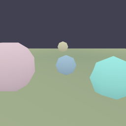

# Rasterization: reference implementations

The same rasterization algorithm three times, with no card and no framework: numpy
(`ref/raster.py`, the definition of correct), threaded C++ for the host CPU
(`cpu/`) and CUDA for one GPU (`gpu/`). The card versions are compared with these:
they use the same scenes ([`ref/scenes.py`](../../../ref/README.md)) and must produce the
same images.

 

*Colour image of the tiny scene (398 triangles) and the 10^4 scene (11,994 triangles),
256 x 256 (the images are 1024 x 1024).*

## The algorithm

Opaque triangles, depth-tested, 1024 x 1024 pixels, tiles of 32 x 32 pixels (a 32 x 32
grid of tiles), float32 arithmetic in the order written in `ref/raster.py`, no fused
multiply-add.

1. **Setup**, one triangle at a time (no triangle depends on another). The three
   vertices are projected with the camera (a triangle with a vertex nearer than the near
   distance is dropped; there is no clipping). The triangle is turned to positive
   orientation by swapping two vertices, a zero-area triangle is dropped, and the
   record is built: three edge functions `a x + b y + c`, the planes of `1/z` and of the
   three colour channels (linear in screen space, no perspective correction), the box of
   pixel centres it can cover (empty box: dropped), and which edges are top or left.
2. **Binning.** A triangle goes to every tile its pixel box touches, in triangle order.
   The sizes of the tile lists are an output.
3. **Fill**, one tile at a time. A pixel centre `(x + 0.5, y + 0.5)` is inside when
   all three edge values are `> 0`, or `== 0` on a top or left edge (the top-left fill
   rule: the edge of a shared diagonal belongs to exactly one of its two triangles). The
   fragment with the larger `1/z` wins; an exact tie goes to the lower triangle index, so
   the result does not depend on the order of the list. Empty pixels keep the background
   colour and depth 0.

Outputs of every implementation (the arrays the comparison reads): `colour`
(1024, 1024, 3) float32, `depth` (the stored `1/z`; 0 where empty) (1024, 1024) float32,
`tri` (the index of the visible triangle, -1 where empty) (1024, 1024) int32 and
`tile_counts` (the list sizes) (32, 32) int32.

| | numpy | C++ | CUDA |
|---|---|---|---|
| source | `ref/raster.py` | `cpu/raster_cpu.cpp` | `gpu/raster_gpu.cu` |
| setup | all triangles as arrays | threads over chunks of 256 triangles | one thread per triangle |
| binning | sort of (tile, triangle) pairs | per-thread counts, prefix sum, scatter in order | atomic counts, one block scans, atomic scatter |
| fill | tile by tile, 128 triangles at a time as arrays | threads over tiles, largest list first | one block of 32 x 8 threads per tile, tiles sorted by list size, 64 records in shared memory at a time |

The C++ and CUDA versions share the setup and the pixel test (`raster_core.hpp`), so
they cannot drift apart; numpy is written separately.

## Running

```bash
python -m pip install -e ".[dev]"          # numpy, pytest, ruff, black
export KR_DATA=<folder for scenes and outputs>    # default: build/data
python -m ref.scenes $KR_DATA                      # the four scenes as .npz
python -m projects.raster.reference.agree          # numpy vs C++ vs CUDA
python -m projects.raster.reference.bench          # the timing table
python -m projects.raster.reference.pictures --out <folder>
```

Binaries are built on first use into `build/` (`KR_BUILD_DIR`) with `g++` (or `$CXX`) and
`nvcc` (`$NVCC`, `$CUDA_HOME` or `/usr/local/cuda`; `KR_CUDA_ARCH`, default `sm_70`). The
GPU runs use a GPU with no process on it, found with `nvidia-smi`; both the CUDA tests
and the CUDA rows are skipped when there is none.

## Agreement

All three implementations produce the same arrays bit for bit, on all four scenes
(numpy against C++ with 96 threads, and C++ against the CUDA version), including the
tile list sizes:

| scene | triangles | differing pixels (`tri`, `depth`, `colour`) | tile list sizes |
|---|---|---|---|
| tiny | 398 | 0 / 0 / 0 | equal |
| 10^4 | 11,994 | 0 / 0 / 0 | equal |
| 10^5 | 102,308 | 0 / 0 / 0 | equal |
| 10^6 | 997,806 | 0 / 0 / 0 | equal |

Why exact: every operation is a float32 add, subtract, multiply, divide or compare in a
fixed order (no fused multiply-add: `-ffp-contract=off`, `--fmad=false`), all
IEEE-exact, and the winner of a pixel does not depend on the order fragments arrive in.
`agree.py` reports, for any difference, how many pixels differ in each array, how many of
those lie on a triangle edge (a pixel whose 3 x 3 neighbourhood holds more than one
triangle) and the colour and depth errors. The tests (`tests/core/test_ref_raster*.py`)
check the fill rule on hand-made triangles (shared diagonal, top, bottom, left and right
edges, a rectangle cut into random triangles covered exactly once), depth order, ties,
culling, and run the C++ and CUDA versions on hand-made and generated scenes against
numpy; changing `>` to `>=` in the pixel test makes six of them fail.

A card implementation will not be bit-exact if it uses another order of operations;
compare coverage and depth per pixel and count the differing pixels, which sit on
triangle edges.

## Timings

What is timed, per repetition: **setup** (all triangles), **binning** (counts, offsets,
lists, and for CUDA the read-back of the list size), **fill** (clearing the tile,
the triangle loop and writing the 1024 x 1024 colour, depth and index images). Not
timed: loading the scene, copying the mesh to the GPU, copying the images back.
CPU: `std::thread` pool, wall-clock time. GPU: CUDA events on the default stream, one
Tesla V100 32 GB (device name `Tesla PG503-216`, compute capability 7.0; one of four, idle when used). Each cell: median over 3 processes x 3
repetitions after one untimed warm-up repetition per process; min and max in brackets.
Times in milliseconds. The host is a shared 96-thread AMD EPYC 7K62 (48 cores, SMT); the
load average (`/proc/loadavg`, 1 / 5 / 15 minutes) was 4.6 to 9.7 for the first
number during these runs, with no other CUDA process on the GPUs. The all-thread CPU
numbers have the widest spread.

| scene | implementation | setup | binning | fill | total |
|---|---|---|---|---|---|
| tiny | C++ 1 thread | 0.03 (0.03-0.03) | 0.02 (0.02-0.02) | 10.85 (10.80-10.88) | 10.90 (10.85-10.93) |
| tiny | C++ 96 threads | 0.31 (0.26-0.82) | 1.08 (0.94-2.69) | 1.25 (1.11-1.41) | 2.65 (2.54-4.70) |
| tiny | V100 | 0.07 (0.07-0.08) | 0.17 (0.16-0.17) | 0.06 (0.06-0.06) | 0.30 (0.29-0.31) |
| 10^4 | C++ 1 thread | 0.87 (0.87-0.88) | 0.16 (0.16-0.17) | 15.44 (15.40-15.58) | 16.48 (16.43-16.61) |
| 10^4 | C++ 96 threads | 0.44 (0.30-0.90) | 1.04 (0.89-1.66) | 1.38 (1.12-1.72) | 2.90 (2.46-3.78) |
| 10^4 | V100 | 0.03 (0.03-0.04) | 0.05 (0.05-0.06) | 0.16 (0.16-0.16) | 0.25 (0.25-0.26) |
| 10^5 | C++ 1 thread | 7.16 (7.15-7.17) | 1.20 (1.20-1.23) | 27.63 (27.51-27.90) | 35.99 (35.88-36.30) |
| 10^5 | C++ 96 threads | 0.88 (0.78-1.24) | 1.14 (1.05-1.63) | 1.85 (1.56-1.95) | 3.86 (3.52-4.76) |
| 10^5 | V100 | 0.13 (0.13-0.14) | 0.09 (0.08-0.09) | 0.66 (0.66-0.66) | 0.88 (0.87-0.89) |
| 10^6 | C++ 1 thread | 67.06 (67.02-68.84) | 15.11 (14.98-15.22) | 69.46 (69.30-70.08) | 151.70 (151.41-153.19) |
| 10^6 | C++ 96 threads | 5.00 (4.06-5.50) | 4.52 (4.15-10.55) | 3.39 (2.79-7.68) | 13.21 (10.99-22.73) |
| 10^6 | V100 | 0.88 (0.87-0.89) | 0.31 (0.30-0.31) | 3.89 (3.87-3.89) | 5.07 (5.05-5.09) |

Reading the table: at the three smaller sizes the 1-thread fill time is mostly
clearing and writing the output images (about 10 ms for 1024 x 1024 pixels on one core;
the tiny scene has almost no triangle work), so the CPU time grows little from tiny to
10^4. At 10^6 triangles setup (67 ms) is as large as the fill (69 ms) and binning
adds 15 ms; most of the 10^6 triangles are smaller than a pixel (5.5 % of them are
visible), so the tile lists are short but there are many entries (626,033, the
largest list has 8,780 triangles). No widely used software rasterizer was installed
for context: OpenGL needs a driver stack that the host's compute GPUs do not offer.

## Scenes and the work they make

| scene | triangles | after setup | list entries | largest list | non-empty tiles of 1024 | covered pixels |
|---|---|---|---|---|---|---|
| tiny | 398 | 289 | 4,047 | 28 | 664 | 62.8 % |
| 10^4 | 11,994 | 7,534 | 17,121 | 232 | 672 | 63.8 % |
| 10^5 | 102,308 | 67,219 | 92,778 | 1,302 | 709 | 66.9 % |
| 10^6 | 997,806 | 549,341 | 626,033 | 8,780 | 754 | 71.2 % |

About a third of the screen is empty sky (empty tiles), a few large near spheres give
tiles with thousands of small triangles, and the ground gives a gradient of
triangle size with distance.
