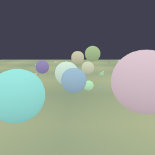

# Rasterization: reference implementations

The same rasterization algorithm three times, with no card and no framework: numpy
(`reference/raster.py`, the definition of correct), threaded C++ for the host CPU
(`cpu/`) and CUDA for one GPU (`gpu/`). The card versions are compared with these:
they use the same scenes ([`reference/scenes.py`](../../../reference/README.md)) and must produce the
same images.

 

*Colour image of the tiny scene (398 triangles) and the 10^4 scene (11,994 triangles),
256 x 256 (the images are 1024 x 1024).*

## The algorithm

Opaque triangles, depth-tested, 1024 x 1024 pixels, tiles of 32 x 32 pixels (a 32 x 32
grid of tiles), float32 arithmetic in the order written in `reference/raster.py`, no fused
multiply-add.

1. **Setup**, one triangle at a time (no triangle depends on another). The three
   vertices are taken into camera space (`x`, `y`, `z` along right, up, forward). A
   triangle with no vertex beyond the near distance `n` (`z > n`) is dropped; one with
   all three beyond is kept whole; any other is **clipped** at the plane `z = n`: its
   edges are walked in order (0-1, 1-2, 2-0), each vertex beyond the plane is kept and
   each edge that crosses the plane adds the point where it crosses, computed from the
   vertex beyond (`a`) toward the other (`b`) as `s = (n - z_a) / (z_b - z_a)`,
   `x = x_a + s (x_b - x_a)`, `y` likewise, `z = n`, colour `c_a + s (c_b - c_a)`
   (float32, in this order). The 3 or 4 points give one triangle or two (0, 1, 2 and
   0, 2, 3), each with the original triangle's index; they go through the rest of the
   setup like whole triangles, so up to two records come from one triangle. Every
   point is then projected (`1/z`, screen `x` and `y`). Each triangle is turned to
   positive orientation by swapping two vertices, a zero-area triangle is dropped, and
   the record is built: three edge functions `a x + b y + c`, the planes of `1/z` and of the
   three colour channels (linear in screen space, no perspective correction), the box of
   pixel centres it can cover (empty box: dropped), and which edges are top or left.
2. **Binning.** A triangle goes to every tile its pixel box touches, in triangle order.
   The sizes of the tile lists are an output.
3. **Fill**, one tile at a time. A pixel centre `(x + 0.5, y + 0.5)` is inside when
   all three edge values are `> 0`, or `== 0` on a top or left edge (the top-left fill
   rule: the edge of a shared diagonal belongs to exactly one of its two triangles). The
   fragment with the larger `1/z` wins; an exact tie goes to the lower triangle index, so
   the result does not depend on the order of the list. Empty pixels keep the background
   colour and depth 0.

Outputs of every implementation (the arrays the comparison reads): `colour`
(1024, 1024, 3) float32, `depth` (the stored `1/z`; 0 where empty) (1024, 1024) float32,
`tri` (the index of the visible triangle, -1 where empty) (1024, 1024) int32 and
`tile_counts` (the list sizes) (32, 32) int32.

| | numpy | C++ | CUDA |
|---|---|---|---|
| source | `reference/raster.py` | `cpu/raster_cpu.cpp` | `gpu/raster_gpu.cu` |
| setup | all triangles as arrays | threads over chunks of 256 triangles | one thread per triangle |
| binning | sort of (tile, triangle) pairs | per-thread counts, prefix sum, scatter in order | atomic counts, one block scans, atomic scatter |
| fill | tile by tile, 128 triangles at a time as arrays | threads over tiles, largest list first | one block of 32 x 8 threads per tile, tiles sorted by list size, 64 records in shared memory at a time |

The C++ and CUDA versions share the setup and the pixel test (`raster_core.hpp`), so
they cannot drift apart; numpy is written separately.

## Running

```bash
python -m pip install -e ".[dev]"          # numpy, pytest, ruff, black
export KR_DATA=<folder for scenes and outputs>    # default: build/data
python -m reference.scenes $KR_DATA                      # the four scenes as .npz
python -m projects.raster.reference.agree          # numpy vs C++ vs CUDA (--fresh: rerun)
python -m projects.raster.reference.bench          # timings and power
python -m projects.raster.reference.pictures --out ${KR_DATA:-build/data}/pictures
```

## Result files and other implementations

Each implementation leaves, per scene, `<folder>/<scene>.npz` and `<folder>/<scene>.json`
(a folder per implementation; the three here write theirs under
`$KR_DATA/results/raster/`). `agree.py`, `pictures.py` and `bench.py` take
`--external DIR ...`: every sub-folder of DIR that holds files for the scene is added as
another implementation, so a card version only has to drop its files into a folder and
appears in the comparison, as a column of pictures and as a row of the table.

| array in `<scene>.npz` | shape, type | content |
|---|---|---|
| `colour` | (1024, 1024, 3) float32 | linear colour, background 0.05, 0.05, 0.08 |
| `depth` | (1024, 1024) float32 | the stored 1/z of the visible fragment, 0 where empty |
| `tile_counts` | (32, 32) int32 | triangles in each tile's list, row-major by tile row |
| `tri` (optional) | (1024, 1024) int32 | visible triangle index, -1 where empty |

`<scene>.json`: `{"name": ..., "scene": ..., "seconds_per_frame": ...,
"timings_ms": {"setup_ms": ..., "bin_ms": ..., "fill_ms": ..., "total_ms": ...},
"power": {"gpu_idle_w": ..., "gpu_mean_w": ..., "gpu_peak_w": ...,
"gpu_joules_per_frame": ..., "cpu_package_joules_per_frame": ...}}`. Only `name` and
`scene` are required; the stage times are what the picture page and table show. Scene
names are `tiny`, `s10k`, `s100k`, `s1m` (the scene files are generated by
`python -m reference.scenes`; the checksums are in `tests/core/ref/test_ref_scenes.py`).
Differences are counted over `colour`, `depth` and, when both have it, `tri`.

Binaries are built on first use into `build/` (`KR_BUILD_DIR`) with `g++` (or `$CXX`) and
`nvcc` (`$NVCC`, `$CUDA_HOME` or `/usr/local/cuda`; `KR_CUDA_ARCH`, default `sm_70`). The
GPU runs use a GPU with no process on it, found with `nvidia-smi`; both the CUDA tests
and the CUDA rows are skipped when there is none.

## Agreement

All three implementations produce the same arrays bit for bit, on all four scenes
(numpy against C++ with 96 threads, and C++ against the CUDA version), including the
tile list sizes:

| scene | triangles | differing pixels (`tri`, `depth`, `colour`) | tile list sizes |
|---|---|---|---|
| tiny | 398 | 0 / 0 / 0 | equal |
| 10^4 | 11,994 | 0 / 0 / 0 | equal |
| 10^5 | 102,308 | 0 / 0 / 0 | equal |
| 10^6 | 997,806 | 0 / 0 / 0 | equal |

Why exact: every operation is a float32 add, subtract, multiply, divide or compare in a
fixed order (no fused multiply-add: `-ffp-contract=off`, `--fmad=false`), all
IEEE-exact, and the winner of a pixel does not depend on the order fragments arrive in.
`agree.py` reports, for any difference, how many pixels differ in each array, how many
of those lie on a triangle edge (a pixel whose 3 x 3 neighbourhood holds more than one
triangle) and the colour and depth errors. The tests (`tests/core/ref/test_ref_raster*.py`,
`tests/ref/test_ref_raster_*.py`) check the fill rule on hand-made triangles (shared
diagonal, top, bottom, left and right edges, a rectangle cut into random triangles
covered exactly once), depth order, ties, culling, and run the C++ and CUDA versions on
hand-made and generated scenes against numpy; changing `>` to `>=` in the pixel test
makes six of them fail.

A card implementation will not be bit-exact if it uses another order of operations;
compare coverage and depth per pixel and count the differing pixels, which sit on
triangle edges.

## Timings and power

What is timed, per repetition: **setup** (all triangles), **binning** (counts, offsets,
lists, and for CUDA the read-back of the list size), **fill** (clearing the tile, the
triangle loop and writing the 1024 x 1024 colour, depth and index images). Not timed:
loading the scene, copying the mesh to the GPU, copying the images back. CPU: `std::thread`
pool, wall-clock time. GPU: CUDA events on the default stream, one Tesla V100 32 GB
(device name `Tesla PG503-216`, compute capability 7.0; one of four, idle when used).
Stage cells: median over 3 processes x 3 repetitions after one untimed warm-up
repetition per process, min and max in brackets, milliseconds.

"ms per frame" and the power columns come from one more run of at least 3 seconds per
row: wall time of the loop over frames divided by the number of frames. The GPU's draw is
`nvidia-smi` `power.draw` of the one GPU, sampled every 100 ms inside the loop (idle: the
second before the process started; mean and peak over the loop); joules per frame is the
mean draw times the seconds per frame. Only the GPU's own board power is included, not
the host CPU that drives it. The CPU package energy counter (RAPL) of this host is not
readable without root, so CPU joules are **not available** here (`bench.py` records them
when the host allows it). The host is a shared 96-thread AMD EPYC 7K62 (48 cores, SMT);
the first load average (`/proc/loadavg`) was between 6.6 and 12.4 during these runs, with
no other CUDA process on the GPUs; the per-process loads are in the JSON that
`bench.py --json` writes. The all-thread CPU numbers have the widest spread.

| scene | implementation | setup | binning | fill | total | ms per frame | GPU W idle / mean / peak | GPU J per frame |
|---|---|---|---|---|---|---|---|---|
| tiny | C++ 1 thread | 0.03 (0.03-0.03) | 0.02 (0.02-0.02) | 11.12 (11.04-11.22) | 11.17 (11.09-11.28) | 11.21 | n/a | n/a |
| tiny | C++ 96 threads | 0.25 (0.22-0.34) | 0.89 (0.85-1.21) | 1.01 (0.92-1.07) | 2.19 (2.01-2.43) | 2.66 | n/a | n/a |
| tiny | V100 | 0.07 (0.07-0.08) | 0.17 (0.16-0.17) | 0.06 (0.06-0.06) | 0.30 (0.29-0.31) | 0.29 | 55 / 89 / 91 | 0.026 |
| 10^4 | C++ 1 thread | 0.87 (0.86-1.37) | 0.17 (0.16-0.25) | 15.65 (15.59-16.03) | 16.68 (16.63-17.66) | 16.79 | n/a | n/a |
| 10^4 | C++ 96 threads | 0.33 (0.30-0.48) | 1.16 (0.90-1.57) | 1.42 (1.13-1.47) | 2.91 (2.48-3.36) | 3.32 | n/a | n/a |
| 10^4 | V100 | 0.03 (0.03-0.04) | 0.05 (0.05-0.06) | 0.16 (0.14-0.16) | 0.25 (0.22-0.26) | 0.25 | 57 / 112 / 114 | 0.028 |
| 10^5 | C++ 1 thread | 7.16 (7.15-7.21) | 1.23 (1.21-1.74) | 27.87 (27.80-31.14) | 36.26 (36.17-40.04) | 39.90 | n/a | n/a |
| 10^5 | C++ 96 threads | 0.92 (0.81-1.11) | 1.22 (1.11-1.32) | 1.90 (1.78-2.36) | 3.98 (3.76-4.77) | 4.08 | n/a | n/a |
| 10^5 | V100 | 0.12 (0.11-0.12) | 0.08 (0.07-0.08) | 0.57 (0.57-0.57) | 0.76 (0.75-0.78) | 0.79 | 65 / 110 / 114 | 0.087 |
| 10^6 | C++ 1 thread | 67.03 (66.89-68.86) | 15.10 (15.06-15.47) | 69.86 (69.70-70.63) | 152.32 (151.79-153.73) | 152.78 | n/a | n/a |
| 10^6 | C++ 96 threads | 4.86 (4.43-6.43) | 5.09 (4.69-7.07) | 3.06 (2.85-5.56) | 12.99 (11.99-18.25) | 17.87 | n/a | n/a |
| 10^6 | V100 | 0.77 (0.75-0.88) | 0.27 (0.27-0.32) | 3.34 (3.32-3.89) | 4.37 (4.35-5.09) | 4.42 | 55 / 110 / 115 | 0.484 |

Reading the table: at the three smaller sizes the 1-thread fill time is mostly
clearing and writing the output images (about 10 ms for 1024 x 1024 pixels on one core;
the tiny scene has almost no triangle work), so the CPU time grows little from tiny to
10^4. At 10^6 triangles setup (67 ms) is as large as the fill (70 ms) and binning
adds 15 ms; most of the 10^6 triangles are smaller than a pixel (5.5 % of them are
visible), so the tile lists are short but there are many entries (626,033, the
largest list has 8,780 triangles). No widely used software rasterizer was installed
for context: OpenGL needs a driver stack that the host's compute GPUs do not offer.

## Scenes and the work they make

| scene | triangles | after setup | list entries | largest list | non-empty tiles of 1024 | covered pixels |
|---|---|---|---|---|---|---|
| tiny | 398 | 289 | 4,047 | 28 | 664 | 62.8 % |
| 10^4 | 11,994 | 7,534 | 17,121 | 232 | 672 | 63.8 % |
| 10^5 | 102,308 | 67,219 | 92,778 | 1,302 | 709 | 66.9 % |
| 10^6 | 997,806 | 549,341 | 626,033 | 8,780 | 754 | 71.2 % |

About a third of the screen is empty sky (empty tiles), a few large near spheres give
tiles with thousands of small triangles, and the ground gives a gradient of
triangle size with distance.

## Shading: materials and textures (SHADE)

On the scenes with a materials file (Sponza and the two Bistro scenes,
[SCENES.md](../../../reference/SCENES.md)) the frame is coloured from each pixel's
material instead of the vertex colours: a stage SHADE after FILL, defined by
`rasterize_shaded` in `reference/raster.py` and matched by the C++ version
(`raster_cpu --materials DIR`, the shared parts in `raster_core.hpp`). The CUDA version
has no SHADE.

1. **Two FILLs.** FILL runs once over the triangles whose material is not `masked` and
   once over those that are (the other set's triangles are collapsed to a point, so
   setup drops them and the rest keep their numbers), into two sets of planes. A pixel
   takes the masked layer where its fragment is nearer (the fill's own rule: larger
   1/z, a tie to the lower triangle number) and not a hole, otherwise the other
   layer. There is one masked layer: a hole shows the nearest surface that is not
   masked, never a second masked one behind it.
2. **Setup, per triangle.** Its first piece that setup keeps (the clip of the fill's
   setup, with the corners' u, v and light term cut along with the colour) gives the
   planes of u/z, v/z and light/z over the screen, built from the record's edge
   functions like the colour planes. For each of the material's textures one mip
   level: with the piece's doubled area `A` in pixels and `T` in level-0 texels,
   the number of `k = 1 .. levels - 1` with `T > A 2^(2k - 1)` (the level at which a
   pixel is nearest to one texel). For `lit`, one tangent frame: the normal of its
   positions turned toward the eye, the tangent along +u from its positions and
   coordinates (made orthogonal to the normal), the bitangent their cross product,
   turned toward +v.
3. **Per pixel**, from the winner's triangle number and the 1/z FILL wrote: u, v and
   the light term are the planes divided by that 1/z (perspective-correct); the texel
   is the nearest one, coordinates wrapping, row 0 at v = 1. An albedo byte becomes
   linear colour by the pictures' 2.2 gamma; the other textures' bytes are read as
   `b / 255` (normals `2 b / 255 - 1`).

| kind | colour of a pixel |
|---|---|
| `flat` | FILL's vertex colour |
| `textured` | albedo x base colour x light term |
| `masked` | as `textured`; a hole where the mask's alpha byte (or the albedo's) is under 128 |
| `lit` | albedo x base colour x (0.25 + 0.75 max(0, n . l)) + specular colour x (specular texel) x max(0, n . h)^exponent, n the normal map's normal in the frame, l toward the scene's point light, h the half vector |
| `emissive` | albedo x base colour, unlit |
| `transparent` | a third layer over the others ("Glass" below): `tau C + (1 - max tau)` x albedo x base colour x light term, `C` the colour behind, `tau` the transmission |

Everything is float32 in the order written (the power by squaring, low bit first),
so the two versions agree bit for bit. Not part of it: bilinear filtering, a level per
pixel and shadows. The C++ version has no `transparent` kind (below, "Glass"). With one level a triangle and a box-filtered mask, leaves
far from the camera fall below the threshold at the coarser levels and thin out.

What SHADE needs beyond the fill's 128-byte record, per triangle: the three planes
of u/z, v/z and light/z (nine floats), a level per texture, the material number and,
for `lit`, the frame (nine floats). The reference computes them from the scene and the
materials file; the record is unchanged.

```bash
python -m reference.public fetch sponza         # once: the public scene, into KR_DATA
python -m reference.public materials            # once: <scene>_materials.npz
python -m projects.raster.reference.shade agree          # numpy against C++, every view
python -m projects.raster.reference.shade pictures --out ${KR_DATA:-build/data}/pictures
python -m projects.raster.reference.shade stats --out ${KR_DATA:-build/data}/pictures
```

`agree` (results under `$KR_DATA/results/raster_shaded/`) on all six views (2026-11-14):
0 differing pixels in `tri`, `depth` and `colour`, tile list sizes equal. `pictures`
writes each view's vertex colours beside its shaded frame; `stats` the numbers a shading
pass on the cores is sized by: the kinds, materials and winners per 32 x 32 tile, the
kinds each of 120 cores meets with the fill's partition of the tiles, the texture pages
(32 x 32 texels of one level) a tile reads, and the hit rate of a page cache per core.

## Lighting

`rasterize_lighted(scene, materials, lights)` in `reference/raster.py` is SHADE with
direct light in place of the fixed per-vertex shade and the `lit` kind's hand-placed
light: a sun, a sky and point lights at the scene's lamps. It is defined in numpy
only: the C++ and CUDA versions do not have it. Every rule is per-pixel arithmetic, a
lookup in a table or a texel fetch, so a per-tile kernel can follow it; no ray is
traced per pixel. The lights and their precomputed data are in `reference/lights.py`,
the per-scene numbers in the `lighting` entry of `reference/public_scenes.json`
([SCENES.md](../../../reference/SCENES.md)).

```bash
python -m reference.public lighting sponza      # map, visibility bake, lamps, shadow map
```

writes `$KR_DATA/public/<scene>_lighting.npz`; the visibility bake is also kept in
`<scene>_visibility.npz` beside the materials file and reused unless `--rebake`.

1. **Environment.** One HDR environment map per scene (Poly Haven, CC0, the
   `environments` table), turned about the up axis (y) by the scene's `turn` (the
   sun's azimuth changes it: "Moving the sun" below). The
   sun is the brightest small region: the luminance-weighted centre of the excess
   over its surroundings inside 4 degrees of the brightest texel; its colour is that
   excess (luminance 1). The sky is the map with that cone replaced by the mean of
   the ring from 4 to 8 degrees, projected to 9 spherical-harmonic coefficients per
   colour; its irradiance on a normal is the quadratic form of Ramamoorthi and
   Hanrahan (2001), clamped at 0. The sun's irradiance facing it is `sun_to_sky`
   times the sky's irradiance on a horizontal surface (its luminance), in the sun's
   colour. `lights.environment` recomputes these from the file. When the entry has an
   authored `sun` (the direction it shines along, its colour), the sun's direction
   and colour are those; the map is turned about y so its own sun's azimuth equals
   the authored one (`turn` is computed) and the sky still comes from the map with its
   sun removed.
2. **Sky visibility**, baked per vertex: the share of 64 cosine-weighted rays (fixed
   directions per vertex from the hash of `vertex x 64 + ray`) from the vertex, moved
   the scene's `eps` along its area-weighted normal, that leave the scene without a
   hit, traced with the reference ray tracer (`raytrace.trace`, any hit). It takes
   the place of the light term at the corners, so the `light/z` plane interpolates it.
3. **Sun shadow.** The 1/z at `shadow_side` x `shadow_side` (the entry's, default
   2,048, saved with the map) from a camera 1000 scene radii away along the sun's
   direction, aimed at the centre of the scene's box, its frame covering the box
   (`sun_camera(..., side)`: focal and principal point scale with the side). A side of
   2,048 is four renders at FILL's 1,024 x 1,024: quadrant (i, j) uses that camera with
   its principal point moved by (-1024 i, -1024 j) (`quadrant_camera`), so its pixel
   (x, y) is texel (x + 1024 i, y + 1024 j). Each render has SHADE's two FILLs and holes: a texel takes the masked layer's 1/z where
   it is nearer and not a hole, else the other layer's, so plants and chains cast the
   shadow of their leaves, not of their quads. A pixel's point, moved along its
   lighting normal `n` (step 5: the normal map's where there is one, else the
   triangle's turned toward the eye) by one shadow texel's world size, is
   shadowed at a texel when its 1/z in that camera is below the texel's by more than
   the bias (`shadow_bias` texels at the camera's distance); texels outside the map
   are lit. The sun's share is the 2 x 2 percentage-closer filter: the comparisons at
   the four nearest texels, weighted bilinearly. One tap (the nearest texel,
   `pcf=False`) left sawtooth edges where the sun grazes a surface.
4. **Point lights.** Emissive triangles connected through shared vertices form
   groups; groups whose centroids are nearer than `merge_distance` are merged. A lamp
   is a point light at its area-weighted centroid, its colour the area-weighted
   emission colour (base colour x the emission texture's 1 x 1 level, scaled to a
   largest channel of 1), its intensity
   `lamp_scale` x its area. Irradiance at distance `d` on normal `n` toward `l`:
   `I max(0, n.l) / (d^2 + s^2) (1 - (d/r)^4)^2` for `d < r`, 0 from `r` on
   (`radius`, `size`). No shadows from point lights.
   When the scene's entry has a list `lights` (authored point lights: position,
   colour), the lamps are those instead, each of intensity `lamp_scale`; the emissive
   groups are used only when `lights` is absent (an empty list: no lamps).
5. **A pixel.** `a` = albedo x base colour as SHADE has it (`flat`: the base colour).
   The normal is the normal map's in the triangle's frame where the material has one
   and the frame is valid, else the triangle's normal turned toward the eye.
   `E = sky(n) x visibility + ambient + sun x max(0, n.s) x shadow + the lamps`;
   colour `= a / pi x E +` the `lit` kind's Blinn-Phong term once for the sun and
   once per lamp, each times that light's irradiance (with `n.l` and the shadow) over
   pi, only for `lit` materials with a specular colour. `emissive`: `a x
   emissive_scale`, unlit; `masked`: holes as SHADE. Background: the nearest texel of
   the octahedral map (below) in the pixel's view direction turned by `-turn` about y,
   `(x, z) -> (c x + s z, c z - s x)` with `c, s` the float32 cosine and sine of
   `-turn` (y kept). The frame is the tone step of the colour (`raster.tone`, below),
   then the pictures' 8-bit conversion (`png.to_srgb8`, the 2.2 gamma).
6. **Octahedral map.** `prepare` resamples the environment once into a side x side
   (the entry's `sky_side`, default 2,048; a reader takes it from the map's shape)
   float32 RGB map of directions in the environment's own frame (turn 0, y up), saved
   in the lighting file as `octahedral`, so the background needs no trigonometry per
   pixel and a new `turn` changes a number, never the map. A direction
   `d = (x, y, z)` (need not be unit) goes to `u = x / (|x| + |y| + |z|)`,
   `v = z / (|x| + |y| + |z|)`; when `y < 0` these are folded to
   `(u, v) = ((1 - |v|) sign u, (1 - |u|) sign v)` (both from the unfolded values,
   sign 0 counted as +). Its texel is column `floor((u + 1) / 2 x side)`, row
   `floor((v + 1) / 2 x side)`, each clamped to `side - 1`. The inverse, used to fill
   the map at texel centres `u, v = (i + 0.5) / side x 2 - 1`: `y = 1 - |u| - |v|`; when
   `y < 0`, `(u, v)` unfolded by the same rule; the direction is `(u, y, v)`
   normalized, whose nearest texel of the equirectangular map is taken. The sun and
   sky still come from the equirectangular file. The map is 2,048 and the files 4k
   (4096 x 2048) because a frame's pixel at 75 degrees over 1,024 pixels is 0.07
   degrees, a 512 texel about 0.4 and a 1k file's 0.35: the sky was blocky; a 2,048
   texel is about 0.1 and a 4k file's 0.09. (Before the movable sun the map
   was resampled turned and looked up unturned. On the Bistro exterior's own view the
   change moved 15,536 of its 24,108 background pixels, by 7.2 of 255 on average and
   95 at most, from nearest-texel resampling on a differently turned grid; against a
   direct lookup of the file the mean error went from 5.9 to 5.2. No surface pixel
   changed. Sponza and the interior, turn 0, are unchanged.)

**The tone step.** `display = curve(saturate(exposure x colour))` with three numbers a
frame, from the scene's `lighting` entry (`lights.load` returns them; a caller may
override them in the lights): `exposure`; `saturation` `s` (default 1), which makes
`x` into `max(0, lum + (x - lum) s)`, `lum = (0.2126 R + 0.7152 G) + 0.0722 B`, and
is skipped when `s = 1`; `curve` (default 0): 0 is `x / (1 + x)`, 1 the filmic fit
`x (2.51 x + 0.03) / (x (2.43 x + 0.59) + 0.14)` clamped to [0, 1]. All float32 in
that order. The 8-bit conversion is the same for both curves. With the defaults every
frame is the earlier one bit for bit. A host test on the frames with indirect light
(2026-11-23) found the filmic curve at exposure 2 to 3 with saturation about 1.15 less
dull; no scene's entry sets these yet, so the defaults stand.

**Moving the sun.** `lights.moved(lights, scene, materials, azimuth, elevation)` takes
the prepared lights (`lights.load`), the scene's mesh and materials, and two angles in
degrees, and returns the lights of a sun at that place without baking visibility again.
The angles are those of the direction toward the sun (`lights.sun_angles`): azimuth 0
at +x, 90 at -z (a right-handed turn about +y, the sense of `turned`), elevation
`atan2(y, sqrt(x^2 + z^2))` above the horizontal plane; the direction is
`(cos e cos a, sin e, -cos e sin a)`. The scenes' own suns: Sponza azimuth 144.08,
elevation 74.53; Bistro exterior azimuth -90, elevation 61.18 (the authored sun).

- **Azimuth** turns the environment with the sun: `turn` grows by the change of
  azimuth, so the map's own sun keeps the sun's azimuth. The sky's 9 coefficients per
  colour are rotated about y (`sh_turned`: the 9 x 9 matrix taking the basis to the
  basis at turned directions, fitted on 128 directions, exact since each band is closed
  under rotation); they agree with projecting the turned map again to float32 rounding
  (under 6e-8). The background follows through `turn` (step 5). The sky's irradiance on
  a horizontal surface does not change under a turn about y, so the sun's stays.
- **Elevation** moves the sun alone: the sky and the background do not change, so the
  map's own sun disc stays where the map has it (a known inconsistency: the
  background's sun and the light's sun part when the elevation moves).
- **Both** give a new direction and a new shadow map (`sun_camera`, `shadow_map`, the
  same rules); the bias stays `shadow_bias` texels at the new camera's distance. The
  sun's colour and irradiance do not change. At or below the horizon (elevation <= 0)
  the irradiance is 0 and the shadow map is a 1 x 1 map of 0 (all lit, unused).
- At the scene's own angles `moved` returns the prepared lights: the same direction,
  coefficients, turn and shadow map (Sponza bit for bit; the exterior's direction has
  x = 2.95e-17 for -0 and the same shadow map; Sponza at side 2,048 checked again bit
  for bit). Its time is the shadow map's: about 10 s for Sponza, 43 s for the Bistro
  exterior at side 2,048, 4 s and 17 s at 1,024 (numpy, 8 CPUs).

**Terms.** `rasterize_lighted(..., terms=...)` takes a subset of `sky`, `ambient`,
`sun`, `shadow`, `lamps`, `specular`, `background` (default: all of them, the frame
above). A term left out contributes nothing: without `shadow` the sun is unshadowed,
without `background` an empty pixel has the fill's constant background colour
(0.05, 0.05, 0.08); emissive materials are always drawn. The card's stages are
checked against these subsets.

**Returned arrays.** `colour` (H, W, 3, linear), `display` (the tone step's), `depth` (the merged 1/z)
and `tri` (the visible triangle, -1 empty), and `parts`, each per pixel of the taken
layer: `albedo` (`a`), `normal` (the normal used), `visibility`, `specular`
(specular colour x texel, 0 where the material has none), `material` (-1 empty),
`depth` (the merged 1/z), `layer` (0 the other layer, 1 the masked layer, -1
empty), and the diffuse parts `sky`, `sun` and `points` (`a / pi` x that light's
irradiance; 0 on emissive pixels).

Everything per pixel is float32. Not part of it: shadows from lamps, bounced light
(`ambient` stands in for it; the optional term `indirect` replaces it: "Indirect light").
Visibility per vertex is coarse on large triangles: Sponza's courtyard floor is a few
triangles whose 23 vertices lie under the arcades, so it gets no sky light.
A shadow texel is 2.25 units on Sponza at side 2,048 (4.5 at 1,024); on a wall the sun
grazes (n.s 0.12 to 0.24) it stretches to about 9 to 19 units (19 to 37), so shadow
edges there are still steps. Turning Sponza's sun by 0.01 / 0.05 / 0.2 degrees changes
10.4 / 10.5 / 11.9 % of its default view's surface pixels by more than 8 of 255 at side
2,048, 11.3 / 11.0 / 13.1 % at 1,024; outside the pixels within 2 of a shadow edge in
both frames 2.2 / 1.6 / 2.1 % against 3.1 / 2.2 / 2.7 % (host, 2026-11-23 16:04). The
larger map sharpens the edges but does not settle them: most of the change is at the
edges and in the speckle of the bias's comparisons, which a turn re-rolls.
The quadrants agree with the 2,048 view: a quadrant's 1/z against a float64
evaluation of the triangle's plane on the 2,048 view's texel ray, 3,000 triangles,
median relative error 6.7e-7 (Sponza; 2.9e-6 for the 1,024 map against its own view);
across a quadrant border one triangle's 1/z steps by up to 6e-5 relative (inside a
quadrant one float32 unit), the two renders' own plane rounding, and no seam shows in a
picture of the map.

## Glass

A material whose transmission `tau` (per channel: `1 - Tf`, else `Tr`, else `1 - d`)
is above 0 has the kind `transparent` and keeps `tau` in the materials file
([SCENES.md](../../../reference/SCENES.md), "Materials"). It is drawn as a third layer
over the surface behind it, in numpy only (`rasterize_shaded` and `rasterize_lighted`
in `reference/raster.py`); no ray is traced, every rule is per-pixel arithmetic, a
table lookup or a texel fetch.

1. **Three FILLs.** FILL runs a third time over the transparent triangles only; the
   other two layers do not contain them. The surface behind is the merge of the other
   two (masked where nearer and not a hole, as SHADE). A pixel's glass is the nearest
   transparent triangle there, counted only where it is nearer than that surface (the
   fill's rule: larger 1/z, a tie to the lower triangle number); an empty pixel's
   surface is the background, so glass in front of the sky counts. One transparent
   layer: glass behind glass is not shown.
2. **A pixel with glass in front**, `C` the colour behind (the lit colour before the
   tone curve, or the background's radiance), `a` the glass's albedo x base colour,
   `n` its triangle's normal turned toward the eye (no normal map, also in the smooth
   variant), `v` toward the eye:
   `colour = tau C + (1 - max tau) a / pi E + S + F reflection R`. `E` is the glass's own
   irradiance by the rules of "Lighting" (sky x visibility, ambient, sun with shadow,
   lamps); `S` the `lit` kind's Blinn-Phong term for the sun and each lamp with the
   material's specular colour and exponent (always, when it has a specular colour);
   `R` the environment's radiance along `2 (n.v) n - v` (the octahedral map's nearest
   texel, turned like the background); `F = F0 + (1 - F0)(1 - n.v)^5`, `F0 = 0.04`,
   `n.v` clamped at 0; `reflection` the scene's number of its `lighting` entry. Then
   the tone curve as for every pixel. `rasterize_shaded` (no lighting) uses
   `tau C + (1 - max tau) a light` with its light term and no `S` or `R`; on scenes without
   transparent materials its results are unchanged (no third FILL runs).
3. **Shadows.** Transparent triangles cast none: the shadow map is `rasterize_shaded`'s
   1/z, which is the surface behind the glass. The baked sky visibility is not rebuilt:
   it still treats glass as opaque.
4. **Terms.** `glass` (default on): left out, transparent triangles are not drawn. `R`
   needs `background`; `S` needs `specular`. `parts` gains the glass layer's own planes
   where it is in front: `glass_depth` (1/z, 0 elsewhere), `glass_tri` and
   `glass_material` (-1 elsewhere), `glass_normal` (`n`). The other parts, `depth` and
   `tri` stay those of the surface behind. `rasterize_shaded` also returns the glass
   layer (`glass`) and where it is in front (`front`).

Chosen by the pictures (2026-11-23): `reflection` 0.5 in both Bistro scenes (in the
interior 0.25 left the clear bottles and glasses hard to see, rims only; in the exterior
the panes show the curtains behind them and a faint reflection); Sponza has no
transparent material. Transparent triangles: Bistro interior 220,840 (the bottles,
jars and glasses, the counter's display glass, the cash register's), exterior 3,778 (the
buildings' window panes `MASTER_Glass_Dirty` and `_Clean`, the street lights, a menu
sign). The bottles pass 0.95 to 0.97 (the `_02` bottles 0.8 to 1 by channel), the panes
0.8: the bottles read as clear glass with a faint reflection and highlights in front of
their opaque liquid (`Paris_LiquorBottle_01_Glass_Wine`), the windows as glass with the
rooms' curtains behind. No picture showed a material that should be clearly darker.

| view | pixels with glass in front | `rasterize_lighted` before, after (s) | `rasterize_shaded` before, after (s) |
|---|---:|---:|---:|
| Bistro interior overview | 5,910 | 9.7, 10.2 | 8.5, 8.7 |
| Bistro interior close | 15,416 | 9.2, 9.5 | 7.4, 8.4 |
| Bistro exterior overview | 30,498 | 14.8, 15.9 | 13.8, 15.7 |
| Sponza overview | 0 | 5.6, 5.7 | 4.8, 4.6 |

Numpy, one process pinned to 8 CPUs, 2026-11-23. Outside the glass the lit frames are
unchanged in the interior (the sun's new shadow map differs in 883 of 1,048,576 texels,
none on a visible surface) and in Sponza (bit for bit, both functions); in the exterior
7,942 pixels of the overview change because the sun now passes through the window
panes (1,803 texels of its shadow map). Not represented: refraction, glass behind
glass, coloured shadows (transparent triangles cast none). The C++ version
(`raster_core.hpp`) has no kind 5 yet: on the Bistro scenes `agree` needs it first.
The card has it (the rasterizer's page, "Glass").

## Indirect light

The optional term `indirect` of `rasterize_lighted` (`terms=raster.TERMS +
("indirect",)`; left out by default, so every frame above is unchanged, bit for bit)
replaces `ambient` and `sky x visibility` by the light bounced between surfaces and the
sky with its visibility, from precomputed data. Defined in `reference/indirect.py`, numpy
with one native routine: `native/trace_batch.cpp` traces many rays at once with the
reference tree walk and triangle test (`raytrace_core.hpp`), threaded (at most 8 or
`KR_THREADS`), built by `native.py` as a shared library. Its rays see glass as open (a
tree over the triangles that are not `transparent`); masked triangles are opaque.

```bash
python -m reference.public indirect sponza      # <scene>_indirect.npz and <scene>_transport/
```

1. **Elements.** `elements` points (the `lighting` entry's, default 50,000) sampled by
   area: element k at area `(k + 0.5) A / N` of the cumulative triangle area (glass has
   none), uniform in its triangle from the hash of k (seed 31); each has the triangle's
   normal (its winding), area `A / N`, the triangle's colour (albedo texture at the
   centroid's coordinates in the 16 x 16 level, times the base colour) as albedo, or, for
   `emissive` materials, as emission (albedo 0). Dropped: those whose 32 cosine rays
   (seed 41) from `p + eps n` escape or hit within 10 eps in more than 97 % (they see
   only the void, or are buried), and those whose form-factor row is empty. The kept
   count is padded to a multiple of 32 with zero-area copies and ordered by a cluster
   tree of whole 32-element units (a node of u units cuts its box's longest axis at
   `u // 2` units; leaves of at most 256 elements).
2. **Transport.** `F_ij = V max(0, cos_i) max(0, cos_j) A_j / (pi r^2 + A_j)` (the near
   field clamped as a disc of area `A_j` seen on its axis), `V` one any-hit ray between
   the points moved `eps` along their normals, 0 on the diagonal; built dense once
   (kept in `<scene>_indirect_work/`, from which a stopped build goes on), then stored as
   a hierarchical matrix of `M = pi F`: admissible when the boxes' separation (gap over
   the larger diagonal) is at least 1, zero blocks dropped, low rank where the rank at
   1e-2 of the block's largest singular value stores fewer numbers than the block. The
   files are the card's (`projects/transport`): `<scene>_transport/` with `blocks.npz`,
   `weights.f32`, `x`, `y_exact`, `y_float`, `y_q8`, `perm.npy` and a README of the
   layout. The reference's apply is that hierarchical matrix in float32 (`indirect.apply`,
   the README's loop): `E = M L`.
3. **The sources.** For the current lights each element's outgoing light is
   `L0 = emission x emissive_scale + albedo / pi (sun + lamps + sky)`: the sun with the
   shadow map's lookup as a pixel has it, the lamps without shadows, the sky of item 4.
   The bounce passes: `E1 = M L0`, `E_k = M (albedo / pi E_(k-1))`, `E = E1 + ... +
   E_b`, b = `lights["bounces"]` (the `lighting` entry's `bounces`, default 2; 0 to 3,
   anything else refused). With 0 the field holds only each element's own sky
   irradiance: a frame is direct light only (the sun, the lamps, the sky with its
   visibility). With the default every frame is the earlier one bit for bit.
4. **The sky** by 25 spherical harmonics (bands 0 to 4): each element has a transfer row
   `T_k = pi / 256 sum Y_k(w)` over those of 256 cosine rays (seed 51) from `p + eps n`
   that escape; its sky irradiance is `max(0, T c)`, `c` (25 x 3) the least-squares fit,
   weighted by solid angle, of the basis to the turned octahedral map with its sun's cone
   replaced by the 4 to 8 degree ring's mean (as the 9 coefficients have it), on a
   256 x 512 grid. A turn of the sky changes `c` only. The brief's rule, 32 patches of
   equal solid angle over the upper hemisphere (4 bands x 8 sectors), was measured first
   and did worse (table below): it is not used.
5. **The field.** Voxels of side `h` = the element spacing `sqrt(A / N)`, six directions
   (+-x, +-y, +-z). (voxel, d) = `sum w E / sum w` over the elements within `R = 1.5 h` of
   its centre, `w = max(0, n.d) (1 - (r/R)^2)^2`, a fixed sparse matrix from the elements
   to the (voxel, d) values. A (voxel, d) with no element takes the row of the nearest
   voxel (centre distance at most 2 voxels; ties by offset order) whose d has one, else
   none. What it holds: `E` of item 3 plus the element's own sky irradiance.
6. **A pixel.** With `indirect`, `E = I(P, n) + sun x max(0, n.s) x shadow + lamps`:
   `ambient` and `sky x visibility` are dropped. `I`: at `Q = P + n h / 2` the 8 voxel
   centres around Q with trilinear weights; per axis the direction of `n`'s sign over the
   voxels with data, weights renormalised; `I = sum n_a^2 V_a` over the axes that found
   data, over the sum of their `n_a^2`. Where no voxel has data the pixel takes
   `ambient`. Glass's own `E` uses the same lookup. `parts` gains `indirect`
   (`a / pi I`); `sky` is 0.
7. **Lights.** `lights.load` gives the path of `<scene>_indirect.npz` as
   `lights["indirect"]` when the file exists; without it the term is refused with a
   message naming the command. After `lights.moved` the sources and the field's values
   are recomputed (item 3) on the next frame; no file is rebuilt. `lights["bounces"]`
   (`load`: the entry's, default 2) may be overridden in the dictionary; a new count
   remakes the field's values the same way.

The count (host, one process on 8 CPUs, 2026-11-24 02:53 to 02:56): the field's values
for the lights (`projects/raster/light.field_of`: sources, the passes, the field's
weights, packing; best of 3) and the mean of the frame's `indirect` part (luminance, `a /
pi I`, over the visible pixels of the view's own camera at 1,024 x 1,024):

| bounces | Sponza overview: field s, mean | Bistro interior overview: field s, mean |
|---:|---|---|
| 0 | 0.164, 0.00611 | 0.147, 0.00085 |
| 1 | 0.624, 0.01188 | 0.918, 0.00736 |
| 2 | 1.127, 0.01324 | 1.689, 0.00820 |
| 3 | 1.607, 0.01348 | 2.448, 0.00831 |

Each pass adds one apply of the transport (0.48 s Sponza, 0.77 s Bistro interior). The
first pass adds 0.94 times the sky's part on Sponza and 7.6 times on the Bistro
interior (lit through its windows and by its lamps); the second 0.24 and 0.13 of the
first's, the third 0.18 and 0.13 of the second's (1.8 % and 1.3 % of the total).

`indirect.truth` (not part of `rasterize_lighted`) gathers the truth per pixel: 256
cosine rays about the pixel's normal from its point moved `eps` along the triangle's
normal; an escape adds the sky (the same map, sun removed), a hit its sun (shadow ray),
lamps and emission, then one cosine ray from it adds the sky times its albedo (the first
bounce of every source), its hit's direct light times the albedo, and one more ray the
sky times both albedos (the second bounce).

What it gets wrong (the prototypes' causes, seen again here): the light bounced within
one element spacing is missed: walls next to sunlit ledges and sills, column bases,
arcade back walls and the curtains' lower edges next to the sunlit floor stay dark (blue
in the ratio pictures); the field's average over 1.5 spacings mixes the elements of a
curved surface that face the sky or the sun with those that do not, so arch soffits,
vault strips and capitals are too bright (red); the open floor sees only
the zenith, which 25 coefficients still underestimate (its sky -14 % on the elements).
The frame is about 20 % dark on Sponza. The element sources use the shadow map and the
truth shadow rays.

Built on the host, 8 threads on 8 CPUs, 2026-11-23 22:00 to 22:26 (`counts` in the
file; Bistro's F in two runs of 575 and 101 s, the first stopped by a time limit):

| | Sponza | Bistro interior |
|---|---:|---:|
| sampled / probe dropped / empty rows / kept / N | 50,000 / 10,800 / 2,382 / 36,818 / 36,832 | 50,000 / 6,341 / 1,444 / 42,215 / 42,240 |
| element spacing = voxel side, eps | 50.3, 0.093 | 14.8, 0.049 |
| F with visibility | 334 s, 554.8 M rays | 676 s, about 927 M rays |
| drop, tree, order / hierarchical / transfer / field / checks | 12.9 / 140 / 2.0 / 0.8 / 9.2 s | 16.6 / 276 / 7.9 / 1.0 / 15.5 s |
| blocks: low rank / dense near / admissible dense | 8,406 / 13,024 / 0 | 11,878 / 13,608 / 68 |
| median rank | 14 | 29 |
| tiles (dense / low rank) | 421,426 (265,798 / 155,628) | 774,298 (364,386 / 409,912) |
| `weights.f32`, `<scene>_indirect.npz` | 1,726 MB, 26.4 MB | 3,172 MB, 34.4 MB |
| voxels; directions with elements / filled; weights | 72,367; 184,634 / 110,541; 1.08 M | 83,089; 269,965 / 127,342; 1.50 M |
| float32 apply vs dense: median / p99 / sum ratio | 1.4e-4 / 1.7e-2 / 0.99997 | 1.7e-4 / 1.0e-2 / 1.00000 |
| card numbers emulated (`y_q8`) vs dense | 1.45e-3 / 4.0e-2 / 0.9998 | 8.2e-4 / 3.2e-2 / 0.9997 |
| sources, two applies and field per lights | 1.7 s | 2.5 s |

(element errors over the elements whose exact luminance is above 1e-4.) The sky rules
against gathering the map along the same 256 rays an element (50,000 sampled, the live
ones; luminance; median / p90 / sum ratio over those seeing sky):

| | 32 patches | 9 harmonics | 25 harmonics |
|---|---|---|---|
| Sponza, all seeing sky (6,057) | 0.10 / 0.69 / 1.22 | 0.09 / 0.32 / 1.01 | 0.05 / 0.23 / 1.00 |
| Sponza, open floor (281) | 0.24 / 0.37 / 0.76 | 0.26 / 0.42 / 0.74 | 0.17 / 0.30 / 0.86 |
| Sponza, open floor, sun moved 90 degrees | 0.22 / 0.36 / 0.76 | 0.19 / 0.33 / 0.80 | 0.09 / 0.22 / 0.93 |
| Bistro interior, all seeing sky (26,113) | 0.47 / 2.47 / 1.36 | 0.15 / 0.46 / 1.03 | 0.14 / 0.64 / 1.00 |

The patches count a ray escaping below the horizon in the horizon band; 37 % of the
Bistro's escaping rays go down (its windows), which the upper hemisphere cannot hold
(dropping them: 0.27 / 1.00 / 0.84).

Against the truth (512 x 512, every second pixel of the 1,024 frame, visible and not
emissive; the Bistro's 1,369 pixels with glass in front left out), irradiance
luminance: median / p90 of the relative error over pixels whose truth is above 0.01,
mean |error| over mean truth, ratio of the means; "blurred": both over 5 x 5 pixels
(most of the truth's own noise gone); "today": `ambient + sky x visibility`.
Kinds of place as the prototype: open floor (n_y > 0.9, y -30 to 10, the truth's escape
share > 0.05), sunlit walls (|n_y| < 0.2, sun part > 1e-4), under the arcades (y -50 to
350, not sunlit, escape < 0.03), the upper gallery (y 350 to 1,000, not sunlit, escape
< 0.1).

| view, place | pixels | indirect | indirect, blurred | today |
|---|---:|---|---|---|
| Sponza overview, all | 258,059 | 0.26 / 0.72 / 0.32 / 0.81 | 0.22 / 0.59 / 0.26 / 0.81 | 0.74 / 7.16 / 0.81 / 1.63 |
| open floor | 30,516 | 0.20 / 0.43 / 0.24 / 0.80 | 0.17 / 0.36 / 0.20 / 0.81 | 0.22 / 0.81 / 0.27 / 1.18 |
| sunlit walls | 50,106 | 0.26 / 0.72 / 0.32 / 0.76 | 0.22 / 0.65 / 0.28 / 0.76 | 0.93 / 2.37 / 0.73 / 1.32 |
| under the arcades | 37,044 | 0.23 / 0.76 / 0.29 / 0.94 | 0.15 / 0.54 / 0.18 / 0.93 | 0.62 / 7.66 / 0.94 / 1.81 |
| upper gallery | 111,682 | 0.29 / 0.83 / 0.36 / 0.84 | 0.25 / 0.63 / 0.29 / 0.84 | 1.40 / 11.68 / 1.31 / 2.28 |
| Sponza close, all | 261,494 | 0.25 / 0.63 / 0.32 / 0.78 | 0.21 / 0.53 / 0.27 / 0.78 | 0.47 / 5.20 / 0.59 / 1.19 |
| open floor | 65,405 | 0.19 / 0.40 / 0.23 / 0.81 | 0.18 / 0.30 / 0.19 / 0.82 | 0.20 / 0.66 / 0.24 / 1.14 |
| sunlit walls | 47,446 | 0.23 / 0.47 / 0.28 / 0.76 | 0.21 / 0.44 / 0.26 / 0.76 | 0.50 / 1.10 / 0.51 / 0.78 |
| under the arcades | 64,392 | 0.36 / 0.81 / 0.45 / 0.69 | 0.29 / 0.69 / 0.37 / 0.70 | 0.59 / 12.12 / 0.79 / 1.17 |
| upper gallery | 64,797 | 0.31 / 0.82 / 0.36 / 0.85 | 0.25 / 0.61 / 0.28 / 0.85 | 1.10 / 12.37 / 1.18 / 2.07 |
| Sponza overview, sun +90 degrees, all | 258,059 | 0.25 / 0.67 / 0.31 / 0.81 | 0.20 / 0.55 / 0.25 / 0.81 | 0.75 / 7.57 / 0.85 / 1.64 |
| open floor | 30,516 | 0.17 / 0.41 / 0.21 / 0.85 | 0.10 / 0.34 / 0.15 / 0.86 | 0.26 / 0.71 / 0.28 / 1.23 |
| sunlit walls | 46,347 | 0.22 / 0.58 / 0.29 / 0.80 | 0.20 / 0.52 / 0.25 / 0.80 | 0.64 / 2.46 / 0.64 / 1.11 |
| under the arcades | 31,754 | 0.28 / 0.74 / 0.37 / 0.88 | 0.20 / 0.58 / 0.26 / 0.86 | 1.41 / 11.61 / 1.59 / 2.49 |
| upper gallery | 123,893 | 0.27 / 0.73 / 0.34 / 0.84 | 0.22 / 0.56 / 0.28 / 0.83 | 1.30 / 10.59 / 1.30 / 2.28 |
| Bistro interior overview, all | 245,550 | 0.13 / 0.39 / 0.17 / 0.94 | 0.07 / 0.26 / 0.11 / 0.94 | 0.89 / 0.95 / 0.85 / 0.18 |

Pixels with no voxel data (fallback to `ambient`): 11, 13, 11 and 1. A frame with
`indirect` took 8.1 to 8.7 s on Sponza against 5.4 to 5.5 s without (numpy, 8 CPUs;
the first one of a lights also 1.7 s for the sources and the field), 12.8 against
10.4 s on the Bistro interior. The truth took 124 to 129 s a Sponza view (5 rays a
sample) and 266 s on the Bistro interior.
