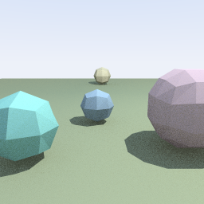
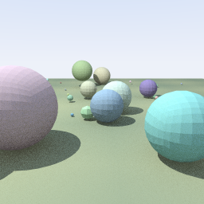

# Ray tracing: reference implementations

The same ray tracer three times, with no card and no framework: numpy
(`reference/raytrace.py`, the definition of correct), threaded C++ for the host CPU (`cpu/`)
and CUDA for one GPU (`gpu/`). All three walk the **same saved tree**
(`reference/bvh.py`, built once per scene), so the card versions can walk it too and must
produce the same nearest hits and the same image. The scenes are the ones of the
rasterization references ([`reference/scenes.py`](../../../reference/README.md)).

 

*Final image of the tiny scene (398 triangles) and the 10^4 scene (11,994 triangles),
256 x 256 (the images are 1024 x 1024; this is a downscale by 4).*

## The algorithm

1024 x 1024 pixels, one primary ray through each pixel centre, opaque triangles seen
from both sides, float32 arithmetic in the order written in `reference/raytrace.py`, no fused
multiply-add. Per pixel, up to four traces:

1. a **primary ray** (closest hit);
2. from its hit point, a **shadow ray** to the one light (any hit with `tmax = 1` on the
   un-normalised direction `light - origin`; the origin is the hit point moved by `eps`
   along the normal that faces the ray);
3. a **diffuse bounce** ray along `normal + random unit vector` (closest hit); the random
   vector is `sum of four uniforms - 2` per component from a hash of the pixel number
   (seed 7, `reference/rng.py`), so every implementation draws the same numbers;
4. a **shadow ray** from the bounce hit, shaded like the first hit.

Colour: `albedo * (0.1 + direct + 0.5 * radiance)`, where `direct` is the clamped cosine
to the light (0 in shadow) and `radiance` is the sky gradient (horizon to zenith by the
height of the direction) for a missed bounce and `albedo1 * (0.1 + direct1)` at a bounce
hit. A missed primary ray gives the sky. The albedo is the vertex colour interpolated
with the barycentric coordinates of the hit.

### The tree

`reference/bvh.py`: a binary box tree, top-down, **one triangle per leaf**, split at the median
of the triangle centroids along the longest axis of the centroid box (stable sort, the
left half rounded up). The builder is deliberately plain (no surface-area heuristic), so
it is easy to state and to reproduce; its cost is a taller walk than a good builder gives.
Nodes are numbered breadth first and the two children of a node have consecutive
numbers. A node is **8 words (32 bytes)**: box min x y z, box max x y z (float32 bits),
child 0, child 1; for a leaf both child words are `0x80000000 | leaf number`. The
triangle records (`v0`, `e1 = v1 - v0`, `e2 = v2 - v0`, 9 floats, 36 bytes) are stored in
leaf order, with `leaf_tri` giving the scene's triangle index of each leaf.

| scene | triangles | nodes | depth | tree and triangles (MB) |
|---|---|---|---|---|
| tiny | 398 | 795 | 9 | 0.04 |
| 10^4 | 11,994 | 23,987 | 14 | 1.2 |
| 10^5 | 102,308 | 204,615 | 17 | 10.2 |
| 10^6 | 997,806 | 1,995,611 | 20 | 99.8 |

### The walk, and the child order

One ray at a time with a stack (numpy does many rays at once, with the same per-ray
steps). Pop a node; skip it if its entry distance is larger than the best hit so far; a
leaf: Moeller-Trumbore test of its triangle (both sides), a hit closer than the best
(or equally close with a lower triangle index) replaces it; an internal node: test both
child boxes (slab test, the box scaled by 1.0000004 so a ray along a face is not lost),
push the ones that are hit with the **nearer on top** and, when the entry distances are
equal, **child 0 first**. A shadow ray stops at its first hit. The stack has 64 entries.

Child order matters for the work (nodes visited), not for the result: with a closest-hit
walk and the tie rule above, any order gives the same nearest hit. Without the tie rule
it would decide which of two exactly equal hits is found first, which is why equal
distances go to the lower triangle index.

### Treelets and the top tree

`bvh.cut_treelets(tree, max_bytes)` cuts the tree top-down into **treelets** of at most
`max_bytes` (32 bytes per node and 36 per leaf triangle): each treelet is a subtree
with its own node numbering and its triangles, and a **top tree** over the treelets
holds the nodes above them, whose child words are either top node numbers or
`0x40000000 | treelet number`. Saved for 128 KiB and 1 MiB (`<scene>_treelets_128k.npz`,
`..._1024k.npz`): the arrays `treelet_root`, `node_treelet` (the treelet of every
node of the flat tree, -1 for top nodes), `treelet_node_off`, `treelet_leaf_first`,
`treelet_leaf_off`, `treelet_nodes`, `treelet_tris`, `top_nodes`, `top_root`. Walking
the top tree and then the treelets finds the same hits as the flat tree (a test checks
it).

| scene | treelets at 128 KiB (top tree nodes) | treelets at 1 MiB (top tree nodes) |
|---|---|---|
| tiny | 1 (0) | 1 (0) |
| 10^4 | 16 (15) | 2 (1) |
| 10^5 | 128 (127) | 16 (15) |
| 10^6 | 1,024 (1,023) | 128 (127) |

### Implementations

| | numpy | C++ | CUDA |
|---|---|---|---|
| source | `reference/raytrace.py` | `cpu/raytrace_cpu.cpp` | `gpu/raytrace_gpu.cu` |
| walk | rays in chunks of 65,536, one step for all active rays | one ray at a time, stack | one ray per thread, stack in local memory |
| parallel over | (arrays) | pixels, chunks of 256 | pixels, blocks of 128 threads |

The C++ and CUDA versions share the walk, the triangle test, the shading and the bounce
(`raytrace_core.hpp`); numpy is written separately. Each frame runs five stages: primary
rays, shadow rays, bounce rays, shadow rays at the bounce hits, shade.

Outputs of every implementation: `t` (nearest primary-hit distance, `1e30` for a miss)
(1024, 1024) float32, `tri` (the scene's triangle index, -1 for a miss) (1024, 1024)
int32, `image` (1024, 1024, 3) float32 and, optional, `nodes` (box tests per primary
ray) (1024, 1024) int32.

## Running

```bash
python -m pip install -e ".[dev]"                 # numpy, pytest, ruff, black
export KR_DATA=<folder for scenes, trees and outputs>   # default: build/data
python -m reference.scenes $KR_DATA                     # the four scenes as .npz
python -m projects.raytrace.reference.agree       # numpy vs C++ vs CUDA (--fresh: rerun)
python -m projects.raytrace.reference.bench       # timings and power
python -m projects.raytrace.reference.pictures --out <folder>
python -m projects.raytrace.reference.library     # optional: Embree, needs embreex
```

The first run builds the tree of a scene (a few seconds, 3.6 s at 10^6 triangles) and saves it in
`$KR_DATA` as `<scene>_tree.npz` (all arrays), `<scene>_tree/*.npy` (for the C++ and CUDA
code) and the treelet cuts. A card version reads those files; nothing else is needed to
walk the same tree.

## Result files and other implementations

Each implementation leaves, per scene, `<folder>/<scene>.npz` and `<folder>/<scene>.json`
(a folder per implementation; the three here write theirs under
`$KR_DATA/results/raytrace/`). `agree.py`, `pictures.py` and `bench.py` take
`--external DIR ...`: every sub-folder of DIR that holds files for the scene is added as
another implementation, so a card version only has to drop its files into a folder and
appears in the comparison, as a column of pictures and as a row of the table.

| array in `<scene>.npz` | shape, type | content |
|---|---|---|
| `t` | (1024, 1024) float32 | nearest hit distance of the primary ray (ray origin plus `t` times the un-normalised direction), `1e30` for a miss |
| `tri` | (1024, 1024) int32 | the scene's triangle index of the nearest hit, -1 for a miss |
| `image` | (1024, 1024, 3) float32 | final linear colour |
| `nodes` (optional) | (1024, 1024) int32 | tree nodes tested per primary ray |

`<scene>.json`: `{"name": ..., "scene": ..., "seconds_per_frame": ...,
"timings_ms": {"primary_ms": ..., "shadow_ms": ..., "bounce_ms": ..., "shadow2_ms": ...,
"shade_ms": ..., "total_ms": ...}, "rays": {"rays_primary": ..., "rays_shadow": ...,
"rays_bounce": ..., "rays_shadow2": ...}, "power": {"gpu_idle_w": ..., "gpu_mean_w": ...,
"gpu_peak_w": ..., "gpu_joules_per_frame": ..., "cpu_package_joules_per_frame": ...}}`.
Only `name` and `scene` are required; the stage times, ray counts and power are what the
picture page and the table show. Scene names are `tiny`, `s10k`, `s100k`, `s1m`.

Binaries are built on first use into `build/` (`KR_BUILD_DIR`) with `g++` (or `$CXX`) and
`nvcc` (`$NVCC`, `$CUDA_HOME` or `/usr/local/cuda`; `KR_CUDA_ARCH`, default `sm_70`). The
GPU runs use a GPU with no process on it, found with `nvidia-smi`; both the CUDA tests
and the CUDA rows are skipped when there is none.

## Agreement

All three implementations produce the same arrays bit for bit on all four scenes (numpy
against C++ with 96 threads, numpy against the V100, and C++ against the V100), over the
whole 1024 x 1024 image:

| scene | triangles | differing pixels (`t`, `tri`, image) | nearest-triangle mismatches: ties / near ties / hit vs miss / other | image max error |
|---|---|---|---|---|
| tiny | 398 | 0 / 0 / 0 | 0 / 0 / 0 / 0 | 0 |
| 10^4 | 11,994 | 0 / 0 / 0 | 0 / 0 / 0 / 0 | 0 |
| 10^5 | 102,308 | 0 / 0 / 0 | 0 / 0 / 0 / 0 | 0 |
| 10^6 | 997,806 | 0 / 0 / 0 | 0 / 0 / 0 / 0 | 0 |

Why exact: every operation is a float32 add, subtract, multiply, divide, square root or
compare in a fixed order (`-ffp-contract=off`, `--fmad=false`; `sqrt` and `/` are
correctly rounded on all three), the hash numbers are integer, and the nearest hit of a
ray does not depend on the order in which the tree is walked (equal distances go to the
lower triangle index). `agree.py` reports, for any difference, how many primary rays
find another triangle and splits those into exact ties (equal `t`), near ties (`t`
within 1e-5 relative: the same surface reached through two triangles that share an edge),
one hit and one miss (a ray grazing a silhouette or an edge), and other; the image error
(maximum, mean and RMS absolute error; pixels over 1/255); and how many differing pixels
lie on a triangle edge (a pixel whose 3 x 3 neighbourhood holds more than one triangle
index). For a card version that does not reproduce the operation order, exact ties and
near ties on shared edges are the expected cause of nearest-triangle differences, and the
image error then follows the colour of the two triangles.

The tests (`tests/core/ref/test_ref_bvh.py`, `test_ref_raytrace.py`,
`tests/ref/test_ref_raytrace_native.py`): the trees of the tiny and 10^4 scenes have
pinned checksums; the tree is a valid binary tree whose boxes contain their triangles,
with the median split checked on hand-made triangles; the treelet cut is a partition
that fits the budget and its walk finds the same hits as the flat tree; the numpy walk
finds the same nearest hit as brute force over all triangles on a subset of the tiny
scene's rays, the nearer of two triangles wins and equal distances go to the lower
index, any-hit stops at a blocker between origin and `tmax`, and a subset of the tiny
image has pinned checksums; the C++ and CUDA binaries are built and compared bit for bit
with numpy on a lattice of pixels of the tiny scene, of hand-made triangles and of the
10^4 scene (skipped without a compiler or GPU). Changing the child-order comparison or
the culling comparison in the C++ walk makes native tests fail.

numpy takes 12.7, 17, 22 and 33 s per full frame (tiny, 10^4, 10^5, 10^6); the two
native versions are the ones to run for timings.

## Timings and power

What is timed, per repetition: five stages, each over all 1024 x 1024 pixels: **primary
rays**, **shadow rays**, **bounce rays**, **shadow rays at the bounce hits**, **shade**
(the final colour). Not timed: loading the scene and the tree, building them, copying
them to the GPU, copying the images back. CPU: `std::thread` pool, wall-clock time. GPU:
CUDA events on the default stream, one Tesla V100 32 GB (device name `Tesla PG503-216`,
compute capability 7.0; one of four, idle when used). Cells: median over 3 processes x 3
repetitions after one untimed warm-up repetition per process, min and max in brackets.
Rates are million rays per second (Mray/s): primary = 1,048,576 rays over the primary
stage; shadow = the shadow rays of the first hits over their stage; bounce likewise;
**together** = all four groups of rays of the frame over the four trace stages plus shade
(the whole frame). Rays per frame: 2.52 M (tiny, of which 1,048,576 primary), 2.58 M
(10^4), 2.68 M (10^5), 2.86 M (10^6); the shadow and bounce rays are one per primary hit
(658,018 on the tiny scene, 746,887 on the 10^6 scene), the second shadow rays one per
bounce hit (158,779 and 313,466). "total ms" is the sum of the five stages.

"ms per frame" and the power columns come from one more run of at least 3 seconds per
row: wall time of the loop over frames divided by the number of frames. The GPU's draw is
`nvidia-smi` `power.draw` of the one GPU, sampled every 100 ms inside the loop (idle: the
second before the process started; mean and peak over the loop); joules per frame is the
mean draw times the seconds per frame. Only the GPU's own board power is included, not the
host CPU that drives it. The CPU package energy counter (RAPL) of this host is not
readable without root, so CPU joules are **not available** here (`bench.py` records them
when the host allows it). The host is a shared 96-thread AMD EPYC 7K62 (48 cores, SMT);
the first load average (`/proc/loadavg`, which includes the benchmark's own threads) was
between 5 and 18 during these runs, with no other CUDA process on the GPUs; the
per-process loads are in the JSON that `bench.py --json` writes. The all-thread CPU
numbers have the widest spread, and the 1-thread rows can be slowed by other accounts'
jobs (the 10^4 one-thread maximum, 1,563 ms against a 1,074 ms median, is such a case).

| scene | implementation | primary | shadow | bounce | together | total ms | ms per frame | GPU W idle / mean / peak | GPU J per frame |
|---|---|---|---|---|---|---|---|---|---|
| tiny | C++ 1 thread | 4.68 (4.67-4.68) | 3.71 (3.62-3.71) | 2.41 (2.38-2.42) | 3.49 (3.42-3.49) | 723.71 (722.12-738.15) | 726.4 | n/a | n/a |
| tiny | C++ 96 threads | 154.19 (121.35-188.03) | 119.45 (98.52-129.07) | 95.28 (81.07-113.46) | 113.54 (95.97-130.97) | 22.22 (19.27-26.29) | 23.1 | n/a | n/a |
| tiny | V100 | 1258.04 (1247.27-1264.26) | 1488.33 (1471.71-1491.05) | 583.14 (576.30-587.36) | 972.85 (966.74-978.67) | 2.59 (2.58-2.61) | 2.3 | 54 / 219 / 228 | 0.51 |
| 10^4 | C++ 1 thread | 3.45 (3.13-3.47) | 2.69 (2.03-2.72) | 1.49 (0.84-1.50) | 2.39 (1.65-2.40) | 1080.91 (1073.59-1563.20) | 1078.4 | n/a | n/a |
| 10^4 | C++ 96 threads | 126.47 (104.11-145.63) | 93.79 (80.46-109.40) | 67.37 (59.70-75.14) | 85.51 (70.98-101.20) | 30.17 (25.49-36.35) | 34.9 | n/a | n/a |
| 10^4 | V100 | 894.31 (883.53-899.06) | 913.83 (898.13-918.79) | 339.90 (334.67-342.03) | 620.56 (610.78-621.94) | 4.16 (4.15-4.22) | 3.7 | 55 / 225 / 233 | 0.83 |
| 10^5 | C++ 1 thread | 2.58 (2.40-2.60) | 2.10 (2.06-2.11) | 1.18 (1.17-1.19) | 1.83 (1.81-1.86) | 1466.71 (1444.26-1480.90) | 1452.1 | n/a | n/a |
| 10^5 | C++ 96 threads | 101.29 (74.96-113.74) | 70.08 (52.70-90.02) | 55.27 (43.55-62.21) | 71.15 (54.80-80.24) | 37.73 (33.45-48.98) | 37.7 | n/a | n/a |
| 10^5 | V100 | 578.52 (570.78-589.52) | 595.85 (592.75-597.03) | 225.47 (224.87-227.34) | 408.97 (406.31-412.44) | 6.56 (6.51-6.61) | 6.1 | 55 / 205 / 213 | 1.26 |
| 10^6 | C++ 1 thread | 1.98 (1.95-1.99) | 1.54 (1.52-1.54) | 0.89 (0.87-0.89) | 1.38 (1.37-1.39) | 2068.17 (2057.23-2088.12) | 2088.9 | n/a | n/a |
| 10^6 | C++ 96 threads | 81.62 (53.79-90.58) | 63.82 (51.26-73.45) | 39.87 (31.12-45.68) | 57.16 (44.89-63.62) | 49.96 (44.89-63.62) | 54.3 | n/a | n/a |
| 10^6 | V100 | 384.81 (382.37-389.65) | 344.14 (343.46-345.63) | 131.21 (130.53-132.35) | 246.74 (246.04-248.70) | 11.57 (11.48-11.61) | 11.3 | 56 / 180 / 188 | 2.03 |

Reading the table: the cost per ray falls with the tree's depth and with how much of the
work is coherent. The primary rays visit 37 (tiny) to 77 (10^6) boxes on average (the
largest count is 115 and 645), shadow rays stop at their first hit, and the bounce
rays, which go in random directions, are the least coherent group and the slowest on
every implementation (a third to two thirds of the primary rate). The V100 is 4 to 9 times
faster than 96 CPU threads on the whole frame (9 times on the tiny scene, 4 times at
10^6); the 96 threads are 33 to 41 times faster than one thread (the host has 48 cores
with two threads each). The V100's energy per
frame is 0.5 J (tiny) to 2.0 J (10^6) at a mean draw of 180 to 225 W, 55 W of which is
the idle draw.

### Context: Embree (a different implementation)

Embree 4 through the Python package `embreex` (`library.py`; `pip install embreex`) on
the same four groups of rays of each frame taken from our numpy result. It builds its own
tree (a high-quality builder; not timed) and has its own triangle test, so it is a
different implementation of the same task, not a comparison of the same algorithm, and
it is reported as context only. The primary hits agree with ours on 99.999 % of the
primary rays or more (the few others were not examined one by one); the ray counts are
identical. Timed: only the
calls that trace the rays, Mray/s as above, medians of 5 runs; host load (first number)
5.1 to 5.2. One thread, 24 threads and 96 threads are shown: with more than about 24
Python threads the package does not scale (the 96-thread rows are slower than the
24-thread rows), so the 24-thread row is its best on this host.

| scene | implementation | primary | shadow | bounce | together | ms per frame |
|---|---|---|---|---|---|---|
| tiny | Embree 1 thread | 12.22 | 14.58 | 11.12 | 12.33 | 204.6 |
| tiny | Embree 24 threads | 94.33 | 63.08 | 65.87 | 62.59 | 40.3 |
| tiny | Embree 96 threads | 36.52 | 22.49 | 25.91 | 23.07 | 109.4 |
| 10^4 | Embree 1 thread | 9.68 | 10.49 | 7.17 | 8.91 | 289.5 |
| 10^4 | Embree 24 threads | 73.04 | 55.92 | 59.45 | 53.79 | 48.0 |
| 10^4 | Embree 96 threads | 26.68 | 16.32 | 17.56 | 16.35 | 157.7 |
| 10^5 | Embree 1 thread | 7.74 | 8.18 | 5.40 | 6.89 | 389.7 |
| 10^5 | Embree 24 threads | 61.15 | 64.40 | 60.66 | 53.90 | 49.8 |
| 10^5 | Embree 96 threads | 28.78 | 18.44 | 17.84 | 17.58 | 152.7 |
| 10^6 | Embree 1 thread | 6.35 | 6.16 | 3.87 | 5.20 | 548.8 |
| 10^6 | Embree 24 threads | 72.71 | 64.12 | 51.27 | 54.77 | 52.1 |
| 10^6 | Embree 96 threads | 28.77 | 19.28 | 19.36 | 19.09 | 149.6 |

Per thread, Embree is 2.6 to 3.8 times faster than the reference walk above (6.4 against
2.0 Mray/s on the primary rays at 10^6); with all threads the reference's C++ reaches
about the same frame rate as Embree's best (50 against 52 ms per frame at 10^6) because
Embree through Python stops scaling. A tuned C++ use of Embree would do better than
this row; no CPU energy figure exists for it (not readable).
